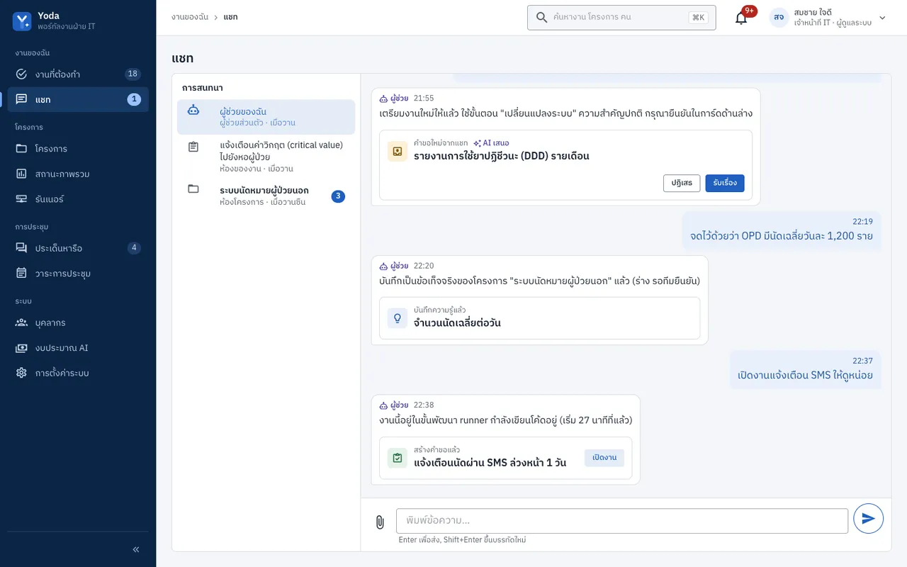
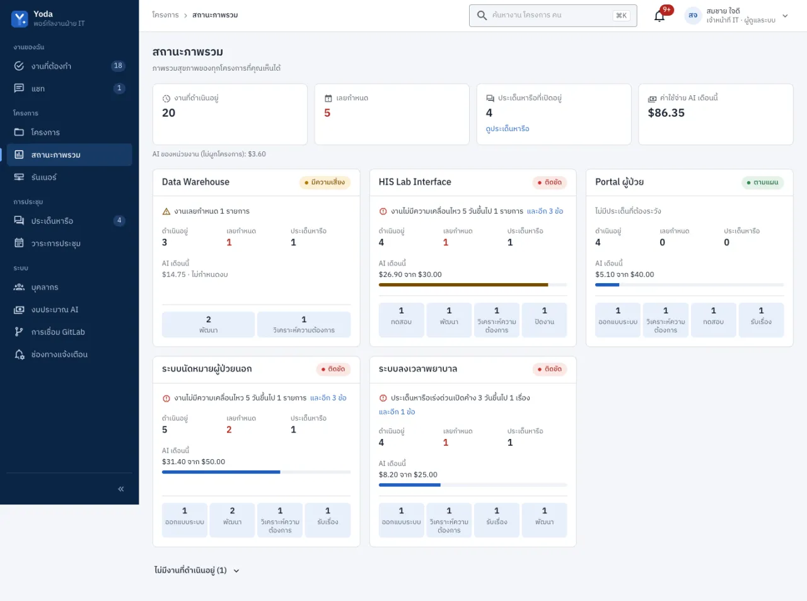

<div align="center">


# Yoda

**The AI work portal for an IT department: AI drafts every step, people review, decide and approve.**

[](https://github.com/tantee/yoda/actions/workflows/ci.yml)
[](CHANGELOG.md)
[](docs/README.md)
[](LICENSE)


</div>

## What Yoda does

Requests arrive through a chat with an AI secretary and move through steps: intake, analysis, design,
development, testing and close. At every step AI writes the first draft, and a person corrects and approves it.

| | |
| --- | --- |
|  | **Chat with an AI secretary.** Staff and requesters ask for work in plain language. The secretary opens requests, records project facts and answers "where is my request?". |
|  | **AI drafts, people approve.** Requirements, designs, test cases and code (as GitLab merge requests, through runners) start as AI drafts, with their gaps flagged. |
|  | **Decisions stay with people.** Anything the AI should not decide becomes a discussion with an AI brief, options and votes, ready for a meeting agenda. |
|  | **One view of everything.** To-do, project status, AI spend against budget, and notifications in the portal, by email, LINE or Telegram. |

Requesters outside IT get a simpler portal: their own requests, questions to answer and deliveries to accept.

## Quick start

**Production.** On a Linux host, as the user that will run Yoda:

```bash
curl -fsSL https://github.com/tantee/yoda/releases/latest/download/install.sh | sh
```

It installs the latest release into `/srv/yoda`. Options go after `sh -s --`, for example a pinned release with
the built-in HTTPS proxy:

```bash
curl -fsSL https://github.com/tantee/yoda/releases/latest/download/install.sh |
  sh -s -- --version 1.2.0 --dir /srv/yoda --with-proxy --domain portal.example.org
```

**Requirements.** The installer checks them first, names whatever is missing or too old, and on Debian, Ubuntu
and the RHEL family offers to install it (with sudo; it prints every command first, then asks once on the
terminal, or `--yes` answers yes):

- Docker Engine 24+ with the Compose plugin v2.24+ (from Docker's own repository), and a user who may run
  `docker` (the installer offers to add you to the `docker` group);
- `curl`, `tar`, `sha256sum` (or `shasum`) and `minisign`, plus `openssl` for `--cert-mode files`;
- about 10 GB free for the database, files and backups.

**What you trust.** Piping trusts GitHub's TLS for `install.sh` itself. Everything it downloads after that is
signature-checked: `SHA256SUMS` against the Yoda release key built into the script (minisign key id
`C73EF0AF404BAE84`), its trusted comment against the exact release, and the bundle against `SHA256SUMS`. Any
mismatch stops it before anything is unpacked.

<details>
<summary>Prefer to verify install.sh itself?</summary>

Download `install.sh` with the release's checksums, check the signature, then run it:

```bash
curl -fsSLO https://github.com/tantee/yoda/releases/download/v1.2.0/install.sh
curl -fsSLO https://github.com/tantee/yoda/releases/download/v1.2.0/SHA256SUMS
curl -fsSLO https://github.com/tantee/yoda/releases/download/v1.2.0/SHA256SUMS.minisig
out=$(minisign -Vm SHA256SUMS -P RWSErktAr/A+x5Gvgr0x29wiu41FmYEVlJYoXyB6oJk4kvwQLOZs9O9j) &&
  printf '%s\n' "$out" | grep -Fx 'Trusted comment: yoda release 1.2.0' &&
  sha256sum --check --ignore-missing SHA256SUMS &&
  sh install.sh --version 1.2.0 --dir /srv/yoda
```

Each command runs only when the one before it passed: `minisign` checks the signature (`out=$(…) &&` keeps its
exit status), `grep` that the signed trusted comment names this release (`Trusted comment: yoda release 1.2.0`;
a different version means you downloaded the wrong files), and `sha256sum` the checksum of `install.sh`. Nothing
runs if any of them fails. Use the latest release from [GitHub Releases](https://github.com/tantee/yoda/releases);
for another release, change the version in the URLs, the `grep` and `--version`.

</details>

**Verifying releases.** The `-P` key above is the Yoda release key, minisign key id `C73EF0AF404BAE84`, also in
[`keys/yoda-release.pub`](keys/yoda-release.pub) and built into `install.sh`, which checks every download with it
([details](docs/releasing.md#verifying-releases)). The images come from `ghcr.io/tantee/yoda` (public, no login), pinned by the digests
in the signed bundle.
To install from an internal mirror, pass `--base-url` and `--image-prefix` with a pinned `--version`
([releasing, internal mirror](docs/releasing.md#internal-mirror)).

Then open `https://<your portal>/setup` and follow the setup wizard. Details: [install guide](docs/guides/install.md).

**Development** (Node 22, pnpm 10, Docker):

```bash
pnpm install
cp .env.example .env
docker compose up -d        # Postgres + pgvector, RustFS, Keycloak, Mailpit
pnpm --filter @yoda/core db:migrate
pnpm dev                    # core and portal
```

Details: [development guide](docs/development.md).

## Documentation

| Guide | For |
| --- | --- |
| [Staff guide](docs/guides/staff.md) · [ภาษาไทย](docs/guides/staff.th.md) | IT staff: to-do, work items, chat, discussions, status |
| [Requester guide](docs/guides/requester.md) · [ภาษาไทย](docs/guides/requester.th.md) | People who ask IT for work |
| [Admin guide](docs/guides/admin.md) | System settings, AI budget, channels, GitLab, runners, people |
| [Install and upgrade](docs/guides/install.md) | Installer, setup wizard, recovery kit, `yoda-admin` |
| [Architecture](docs/architecture.md) | How the parts fit together |
| [Operations runbook](docs/operations.md) | Every setting, backups, rotation, troubleshooting |
| [Development](docs/development.md) | Running from source, tests, CI, runner reference |
| [Releasing](docs/releasing.md) | Maintainers: signing key, cutting a release, dry runs, internal mirror |

## Runners

Runners work AI coding tasks with Claude Code (or Codex) on a staff machine or a server. Setup and configuration:
[development guide, Runners](docs/development.md#runners).

## Tech stack

Nuxt 4 + Vuetify portal · Node 22, Fastify, Drizzle and pg-boss core · PostgreSQL 17 with pgvector ·
RustFS (S3) · Keycloak (OpenID Connect) · provider-neutral AI gateway (Anthropic, OpenAI-compatible) ·
MCP server for runners · GitLab issues, merge requests and webhooks · Docker Compose.

## License

Yoda is licensed under the [Apache License, Version 2.0](LICENSE). See [NOTICE](NOTICE) for attributions.
