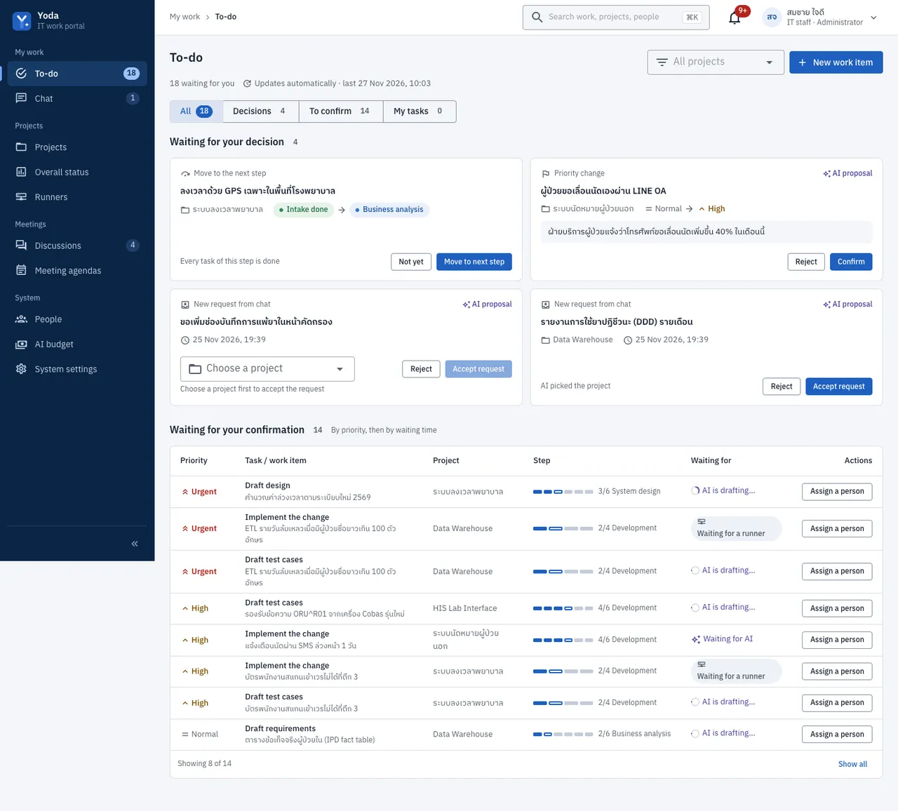
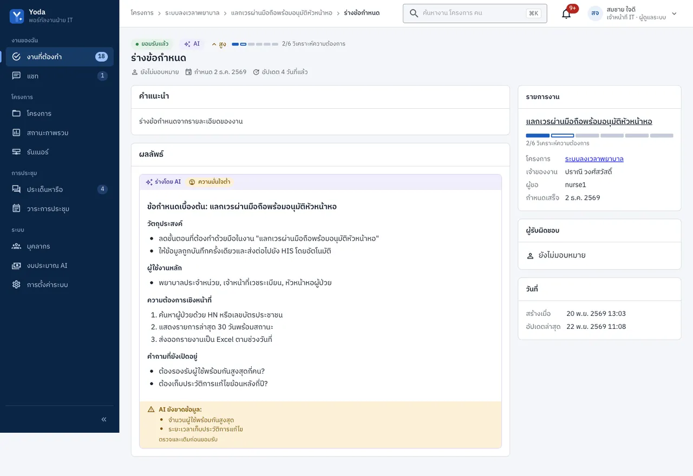
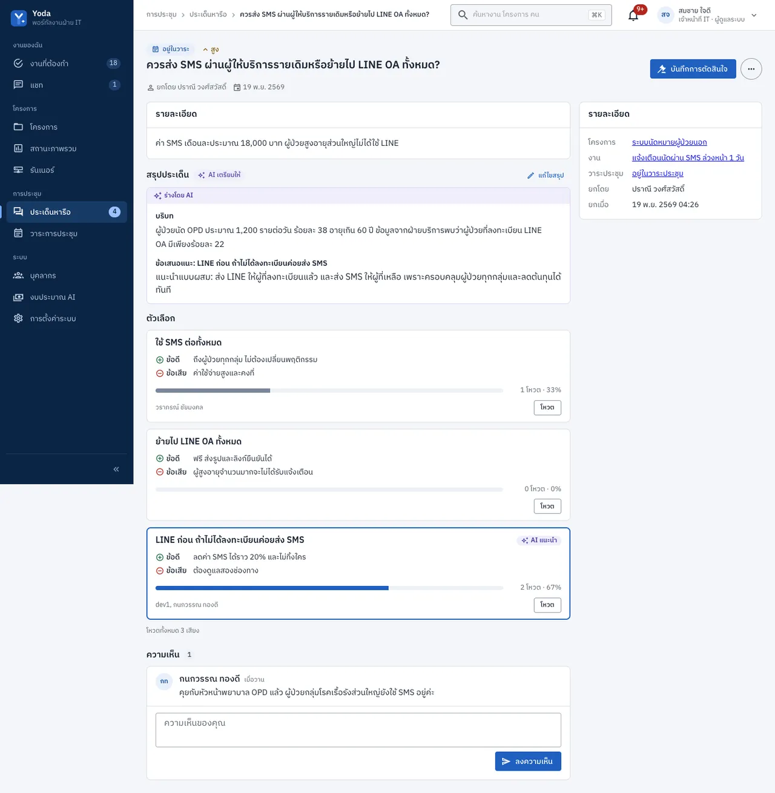

<div align="center">


# Yoda

**The AI work portal for an IT department: AI drafts every step, people review, decide and approve.**

[](https://github.com/tantee/yoda/actions/workflows/ci.yml)
[](CHANGELOG.md)
[](docs/README.md)
[](LICENSE)



</div>

## What Yoda does

Requests arrive through a chat with an AI secretary and move through steps: intake, analysis, design,
development, testing and close. At every step AI writes the first draft, and a person corrects and approves it.

| | |
| --- | --- |
|  | **Chat with an AI secretary.** Staff and requesters ask for work in plain language. The secretary opens requests, records project facts and answers "where is my request?". |
|  | **AI drafts, people approve.** Requirements, designs, test cases and code (as GitLab merge requests, through runners) start as AI drafts, with their gaps flagged. |
|  | **Decisions stay with people.** Anything the AI should not decide becomes a discussion with an AI brief, options and votes, ready for a meeting agenda. |
|  | **One view of everything.** To-do, project status, AI spend against budget, and notifications in the portal, by email, LINE or Telegram. |

Requesters outside IT get a simpler portal: their own requests, questions to answer and deliveries to accept.

## Quick start

**Production** (Docker Engine 24+ and Compose v2.24+). Download a pinned release, check its signature, then run it
(never pipe a download into `sh`):

```bash
curl -fsSLO https://files.example.org/yoda/releases/1.0.0/install.sh
curl -fsSLO https://files.example.org/yoda/releases/1.0.0/SHA256SUMS
curl -fsSLO https://files.example.org/yoda/releases/1.0.0/SHA256SUMS.minisig
minisign -Vm SHA256SUMS -P <release public key> && sha256sum --check --ignore-missing SHA256SUMS
sh install.sh --version 1.0.0 --dir /srv/yoda
```

Then open `https://<your portal>/setup` and follow the setup wizard. Details: [install guide](docs/guides/install.md).

**Development** (Node 22, pnpm 10, Docker):

```bash
pnpm install
cp .env.example .env
docker compose up -d        # Postgres + pgvector, RustFS, Keycloak, Mailpit
pnpm --filter @yoda/core db:migrate
pnpm dev                    # core and portal
```

Details: [development guide](docs/development.md).

## Documentation

| Guide | For |
| --- | --- |
| [Staff guide](docs/guides/staff.md) · [ภาษาไทย](docs/guides/staff.th.md) | IT staff: to-do, work items, chat, discussions, status |
| [Requester guide](docs/guides/requester.md) · [ภาษาไทย](docs/guides/requester.th.md) | People who ask IT for work |
| [Admin guide](docs/guides/admin.md) | System settings, AI budget, channels, GitLab, runners, people |
| [Install and upgrade](docs/guides/install.md) | Installer, setup wizard, recovery kit, `yoda-admin` |
| [Architecture](docs/architecture.md) | How the parts fit together |
| [Operations runbook](docs/operations.md) | Every setting, backups, rotation, troubleshooting |
| [Development](docs/development.md) | Running from source, tests, CI, runner reference |

## Runners

Runners work AI coding tasks with Claude Code (or Codex) on a staff machine or a server. Setup and configuration:
[development guide, Runners](docs/development.md#runners).

## Tech stack

Nuxt 4 + Vuetify portal · Node 22, Fastify, Drizzle and pg-boss core · PostgreSQL 17 with pgvector ·
RustFS (S3) · Keycloak (OpenID Connect) · provider-neutral AI gateway (Anthropic, OpenAI-compatible) ·
MCP server for runners · GitLab issues, merge requests and webhooks · Docker Compose.

## License

Yoda is licensed under the [Apache License, Version 2.0](LICENSE). See [NOTICE](NOTICE) for attributions.
