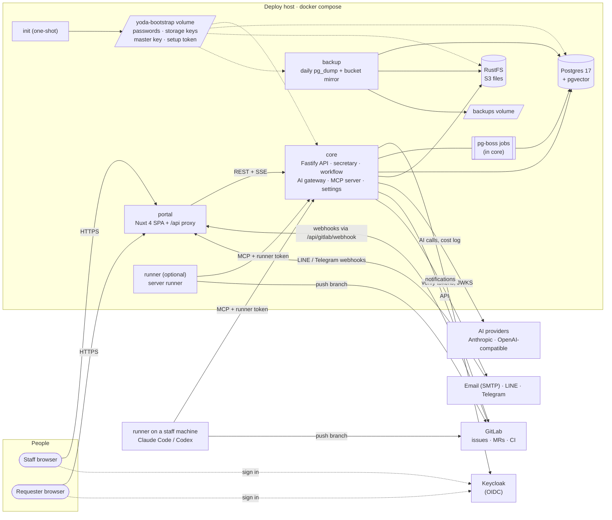

# Architecture

[All guides](README.md)

Yoda is a small set of containers on one host, run with Docker Compose. One pnpm monorepo builds them:
`apps/portal`, `apps/core`, `apps/runner` and `packages/shared` (types, zod schemas, the settings registry and the
MCP tool definitions shared by all three).

## The parts

**portal** (`apps/portal`, Nuxt 4 + Vuetify). The single-page app for staff, requesters and admins, plus the
setup wizard (`/setup`) and the break-glass page (`/recovery`). Its server only serves the app and proxies `/api/*`
to core, passing the GitLab, LINE and Telegram webhooks through unchanged. Settings such as the organisation name
and where to sign in are read from core at runtime, so one image fits every install. Thai and English.

**core** (`apps/core`, Node 22, Fastify, Drizzle). Everything else:

- the REST API and live updates (server-sent events) for the portal;
- the **work model**: projects, work items moving through workflow templates (software change, bug fix), tasks,
  discussions and agendas, knowledge entries, and an append-only event log that doubles as the audit trail;
- the **AI secretary**: an event-driven coordinator, triggered by chat messages, task results, decisions, GitLab
  webhooks and a sweep every 15 minutes. It drafts, proposes assignments and next steps, and raises discussions;
  people confirm;
- the **AI gateway**: a provider-neutral layer (Vercel AI SDK) for Anthropic and OpenAI-compatible APIs, with a
  cost log per call, per-project and department budgets, and a per-project "no AI" switch;
- **jobs** on pg-boss (in the same Postgres): AI drafts, briefs, embeddings, notifications, GitLab sync;
- the **MCP server** (`/mcp`): task and knowledge tools for runners and for staff's own coding agents;
- **GitLab**: issues and merge requests through a bot account, merge request, pipeline and comment webhooks, plus a pull
  safety net when webhooks are missed;
- **notifications**: the portal bell, email, LINE and Telegram, with each person's choice per kind;
- **System settings**: a typed registry; secrets encrypted with the master key (AES-256-GCM, a data key per
  secret); an environment value always wins and locks the field; every change is logged;
- `yoda-admin`, the host CLI for setup tokens, the break-glass account, the recovery kit and master key rotation.

**Postgres 17 + pgvector.** The single store: work data, knowledge with vector and trigram search, the job queue,
settings and the audit log. `migrate` (a one-shot run of the core image) applies the migrations before core starts.

**RustFS.** S3-compatible object storage for attachments, one bucket.

**Keycloak.** Sign-in for everyone through OpenID Connect. Core checks the tokens itself; staff are the members of
the configured group, everyone else is a requester. A custom login theme ships in `infra/keycloak/themes`.

**runner** (`apps/runner`). A CLI that claims AI tasks from core over MCP with its own token, works them with a
coding agent (Claude Code; Codex experimental) in a git worktree, pushes a `yoda/<id>-<slug>` branch, and lets core
open the merge request. It runs on a staff machine (on demand or unattended) or as the optional server container.
Code always reaches the main branch through a person's review in GitLab.

## Install-time pieces

**init and the bootstrap volume.** Before each start the one-shot `init` service fills the `yoda-bootstrap`
volume: the Postgres password, the storage keys, `bootstrap.env` (the database URL and storage keys for core,
`migrate` and `backup`), the master key (readable by core only) and the setup token. A value in `.env` wins;
otherwise an existing value is kept, or a new one is generated. Nothing secret is ever written to the database in
the clear or to the logs.

**Setup and recovery.** A fresh install starts in setup mode: `/setup` (guarded by the setup token) collects the
organisation, the break-glass admin, sign-in and the optional services, hands out the recovery kit once, and ends
when the first admin signs in through Keycloak. `/recovery` is a separate, minimal page for the break-glass account
when Keycloak sign-in fails.

**backup.** A container that runs `pg_dump` and mirrors the bucket into the `backups` volume every day, keeps a set
number of days, and turns unhealthy when the last backup is too old. Copy that volume off the host.

**Release and deploy.** GitLab CI builds the `core`, `portal`, `runner` and `backup` images and, on tags, a
minisign-signed release bundle; `install.sh` installs from that bundle and `deploy.sh` upgrades
([install guide](guides/install.md)). GitHub Actions only builds and tests.

## Where to read more

- Design spec: [docs/superpowers/specs](superpowers/specs/2026-11-24-ai-work-portal-design.md)
- Every setting and the host procedures: [operations runbook](operations.md)
- Code-level setup, GitLab and runner reference: [development guide](development.md)
