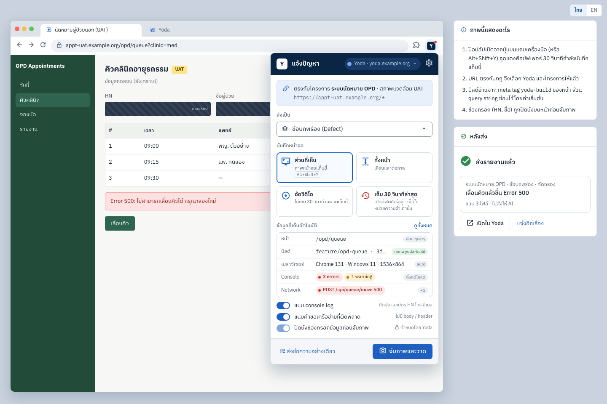
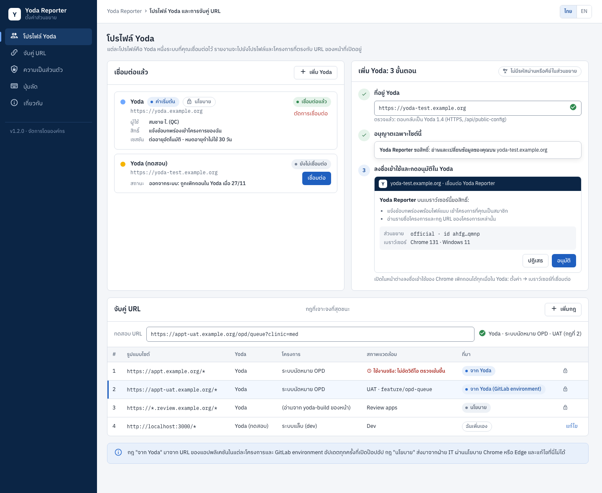
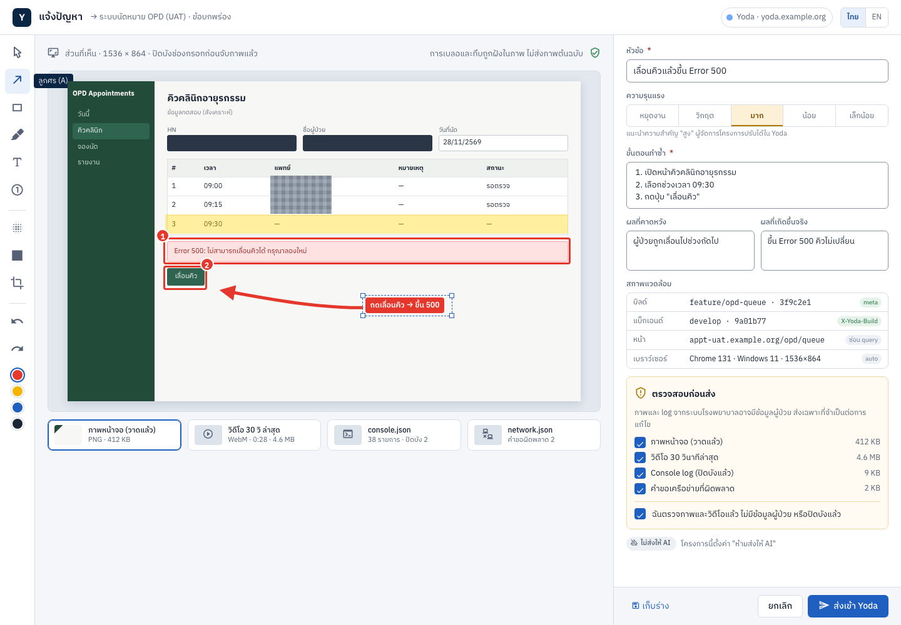

# Yoda Reporter (Chrome extension for UI defects): proposal

Status: **proposal for owner review**. No extension code exists. Nothing under `apps/` or `packages/` changes until
this is approved. Inputs read: `packages/shared/src/{work,knowledge,proposals}.ts`, `packages/shared/src/settings/registry.ts`,
`apps/core/src/{app,config}.ts`, `apps/core/src/auth/*`, `apps/core/src/local/session.ts`,
`apps/core/src/routes/{attachments,work,requests,projects}.ts`, `apps/core/src/attachments/service.ts`,
`apps/core/src/storage/s3.ts`, `apps/core/src/ai/gateway.ts`, `apps/core/src/knowledge/context-pack.ts`,
`apps/core/src/secretary/chat.ts`, `apps/core/src/gitlab/webhook.ts`, `apps/core/src/runners/tokens.ts`,
`apps/core/src/notifications/linking.ts`, `apps/core/src/settings/rate-limit.ts`, `apps/core/src/db/schema.ts`,
`apps/core/src/workflow/templates/*.json`, `apps/portal/app/plugins/keycloak.client.ts`,
`apps/portal/server/routes/api/[...path].ts`, `.github/workflows/release.yml`, `docs/releasing.md`, and the spec
(`docs/superpowers/specs/2026-11-24-ai-work-portal-design.md` §3, §4, §9, §12, §14).

Mockups: [`mockups/extension-*.html`](mockups/) (static HTML, Thai by default, a ไทย/EN toggle in the corner, `?lang=en`
opens English). Screenshots at 1440 px wide:

| Mockup | Shows | Screenshot |
| --- | --- | --- |
| [extension-popup.html](mockups/extension-popup.html) | The toolbar popup on an app under test: matched Yoda profile and project, capture choices, collected metadata with its source, capture toggles, the "sent" state | `extension-popup.png`, `extension-popup-en.png` |
| [extension-editor.html](mockups/extension-editor.html) | The annotation editor (arrow, box, highlight, text, numbered step, pixelate, redact, crop) and the report form with the check-before-sending step | `extension-editor.png` |
| [extension-setup.html](mockups/extension-setup.html) | The options page: Yoda profiles, connecting a new Yoda in three steps (including Yoda's approval page), URL mapping with a URL tester | `extension-setup.png` |

Every hostname is a placeholder (`example.org`). The page under test in the mockups is fictional and its data is
synthetic. There are no secrets in this document.

Owner brief: testers need a Chrome extension that captures a UI defect (metadata, screenshot or short video,
annotations, a structured description) and posts it into Yoda as a work item on the right project. It is
downloaded from Yoda and sets itself up against that Yoda without shipping secrets. It supports several Yoda
instances and maps sites to instance and project automatically.

## Contents

1. [Summary](#1-summary)
2. [Where it lives](#2-where-it-lives)
3. [Extension architecture](#3-extension-architecture)
4. [Capture: metadata, screenshots, video, console and network](#4-capture-metadata-screenshots-video-console-and-network)
5. [MV3 permissions](#5-mv3-permissions)
6. [Branch and commit detection](#6-branch-and-commit-detection)
7. [Connecting the extension to Yoda](#7-connecting-the-extension-to-yoda)
8. [Threat analysis](#8-threat-analysis)
9. [Profiles and URL mapping](#9-profiles-and-url-mapping)
10. [Yoda side](#10-yoda-side)
11. [Privacy and PDPA](#11-privacy-and-pdpa)
12. [Distribution, signing, updates, Edge](#12-distribution-signing-updates-edge)
13. [Phases and effort](#13-phases-and-effort)
14. [Risks](#14-risks)
15. [Open questions for the owner](#15-open-questions-for-the-owner)

---

## 1. Summary

**Yoda Reporter** is a Manifest V3 extension for Chrome and Edge. A tester clicks the toolbar button (or presses
`Alt+Shift+Y`) on the page that misbehaves. The popup already knows which Yoda and which project the page belongs
to, and what build it runs. The tester takes a screenshot or a video of up to 30 s, or saves the last 30 s from a
rolling buffer. They mark it up, fill in title, severity, steps, expected and actual, check a privacy confirmation,
and send. Yoda creates a **defect** work item in that project, with the media and masked logs attached, and the
tester gets a link to it.



Recommendations, one line each:

| Topic | Recommendation |
| --- | --- |
| Where | `apps/extension` in this monorepo (Vite + Vue 3 + Vuetify, same tokens and th/en strings as the portal), API schemas in `@yoda/shared`, versioned in lockstep with Yoda (§2). |
| Capture | Metadata, a visible-area screenshot, console and failed requests via a MAIN-world script injected on click, plus Resource Timing so earlier failures are not lost. **No `debugger` permission.** Full page by scroll and stitch. Video through `tabCapture` and an offscreen `MediaRecorder` (WebM). The buffer keeps two rotating segments in memory (§4). |
| Permissions | Required: `activeTab`, `scripting`, `storage`, `identity`, `offscreen`. Optional: `tabCapture` and per-origin host permissions, requested when first needed. The install prompt shows **no warnings** (§5). |
| Build detection | `<meta name="yoda-build" content="repo=…;branch=…;commit=…;env=…">`. Then `/.well-known/yoda-build.json`, then an `X-Yoda-Build` response header, then GitLab deployments known to Yoda, then manual entry. Snippets for Nuxt, Vite and Spring (§6). |
| Connecting | One click from the extension: `chrome.identity.launchWebAuthFlow` opens Yoda's `/extension/connect`, the user is already signed in through Keycloak and presses **Approve**, and Yoda returns a one-time code to `https://<extension-id>.chromiumapp.org/`. The code is exchanged with PKCE for a **Yoda-issued, scoped, short-lived, revocable token**. Nothing secret is in the zip. A pairing code is the fallback; a signed config link is not recommended (§7). |
| Yoda API | `/extension/*` routes, accepted only with extension tokens, and extension tokens are accepted nowhere else. One multipart `POST /extension/defects` creates the work item and stores the files atomically. It is idempotent (§10.1). |
| Work item | A new **human-only `defect` template**: triage, fix, then verify (the reporter retests). A `defect_reports` row holds the structured fields. "Bug-fix request" maps to the existing `bug-fix` template (§10.2). |
| Files | `video/webm` is added for this route. Each file stays within the existing `MAX_UPLOAD_BYTES` (25 MB), with up to 8 files and 50 MB per report. Files go to RustFS under `projects/<id>/defects/<workItemId>/…`. They create no knowledge entries (§10.3). |
| AI | Media and logs are **always** stored `noAi`. A project's noAi wins over everything. The report text reaches AI only on AI-enabled projects, and only when the tester has not marked it sensitive. No automatic AI triage in v1 (§10.4). |
| Who | Staff members of the project report directly. Requesters (UAT users) come later and only to projects that opt in. Their reports become `create_work_item` proposals for the PM (§10.5). |
| Privacy | Form fields and `[data-yoda-mask]` elements are masked **before** capture. Pixelate and redact tools are burned into the image, and the original is never uploaded. Regex masking covers Thai national ID (with checksum), HN (configurable), phone, email and tokens, both in the extension and again in core. A confirmation step comes before sending. Rules for production sites are stricter. Media is deleted 180 days after the item closes (§11). |
| Distribution | MVP: a zip on a new Yoda **Help** page, loaded unpacked by IT testers. Rollout: managed Chrome and Edge **force-install** of a signed CRX that Yoda serves with an `updates.xml` (`ExtensionSettings` with `override_update_url`). The Chrome Web Store (unlisted) is optional. The extension ID is the same across all channels (§12). |
| Effort | About **36 to 52 dev-days** for phases 0 to 3. Phase 4 adds 6 to 10 (§13). |

---

## 2. Where it lives

**Agree: `apps/extension` in the monorepo.**

- **Shared contracts.** The request and response schemas (`DefectReportCreate`, `ExtensionSession`, the token
  responses) go in `packages/shared/src/extension.ts` as zod schemas, as `work.ts` and `knowledge.ts` do today.
  Core validates with them. The extension builds its form and its pre-checks from them, as the portal does with
  `MAX_UPLOAD_BYTES` and `UPLOAD_ALLOWED_TYPES`. A change to the contract fails type checks in both apps in the
  same PR.
- **One UI kit.** The popup, editor and options pages use Vue 3 and Vuetify with the portal's theme tokens
  (`docs/design/portal-design-refresh.md`) and the portal's th/en message style. Testers see one product.
- **One release.** The release workflow already builds, signs (minisign) and publishes a versioned bundle. The
  extension is one more artefact in it (§12). The extension version equals the Yoda version (for example
  `1.4.0`). The manifest `version` must be dotted integers, so an `-rc.1` goes to `version_name` and the
  integer version gets a fourth part (for example `1.4.0.1`).
- **Version skew is handled at runtime.** `GET /extension/session` returns `apiVersion` and `latestExtension`.
  The extension shows "update available" when it is older, and refuses with a clear message when the API is
  newer than it understands.

Arguments for a separate repo, and why they do not win here:

| For a separate repo | Answer |
| --- | --- |
| Different cadence: Web Store review takes days | Lockstep is fine. The extension tolerates one API version of skew, and the managed channel updates within hours. |
| Outside contributors or another team owns it | Neither is true today; one builder works with AI agents (spec §4). |
| Keeps extension dependencies out of the lockfile | pnpm workspaces isolate them (`pnpm --filter @yoda/extension`). The cost is a larger lockfile. |

Build: Vite with multiple entries (service worker, popup, editor, options, offscreen, injected scripts), no
remote code (MV3 forbids it), and IBM Plex fonts bundled (OFL). The annotation canvas uses **Konva** (MIT, about
150 KB) rather than a hand-written canvas layer. CI adds `pnpm --filter @yoda/extension test` (Vitest for the
masking, matching and metadata parsers) to `ci.yml`.

---

## 3. Extension architecture

```
 toolbar click / Alt+Shift+Y
        │
 ┌──────▼──────┐  chrome.runtime messages   ┌────────────────────┐
 │   popup     │ ─────────────────────────▶ │  service worker    │── fetch (Bearer yoda_xt_…) ──▶ Yoda /api/extension/*
 │ (Vue, 400px)│ ◀───────────────────────── │  (state, tokens,   │
 └─────────────┘                            │   rules, capture)  │── identity.launchWebAuthFlow ─▶ Yoda /extension/connect
                                            └─┬──────┬──────┬────┘
            scripting.executeScript (activeTab)│      │      │ tabCapture.getMediaStreamId
     ┌──────────────────────────┐   ┌─────────▼──┐   │   ┌──▼─────────────────────┐
     │ MAIN world: console,     │◀─▶│ ISOLATED:  │   │   │ offscreen document:    │
     │ fetch/XHR, errors ring   │   │ metadata,  │   │   │ MediaRecorder (WebM),  │
     │ buffer (untrusted data)  │   │ masking CSS│   │   │ 30 s clip or buffer    │
     └──────────────────────────┘   └────────────┘   │   └────────────────────────┘
                                                      │
                                           ┌──────────▼──────────┐
                                           │ editor tab (Vue +   │  annotate, form, check, send
                                           │ Konva), options page│
                                           └─────────────────────┘
```

- The **service worker** holds no long-lived state in memory, because MV3 can stop it at any time. Profiles and
  rules live in `chrome.storage.local`. Access tokens live in `chrome.storage.session`. Drafts (images and
  metadata) live in the extension origin's IndexedDB until they are sent or 24 h pass.
- The **editor** opens in its own tab (`editor.html?draft=<id>`). Annotating in a 400 px popup is not workable,
  and a popup closes as soon as it loses focus.
- The **offscreen document** exists only while a recording or the buffer runs. MV3 service workers cannot use
  `MediaRecorder`.

---

## 4. Capture: metadata, screenshots, video, console and network

### 4.1 Metadata (always, cheap)

| Field | How | Notes |
| --- | --- | --- |
| URL | `tab.url` (available through `activeTab` after the click) | The query string is **stripped by default**, because it often carries HN or IDs. The tester can include it, and it is regex-masked when included. The hash is kept, for hash-router SPAs. |
| Page title | `tab.title` | Regex-masked. |
| Route | `location.pathname` + `hash`; a route name from `<meta name="yoda-route">` if the app sets one (§6) | |
| Build (front end) | §6 chain | Shows its source: `meta`, `well-known`, `header`, `gitlab`, `manual`. |
| Build (back ends) | `X-Yoda-Build` headers seen by the fetch/XHR hook on the page's API calls | One entry per API origin. |
| Browser, OS | `navigator.userAgentData.getHighEntropyValues(['platformVersion','fullVersionList'])` | Needed to tell Windows 11 from Windows 10. |
| Viewport | `innerWidth/innerHeight`, `devicePixelRatio`, screen size, `chrome.tabs.getZoom` | |
| Time | ISO 8601 with offset (`+07:00`), plus the time Yoda received the report | |
| Locale | `navigator.language`, `Intl…timeZone` | |
| Console | §4.4 | Counts in the popup; entries in `console.json`. |
| Network errors | §4.4 | Count in the popup; entries in `network.json`. |

### 4.2 Screenshots

- **Visible area (MVP):** `chrome.tabs.captureVisibleTab` works with `activeTab` alone. The masking stylesheet
  (§11.1) is injected first and removed right after.
- **Full page (phase 2, labelled beta):** scroll and stitch. After the first frame, `position: fixed/sticky`
  elements are hidden so they do not repeat. Chrome allows two captures per second
  (`MAX_CAPTURE_VISIBLE_TAB_CALLS_PER_SECOND`), so ten screens take about 5 s, with a progress bar. Limits: the
  result is capped at 15 000 px (canvas size limits). Apps that scroll an inner container instead of the
  document (common in Vuetify layouts) are detected, and the scroller is driven instead; if that fails the
  extension falls back to the visible area. The alternative, `chrome.debugger` with
  `Page.captureScreenshot({captureBeyondViewport})`, is sharper but needs the debugger permission (§4.4).

### 4.3 Video and the rolling buffer

- **Clip (phase 2):** the service worker calls `chrome.tabCapture.getMediaStreamId({targetTabId})` (allowed after
  the user invokes the extension on that tab). The offscreen document then calls
  `getUserMedia({video: {mandatory: {chromeMediaSource: 'tab', chromeMediaSourceId}}})` and `MediaRecorder` with
  `video/webm;codecs=vp9` (falling back to vp8), at about 1 Mbit/s, at most 1280 px wide, with no audio. It stops
  hard at 30 s. That is about 4 to 5 MB per 30 s. Chrome shows its own "this tab is being shared" indicator. The
  masking stylesheet stays injected while recording.
- **Rolling buffer (phase 3):** a WebM stream cannot simply drop its first chunks, because the header and the
  keyframes are at the start. The offscreen document therefore runs a recorder that **restarts every 30 s** and
  keeps the previous complete segment plus the current one. "Save last 30 s" yields 30 to 60 s as two files
  (`buffer-1.webm`, `buffer-2.webm`), which the portal plays back to back. Re-muxing into one file is possible
  later (ts-ebml) but not worth it now. Constraints:
  - It is **armed per tab with a click**. `tabCapture` cannot start on page load, by design.
  - It lives **only in memory** (at most about 10 MB) and is never written to disk.
  - It stops after 15 minutes without a save, when the tab leaves a mapped site, and always on sites marked
    production.
  - A red dot on the toolbar icon shows that it is running (see the mockup).

### 4.4 Console and network: without `debugger`

| Approach | What it sees | Cost |
| --- | --- | --- |
| **A. MAIN-world script injected on click** (`scripting.executeScript({world: 'MAIN'})` via `activeTab`) | `console.*`, `window.onerror`, `unhandledrejection`, and wrapped `fetch`/`XHR` (method, URL, status, duration; **no headers or bodies**) **from the click onward**. Also **retroactive** resource failures from `performance.getEntriesByType('resource')` (`responseStatus`, Chrome 109+, same-origin or with `Timing-Allow-Origin`). | No warnings. It misses console output that happened before the click, so the tester presses "arm capture" and then reproduces. |
| **B. Pre-armed on mapped sites** (`scripting.registerContentScripts({world: 'MAIN', runAt: 'document_start'})`, needs an optional host permission for that site) | Everything in A, from page load: a 500-entry ring buffer. | One permission prompt per site ("read and change your data on appt-uat.example.org"), asked when the tester turns on "capture from page load" for a rule. |
| **C. `chrome.debugger`** (CDP `Runtime`, `Log`, `Network`) | Everything, including CSP and CORS errors, failed preflights and requests made before injection. | Install warning "Access the page debugger backend". A yellow "started debugging this browser" bar on every capture. Breaks easily with DevTools open. Testers will rightly find it alarming. |

**Recommendation: A in the MVP, B in phase 3, C not planned.** If testers find gaps, C could later be an
optional permission with an off-by-default "deep capture" switch. Injected scripts run in the page's world and the
page can tamper with them, so everything they send back is **untrusted page data** (§8). Every entry is masked
(§11.2) and truncated to 2 KB per message and 500 entries.

---

## 5. MV3 permissions

```jsonc
{
  "manifest_version": 3,
  "minimum_chrome_version": "116",
  "permissions": ["activeTab", "scripting", "storage", "identity", "offscreen"],
  "optional_permissions": ["tabCapture"],
  "optional_host_permissions": ["https://*/*", "http://localhost/*", "http://127.0.0.1/*"],
  "commands": { "_execute_action": { "suggested_key": { "default": "Alt+Shift+Y" } } },
  "storage": { "managed_schema": "managed-schema.json" },
  "key": "<public key, fixes the extension ID; not a secret>"
  // no externally_connectable, no web_accessible_resources, no content_scripts in the manifest
}
```

| Permission | Why | Install warning |
| --- | --- | --- |
| `activeTab` | `captureVisibleTab`, the tab's URL and title, and injecting the metadata, masking and capture scripts into **the current tab only, after the user clicks** | None |
| `scripting` | `executeScript` for the above; `registerContentScripts` for pre-armed sites (phase 3) | None by itself; it acts only where `activeTab` or a host permission allows |
| `storage` | Profiles, rules and settings; session-scoped tokens; managed policy (`storage.managed`) | None |
| `identity` | `launchWebAuthFlow` to connect to Yoda (§7) | None |
| `offscreen` | `MediaRecorder` for clips and the buffer | None |
| `tabCapture` (optional) | Video of the current tab; requested the first time someone records | Shown when requested |
| Host permissions (optional, per origin) | (1) The **Yoda origin**, requested while connecting, so the service worker can call the API without CORS changes in core. (2) **Sites under test**, only when "capture from page load" is turned on for a rule. | Shown per origin ("…your data on yoda.example.org") |

Not requested: `<all_urls>`, `tabs`, `debugger`, `webRequest`, `cookies`, `downloads`, `history`, `clipboardRead`,
`notifications`. The broad `https://*/*` is only the **ceiling** for optional requests. The user grants single
origins, and the options page lists what was granted, with a "remove" button for each.

---

## 6. Branch and commit detection

### 6.1 The convention

1. **`<meta name="yoda-build" content="repo=group/appt-web;branch=feature/opd-queue;commit=3f9c2e1;env=uat;built=2026-11-27T10:02:00Z">`**
   Keys: `repo` (GitLab `path_with_namespace`, which Yoda already stores in `project_repos`), `branch`, `commit`
   (short or full SHA), `env`, `built`. All are optional. Values are percent-encoded if they contain `;` or `=`.
   An optional `<meta name="yoda-route" content="opd-queue">` gives the SPA route name.
2. **`/.well-known/yoda-build.json`** on the page's origin: the same keys as JSON. It is fetched by the ISOLATED
   script, same-origin, with a 1 s timeout. This suits apps whose HTML is hard to template.
3. **`X-Yoda-Build` response header**, same format as the meta tag. It is read from that well-known fetch and from
   the page's own API calls (the fetch hook), which also identifies **back-end** builds. A cross-origin API must
   send `Access-Control-Expose-Headers: X-Yoda-Build`.
4. **GitLab deployments known to Yoda:** `GET /extension/resolve?url=` matches the origin against the
   `external_url` of environments in linked repos (§10.6). It returns the deployed `ref` and `sha`. This also
   covers review apps with no code change at all.
5. **Manual:** the build fields stay editable in the form, with the project's branches suggested.

`repo` also helps pick the project when no URL rule matched: Yoda maps `repo` to a project the user is a member
of. Commit SHAs are not secret, but we recommend emitting the tag **only outside production** by default, with
`YODA_BUILD_META=false` as the switch.

### 6.2 Snippets for apps to adopt

GitLab CI already provides `CI_PROJECT_PATH`, `CI_COMMIT_REF_NAME`, `CI_COMMIT_SHORT_SHA` and
`CI_ENVIRONMENT_NAME`. In a Docker build, pass them in as `ARG`s.

**Nuxt** (`nuxt.config.ts`):

```ts
const e = process.env
const yodaBuild = e.YODA_BUILD_META === 'false' ? [] : [{
  name: 'yoda-build',
  content: [
    `repo=${e.CI_PROJECT_PATH ?? ''}`,
    `branch=${e.CI_COMMIT_REF_NAME ?? 'local'}`,
    `commit=${e.CI_COMMIT_SHORT_SHA ?? ''}`,
    `env=${e.CI_ENVIRONMENT_NAME ?? 'dev'}`,
    `built=${new Date().toISOString()}`,
  ].join(';'),
}]
export default defineNuxtConfig({ app: { head: { meta: yodaBuild } } })
```

**Vite** (any framework, `vite.config.ts`):

```ts
import { defineConfig, type Plugin } from 'vite'
const yodaBuild = (): Plugin => ({
  name: 'yoda-build',
  transformIndexHtml: () => process.env.YODA_BUILD_META === 'false' ? [] : [{
    tag: 'meta', injectTo: 'head',
    attrs: { name: 'yoda-build', content: `repo=${process.env.CI_PROJECT_PATH ?? ''};branch=${process.env.CI_COMMIT_REF_NAME ?? 'local'};commit=${process.env.CI_COMMIT_SHORT_SHA ?? ''}` },
  }],
})
export default defineConfig({ plugins: [yodaBuild()] })
```

Optional route name for a Vue Router app: `router.afterEach(to => document.querySelector('meta[name=yoda-route]')?.setAttribute('content', String(to.name ?? '')))`.

**Spring Boot**: properties come from the container environment (`yoda.build.branch=${CI_COMMIT_REF_NAME:local}` in
`application.properties`, or `git-commit-id-maven-plugin`), and a filter plus a controller expose them:

```java
@Component
@ConditionalOnProperty(name = "yoda.build.expose", havingValue = "true")
public class YodaBuildFilter extends OncePerRequestFilter {
  private final String value;
  public YodaBuildFilter(@Value("${yoda.build.repo:}") String repo,
                         @Value("${yoda.build.branch:}") String branch,
                         @Value("${yoda.build.commit:}") String commit) {
    this.value = "repo=" + repo + ";branch=" + branch + ";commit=" + commit;
  }
  @Override
  protected void doFilterInternal(HttpServletRequest req, HttpServletResponse res, FilterChain chain)
      throws ServletException, IOException {
    res.setHeader("X-Yoda-Build", value);
    res.addHeader("Access-Control-Expose-Headers", "X-Yoda-Build"); // only matters for cross-origin callers
    chain.doFilter(req, res);
  }
}

@RestController
@ConditionalOnProperty(name = "yoda.build.expose", havingValue = "true")
class YodaBuildController {
  @Value("${yoda.build.repo:}") String repo;
  @Value("${yoda.build.branch:}") String branch;
  @Value("${yoda.build.commit:}") String commit;
  @GetMapping(value = "/.well-known/yoda-build.json", produces = "application/json")
  Map<String, String> build() { return Map.of("repo", repo, "branch", branch, "commit", commit); }
}
```

Server-rendered (Thymeleaf) pages can also add `<meta name="yoda-build" th:content="${@environment.getProperty('yoda.build.meta')}">`.
`yoda.build.expose` is `false` in the production profile. If Spring Security is on, `/.well-known/yoda-build.json`
must be `permitAll`. The team's shared Spring starter is the natural home for this filter, so every service gets
it from one dependency bump.

---

## 7. Connecting the extension to Yoda

### 7.1 Requirements

- The downloaded zip is the **same for every install** and contains **no secret**. Its only key material is the
  manifest's *public* `key`, which fixes the extension ID.
- The extension acts **as the signed-in person**. Their Keycloak sign-in is proven at connect time, and their
  project membership is checked on every call.
- What the extension holds is **narrow** (report defects, list own projects), **short-lived**, and
  **revocable** in Yoda by the person and by an admin.

### 7.2 Options compared

| | Signed config link | Pairing code (device flow, RFC 8628 style) | One click from the portal while signed in |
| --- | --- | --- | --- |
| How | Yoda shows a link or file carrying the instance URL (and perhaps a token), signed so the extension can trust it | The extension shows `ABCD-EFGH`; the user opens Yoda, signs in and types the code; the extension polls and receives a token | **(a)** `externally_connectable`: the portal page calls `chrome.runtime.sendMessage(EXT_ID, …)`. **(b)** `identity.launchWebAuthFlow`: the extension opens Yoda's approve page, and Yoda redirects a one-time code to `https://<id>.chromiumapp.org/` |
| Effort for the user | Click a link, but the extension needs a content script on Yoda or a paste to receive it | Type 8 characters | (a) and (b): one click, **Approve** |
| Secrets in transit | If it carries a token, the link **is** a bearer secret (chat, e-mail, browser history). Without one, it is only convenience. The signature needs a key the extension already trusts (chicken and egg). | The device code stays in the extension; the user code is short-lived | (a) the token passes through the portal page's JavaScript. (b) A 60 s single-use code goes only to the extension that owns that ID, bound to PKCE. |
| Phishing | Links get forwarded | **Device-code phishing**: an attacker starts a pairing and persuades a victim to type the attacker's code; the attacker's extension then receives a token for the victim | (a) any XSS on Yoda can message the extension. (b) The approve page names the extension ID; core accepts only allowlisted IDs and their exact redirect URI. A clone with another ID gets nothing. |
| Works with one generic build for every Yoda URL | Yes | Yes | (a) **No**: `externally_connectable.matches` is fixed at build time and cannot be "any Yoda". (b) **Yes** |
| Edge | Yes | Yes | (b) `launchWebAuthFlow` and `chromiumapp.org` redirects are supported in Edge; verified in the phase 0 spike |

**Recommendation: (b), one click through `launchWebAuthFlow` with an authorization code and PKCE**, issuing
**Yoda-scoped tokens**. The pairing code is a phase 3 fallback for places where the identity API is blocked by
policy. It is entered only on Yoda's own page, with a strong warning ("only enter a code shown by *your*
extension, just now"). The signed config link is **not** built. Its legitimate job, pre-filling the Yoda URL and
rules, is done better by **managed policy** (`storage.managed`, §12) and by the Help page's copy button.

**Why not hand the extension Keycloak tokens directly?** Core accepts only access tokens whose `azp` is the
portal's client (`auth/plugin.ts`). Reusing that client means registering a `chromiumapp.org` redirect in Keycloak
for every extension ID. It also means storing a Keycloak refresh token that carries the person's **full portal
powers** for the length of the SSO session, revocable only in Keycloak. A Yoda-issued token is limited to the
reporter's routes, and a person or an admin revokes it in Yoda. The extension never sees Keycloak credentials or
tokens.

### 7.3 Flow

```
Extension (service worker)                 Browser auth window                    Yoda core / portal
 1. user enters https://yoda.example.org
    (or it comes from policy)
 2. GET /api/public-config ──────────────────────────────────────────────────────▶ checks it is Yoda, HTTPS
 3. permissions.request({origins:[yoda]})  (Chrome prompt, user gesture)
 4. verifier = random 32 B; challenge = S256(verifier); state = random
 5. launchWebAuthFlow(https://yoda.example.org/extension/connect?ext=<id>&redirect_uri=
      https://<id>.chromiumapp.org/&code_challenge=…&state=…&browser=Chrome%20131%20Windows)
                                            ─▶ portal page (keycloak-js, login-required:
                                               Keycloak SSO cookie → usually no prompt)
                                               shows extension ID, browser, scopes
                                               [Approve] → POST /api/extension/authorize ─▶ checks ID allowlisted,
                                                           (Keycloak bearer, as every portal call)    redirect_uri exact, person active;
                                                                                                    stores code hash (60 s, single use)
                                            ◀─ location = https://<id>.chromiumapp.org/?code=yoda_xc_…&state=…
 6. flow resolves with that URL; check state
 7. POST /api/extension/token {grantType:'authorization_code', code, codeVerifier, extensionId} ─▶
                                            ◀── {accessToken: yoda_xt_… (1 h), refreshToken: yoda_xr_… (rotating), grantId, person}
```

### 7.4 Tokens

Modelled on runner tokens (`runners/tokens.ts`: a prefix plus 32 random bytes in base64url; only a SHA-256 hash
and a display prefix are stored).

| Token | Lifetime | Stored in Yoda | Stored in the extension |
| --- | --- | --- | --- |
| `yoda_xc_…` authorization code | 60 s, single use | `extension_auth_codes.code_hash` with the challenge, redirect URI, extension ID and person | Never stored |
| `yoda_xt_…` access | 1 h (`extension.accessTtlMinutes`) | Hash on the grant row | `chrome.storage.session`: memory only, gone when the browser closes, not readable by content scripts (the default `TRUSTED_CONTEXTS` access level) |
| `yoda_xr_…` refresh | **Rotated on every use**. 30 days idle, 90 days absolute. | Hash plus a family ID on the grant. **Reuse of an old refresh token revokes the whole grant** (theft signal). | `chrome.storage.local` by default. `storage.session` only when "sign out when the browser closes" is set, which is a policy default for shared ward PCs. |

Further rules:

- **Tied to Keycloak.** A refresh is refused when the person has not passed a Keycloak sign-in within
  `extension.reauthDays` (default 14). Each connect counts as one, as does any portal request. The extension then
  asks for a one-click reconnect, which goes through Keycloak again. A person disabled in Keycloak therefore
  loses the extension within 14 days at most, or at once if an admin revokes it.
- **Checked live on every call.** The person row must exist and not be blocked. Staff status comes from
  `people.lastSeenStaff`, recorded at the last Keycloak sign-in. Project membership comes from `canSeeProject`.
  The token itself carries no roles.
- **Only on `/extension/*`.** These routes are marked `config: { public: true, extension: true }` and use their
  own hook, which accepts only `yoda_xt_` tokens. The existing Keycloak hook does not accept `yoda_xt_` tokens
  anywhere else, and the extension hook does not accept Keycloak tokens. A stolen extension token cannot read
  work items, chat, knowledge or settings.
- **Revocation:** Settings → **Connected browsers** (per person: browser label, created, last used, IP, Revoke).
  Admin → **Connected browsers** (everyone, and "revoke all"). Revoking takes effect at once, because access
  tokens are checked against the grant row.

---

## 8. Threat analysis

| # | Threat | Vector | Mitigation | Residual |
| --- | --- | --- | --- | --- |
| T1 | Secret in the zip | Shipping a client secret or an install token | None exists. The manifest holds only the public key. CI fails if `gitleaks` finds anything in `apps/extension/dist`. | None |
| T2 | Token theft from the profile | Malware or a person copying the Chrome profile; shared PCs | Access token in memory only (`storage.session`). Refresh token scoped, rotated with reuse detection, idle and absolute expiry, 14-day Keycloak re-check. "Sign out on close" for shared PCs. Revoke in Yoda. | Malware running as the user can always act as the user. The scope keeps the damage to "file defects as me". |
| T3 | A malicious site talks to the extension | `chrome.runtime.sendMessage` from a page; probing resources | **No `externally_connectable`**, so pages cannot message the extension. **No `web_accessible_resources`**, so nothing can be probed or framed. No manifest content scripts. Every `onMessage` handler checks `sender.id === chrome.runtime.id` and the expected context (`sender.tab` only for our own injected scripts). | None |
| T4 | A hostile page tampers with capture | The page shares the MAIN world with our hook: it can fake console entries, flood the buffer, or spoof `yoda-build` | MAIN-world data is **untrusted input**: schema-validated, size-capped, rendered as text (never `v-html`) in the editor and in the portal. MAIN → ISOLATED uses `window.postMessage` with `event.source === window`, a namespaced type and a per-injection nonce (against accidental collisions, not against the page). Nothing secret is ever sent into the MAIN world. Spoofed build data is visible and editable before sending. | A hostile page can lie about itself, which only affects its own defect report |
| T5 | Choosing the target | A page or an injected tag picks another Yoda or project | The Yoda instance comes **only** from local rules and profiles. `repo` from the page can only select among projects the person is a member of, and the choice is shown before sending. | None |
| T6 | CSRF | A cross-site request to Yoda using ambient credentials | The extension API uses `Authorization: Bearer`, with **no cookies**, so classic CSRF does not apply. `/extension/authorize` is called by the portal SPA with the Keycloak bearer after an explicit click. `/extension/connect` sends `frame-ancestors 'none'` against clickjacking. `state` is checked by the extension. | None |
| T7 | Authorization-code interception or injection | A rogue page or extension catching the redirect | `redirect_uri` must be exactly `https://<id>.chromiumapp.org/` for an ID in `extension.allowedIds`. Only the extension with that ID receives it from `launchWebAuthFlow`. PKCE S256 binds the code to the verifier. The code is single use and lives 60 s. | None |
| T8 | A cloned extension phishes users | Republished code with another ID asking people to approve | The ID allowlist (default: the official ID). The approve page shows the ID. Unknown IDs get "this extension is not approved by your Yoda admin". | An admin who adds a dev ID accepts that risk |
| T9 | A fake Yoda | The tester types a look-alike URL | HTTPS only (plus `localhost` for dev). The `/api/public-config` shape is checked. The origin is shown in large text at every step. Policy pre-seeds the real instances. Reports go only to origins the user granted. | A user who approves a look-alike origin themselves |
| T10 | `externally_connectable` or postMessage added later | A future "detect the extension from the portal" feature | If ever added: list exact Yoda origins in a per-install build (managed channel only), check `sender.origin` against connected profiles, and expose only "is installed, version". Never tokens. | n/a |
| T11 | Compromised or malicious Yoda server | Pushing rules or policy to the extension | Server rules can only map sites to **that same** Yoda. They cannot grant host permissions (the user must), cannot start capture (that needs a user gesture), and cannot change masking to weaker than the local or policy setting. | It receives what testers send to it, by design |
| T12 | Supply chain | A dependency or build tampering | Pinned lockfile. No remote code (MV3). The default extension CSP. Built in release CI. CRX signed, bundle minisign-signed (§12). | Standard |
| T13 | Abuse or DoS | Huge uploads or report floods | Per-route size limits, rate limits (§10.8), idempotency keys | None |
| T14 | Patient data | Screens and logs from hospital systems | §11 | Human error; reduced by masking and the confirmation step |
| T15 | Drafts left on disk | A tester abandons a report | Drafts in extension-origin IndexedDB, purged on send or after 24 h. The buffer is never written to disk. | Short window on that PC |

**Token storage in `chrome.storage`.** `storage.session` is memory-only and by default not visible to content
scripts. That is the right place for the access token. `storage.local` is a plain on-disk file in the profile, so
it suits the refresh token only because that token is rotated, scoped and revocable. Wrapping it with a
non-extractable WebCrypto key in IndexedDB adds little, since that key also lives in the same profile on disk.
Revisit it only if the owner wants proof-of-possession later (a key pair per grant, with refresh signed by the
key).

---

## 9. Profiles and URL mapping



- **Profile** = one Yoda instance: `{ id, name, colour, url, grant, isDefault, managed }`. The popup's header chip
  switches profiles. Each profile has its own tokens.
- **Rule** = `{ pattern, profile, projectId?, environment?, production, captureFromLoad, source }`.
  - `pattern` is a Chrome match pattern (`https://*.review.example.org/*`).
  - `source` is one of `policy` (from `storage.managed`, locked), `yoda` (from the server, locked), or `mine`
    (editable).
- **Where rules come from**, so testers rarely type one:
  1. **Yoda**: each project gets **Application URLs** (project settings: pattern, environment, production flag).
     GitLab environments of linked repos add their `external_url` (§10.6). `GET /extension/session` returns the
     rules of the projects the person may report to. They are refreshed when the popup opens, cached for 10
     minutes.
  2. **Policy**: IT pushes instances and rules through Chrome or Edge policy (§12).
  3. **Mine**: the tester adds a rule, for example for `localhost:3000`.
- **Matching:** among all rules of all connected profiles, the most specific wins. That means the longest host
  without wildcards, then the longest path, then `policy` over `yoda` over `mine`, then list order. If none
  matches, the extension uses the page's `repo` (§6) to look up a project on the default profile. Failing that,
  the tester picks one (the list shows only projects they can report to). The options page has a **URL tester**
  that explains which rule matched.
- **The production flag** turns on the stricter privacy defaults of §11.4.

---

## 10. Yoda side

### 10.1 API

All under core (the portal proxies `/api/*`). The tables below use core paths.

| Route | Auth | Purpose |
| --- | --- | --- |
| `GET /extension/connect` (portal page `/extension/connect`) | Keycloak (portal) | Approve page |
| `POST /extension/authorize` | Keycloak bearer | Mint a 60 s code |
| `POST /extension/token` | Public; code + PKCE, or refresh token | Issue or rotate tokens |
| `POST /extension/revoke` | Extension token | Sign out this browser |
| `GET /extension/session` | Extension token | Who am I, projects, rules, limits, policy, versions |
| `GET /extension/resolve?url=` | Extension token | Project and build for a URL (rules plus GitLab deployments) |
| `POST /extension/defects` | Extension token | Create the report |
| `GET /extension/updates.xml`, `GET /extension/download/:file` | Public | CRX update manifest; zip and CRX downloads (no secrets in them) |
| `GET/DELETE /me/extension-grants[/:id]` | Keycloak | Settings → Connected browsers |
| `GET/DELETE /admin/extension-grants[/:id]` | Keycloak, admin | Admin view and revoke |
| `GET/PUT /projects/:id/app-urls` | Keycloak, PM | Project application URLs |

Shapes (zod in `packages/shared/src/extension.ts`, abbreviated):

```ts
// POST /extension/authorize (portal → core)
ExtensionAuthorize = { extensionId: string, redirectUri: string /* https://<id>.chromiumapp.org/ */,
  codeChallenge: string, codeChallengeMethod: 'S256', state: string, browserLabel: string.max(120) }
// → 200 { redirectTo: string /* redirectUri?code=yoda_xc_…&state=… */ }   403 { error: 'forbidden', reason: 'extension_not_allowed' }

// POST /extension/token
ExtensionTokenRequest =
  | { grantType: 'authorization_code', code: string, codeVerifier: string, extensionId: string }
  | { grantType: 'refresh_token', refreshToken: string }
// → 200 { accessToken: string, expiresIn: number, refreshToken: string, grantId: uuid,
//         person: { id, displayName, isStaff } }
// → 401 { error: 'unauthorized', reason: 'invalid_grant' | 'reauth_required' | 'revoked' }

// GET /extension/session → 200
ExtensionSession = {
  apiVersion: 1, instance: { name: LocalizedText, publicUrl: string, version: string },
  latestExtension: { version: string, zipUrl: string } | null,
  person: { id, displayName, isStaff },
  projects: Array<{ id, name, noAi: boolean, kinds: ('defect' | 'bug_fix_request')[],
                    repos: string[] /* path_with_namespace */,
                    rules: Array<{ pattern, environment?: string, production: boolean }> }>,
  limits: { maxFileBytes, maxReportBytes, maxFiles, maxVideoSeconds, allowedTypes: string[] },
  policy: { maskInputsLocked: true, piiPatterns: Array<{ name, regex }>, videoOnProduction: false,
            consoleOnProduction: false, requireConfirm: true },
}

// POST /extension/defects   multipart/form-data, headers: Authorization, Idempotency-Key: <uuid>
//   part "report": application/json  DefectReportCreate
//   parts "file1".."file8": the files named in report.attachments
DefectReportCreate = {
  projectId: uuid, kind: 'defect' | 'bug_fix_request',
  title: string.trim().min(1).max(200),
  severity: 'blocker' | 'critical' | 'major' | 'minor' | 'trivial',
  description: string.max(10000).default(''),
  steps: string.max(500).array().max(30), expected: string.max(2000), actual: string.max(2000),
  page: { url: string.url() /* query stripped unless included */, title: string.max(300), route?: string.max(200) },
  build?: { repo?, branch?, commit?, env?, builtAt?, source: 'meta'|'well-known'|'header'|'gitlab'|'manual' },
  backendBuilds: Array<{ origin, repo?, branch?, commit? }>.max(10),
  client: { browser, browserVersion, os, osVersion, viewport: { w, h, dpr }, zoom, locale, timeZone, extensionVersion },
  capturedAt: string.datetime({ offset: true }),
  attachments: Array<{ part: string, role: 'screenshot'|'screenshot_full'|'video'|'buffer'|'console'|'network',
                       masked: { inputs: boolean, regexHits: number } }>.max(8),
  privacy: { confirmedNoPatientData: literal(true), productionSite: boolean, textMayContainPatientData: boolean },
}
// → 201 { workItemId, url /* portal link */, title, stepKey: 'triage', state: 'active', aiAllowed: boolean,
//         attachments: Attachment[] /* existing shape, noAi: true */ }
// → 200 the same body when the Idempotency-Key was already used by this person (a retry after a timeout)
// → 401 (refresh and retry) | 403 forbidden | 404 not_found (not a member) | 413 too_large { limit } |
//   415 unsupported_type | 400 validation { issues } | 429 rate_limited { retryAfter }
```

Implementation notes from the current code:

- `@fastify/multipart` is registered app-wide with `files: 1` and `fileSize: MAX_UPLOAD_BYTES`. The defect route
  passes its own limits to `request.parts({ limits: { files: 8, fileSize } })` and enforces the 50 MB total
  itself.
- Write order follows `storeUpload`: put every object first, then insert the work item, `defect_reports` and the
  `attachments` rows in **one** `runWork` transaction, and remove the objects if it fails.
- The `onStored` knowledge hook is **not** called. `console.json` is `application/json`, so it would otherwise
  become a knowledge `document` entry.
- Core **re-runs the masking** (§11.2) on the text fields, `console.json` and `network.json` before storing, and
  records the hit counts.

### 10.2 The `defect` template and data model

There is no separate work-item "type" concept today: types *are* workflow templates (`templateKey`: `bug-fix`,
`software-change`). The proposal adds a third template, `apps/core/src/workflow/templates/defect.json`. It is
**human-only**, so it works unchanged in noAi projects:

| Step | Tasks |
| --- | --- |
| `triage` (คัดกรอง) | `triage-defect`: approval, QC. Reproduce, confirm severity, spot duplicates. Rejecting it means cancelling the item (the existing cancel route) with a reason. |
| `fix` (แก้ไข) | `fix-defect`: human, DEV. `review-fix`: review, DEV, depends on `fix-defect`. |
| `verify` (ทดสอบซ้ำ) | `retest`: human, **REQUESTER** (the reporter is set as `requesterId`, so the person who found it retests it). `close-defect`: approval, QC, depends on `retest`. |

- "**Bug-fix request**" (`kind: 'bug_fix_request'`) creates an item on the existing `bug-fix` template, whose dev
  step has AI tasks. That fits AI-enabled projects that want an AI-drafted fix. In a noAi project those tasks
  already fall back to a person.
- The item's dev step gets a GitLab issue exactly as for `bug-fix` (spec §12). The issue section includes the
  masked text, build and browser, plus links to the attachments in Yoda. **No media is copied into GitLab.**
- **Severity versus priority:** severity is the tester's statement and is kept. Priority is derived once and the
  PM may change it: blocker or critical → `urgent`, major → `high`, minor → `normal`, trivial → `low`.

New tables (Drizzle, one migration):

```
defect_reports      work_item_id PK→work_items, kind, severity, steps jsonb, expected, actual,
                    page_url, page_title, route, build jsonb, backend_builds jsonb, client jsonb,
                    captured_at, reported_by→people, source ('extension'|'portal'), extension_version,
                    production_site bool, no_ai bool, masked_counts jsonb,
                    idempotency_key, unique(reported_by, idempotency_key)
extension_grants    id, person_id, extension_id, browser_label, access_hash, access_expires_at,
                    refresh_hash unique, refresh_prefix, family_id, idle_expires_at, absolute_expires_at,
                    created_at, last_used_at, last_ip, revoked_at, revoked_by, revoke_reason
extension_auth_codes code_hash PK, person_id, extension_id, redirect_uri, code_challenge, browser_label,
                    expires_at, used_at
project_app_urls    id, project_id, pattern, environment, production bool, created_by, created_at
deploy_environments repo_id→project_repos, name, external_url, ref, sha, status, deployed_at  (unique repo_id+name)
attachments         + role text null ('screenshot'|'video'|…), + purged_at timestamptz null
```

Portal additions:

- The work item page gets a **Defect report** card: severity, steps, expected and actual, environment and build
  (with the commit linked to GitLab for staff), browser, and a viewer for images, video and log tables.
- The Help page, Connected browsers (settings and admin), project Application URLs, and the `/extension/connect`
  page.
- The portal's create dialog may offer the `defect` template too, so people without the extension can file the
  same structure (source `portal`).

### 10.3 Attachments: limits, video, storage

| | Today | Defect route |
| --- | --- | --- |
| Per file | `MAX_UPLOAD_BYTES` = 25 MB | Same 25 MB, plus per role: screenshot 10 MB, full page 15 MB, video or buffer segment 25 MB, each log 1 MB |
| Files per request | 1 (`files: 1`) | 8 |
| Per report | n/a | 50 MB |
| Types | `UPLOAD_ALLOWED_TYPES` (text, office, PDF, PNG, JPEG, GIF, WebP) | PNG, JPEG, WebP, **`video/webm`**, `application/json`. WebM is checked by its EBML magic bytes (`1A 45 DF A3`), not just the declared type. |
| Video length | n/a | The client stops at 30 s (`extension.maxVideoSeconds`, maximum 60). At 720p and about 1 Mbit/s VP9 that is about 4 to 5 MB, far below 25 MB. |

- **Storage:** RustFS through the existing `Storage` (`storage/s3.ts`), key
  `projects/<projectId>/defects/<workItemId>/<uuid>/<name>`. A 25 MB single `PutObject` is fine. Buffering the
  files in memory as `readUpload` does today is acceptable at about 30 testers. Streaming uploads
  (`@aws-sdk/lib-storage`) is a later improvement.
- **Playback:** the portal fetches `/attachments/:id/download` with its bearer, as it does today, and plays a
  blob URL. HTTP Range support is not needed at these sizes.
- `video/webm` is **not** added to the general `UPLOAD_ALLOWED_TYPES` in v1, to keep chat and knowledge uploads
  as they are.

### 10.4 The noAi rule and the AI secretary

Today: `projects.no_ai` makes the gateway refuse before any provider call (`AiRefused('no_ai')`). Context packs
skip `noAi` attachments and entries. The work item **description is included in context packs** on AI-enabled
projects (`context-pack.ts`). Proposal:

1. **The project's noAi wins**, unchanged: nothing about the defect reaches AI.
2. **Media and logs are always `noAi = true`**, whatever the project setting. Images and video carry no
   extracted text, but a future vision model must not pick them up by default, and logs can hold patient data
   that the regexes missed.
3. **Report text** (title, description, steps, expected, actual) on an AI-enabled project is AI-eligible only
   when the tester has **not** ticked "the text may contain patient data". If ticked, `defect_reports.no_ai = true`
   and the context pack replaces the description with "[withheld: report marked do not send to AI]". That is a
   small change in `context-pack.ts` and the GitLab issue section.
4. **AI secretary triage: not in v1.** Defects are short, structured and arrive already sorted to a project. The
   value of an AI summary is low, and the patient-data risk is real. A later, opt-in "AI triage" on AI-enabled
   projects would read only AI-eligible text plus non-sensitive metadata (path without query, build, browser,
   console *message* lines already masked). It would produce **proposals** (possible duplicate, suggested
   assignee, suggested severity), never act directly. This matches the secretary's `propose` autonomy (spec §9).
   The popup shows "Not sent to AI" or "Text may be read by AI" before sending (see the editor mockup).

### 10.5 Who may report, and to which projects

| Person | v1 | Later |
| --- | --- | --- |
| Staff, member of the project (any role) | Creates the work item directly, with the same check as `POST /projects/:id/work-items` (`requireStaff` plus membership). Owner and requester are set the same way as for an item created in the portal; requester = reporter. | |
| Staff, not a member | Not listed; 404 | |
| Admin | As a member (`canSeeProject` is true for admins) | |
| Requester (for example ward UAT testers) | Refused (403) | Phase 4: only to projects with **Accept reports from requesters** on, and only via a matching Application URL (requesters never see project lists, spec §3). The report becomes a `create_work_item` **proposal** for the PM, filed in the requester's intake conversation with the attachments (`conversations/:id` uploads). It appears in **My requests**. No AI is involved; the code creates the proposal. |

### 10.6 GitLab environments

Today the webhook handles `merge_request`, `pipeline` and `note` only, and operations.md asks admins to enable
those three event types. Added:

- `object_kind: 'deployment'` events (environment, `environment_external_url`, `ref`, `sha`, status) upsert
  `deploy_environments`. The operations guide adds **Deployment events** to the webhook checklist.
- A sync on repo link and nightly: `GET /projects/:id/environments?states=available` plus each environment's last
  deployment, for deployments made before the webhook existed.
- `/extension/resolve` matches the page's origin against `external_url`, including review-app wildcards. It
  returns `{ projectId, repo, environment, ref, sha, source: 'gitlab' }`. Environments with an external URL
  appear as `yoda` rules in the extension (§9), with the production flag set when the GitLab environment tier is
  `production`.

### 10.7 Audit

- A **work item event** `defect.reported` (the existing `events` table: project, work item, actor = the
  person). The payload holds `{ source: 'extension', extensionVersion, grantId, kind, severity, roles of files,
  sizes, maskedCounts, productionSite, aiAllowed }`. It holds **metadata only, never content**. The existing
  timeline shows it.
- **Grant lifecycle** (created, refreshed-after-reauth, revoked, reuse-detected) is kept on the grant row (who
  revoked, why) and in structured logs. Admin → Connected browsers is the audit view.
- **Removal of a defect attachment** (new `DELETE /attachments/:id` for the uploader, the PM or an admin, needed
  for PDPA requests) writes `attachment.removed` with who and why. The bytes are deleted and the row keeps
  `purged_at`.

### 10.8 Rate limits

The in-memory `RateLimiter` (`settings/rate-limit.ts`; core is a single process). It answers the existing 429
`rate_limited` with `retryAfter`.

| Route | Limit |
| --- | --- |
| `POST /extension/token` | 20/min per IP; 5 failed code exchanges per 15 min per IP |
| `POST /extension/authorize` | 10/h per person |
| `POST /extension/defects` | 20/h and 100/day per person; 300 MB/day per person; 1 upload at a time per grant |
| `GET /extension/session`, `/resolve` | 120/h per grant |

### 10.9 Settings registry

A new `SettingCategory` `extension`, with an Admin → System settings page:

| Key | Default | Notes |
| --- | --- | --- |
| `extension.enabled` | `true` | Off: `/extension/*` answers 404; grants are kept |
| `extension.allowedIds` | the official ID | List; add a dev ID for local builds |
| `extension.accessTtlMinutes` | 60 | 5 to 240 |
| `extension.refreshIdleDays` / `refreshAbsoluteDays` / `reauthDays` | 30 / 90 / 14 | |
| `extension.maxVideoSeconds` | 30 | 5 to 60 |
| `extension.mediaRetentionDays` / `logRetentionDays` | 180 / 90 | After the item is done or cancelled; 0 = keep |
| `extension.piiPatterns` | `[]` | Extra named regexes, for example the hospital's HN format (§11.2) |
| `extension.requesterReports` | `false` | Phase 4 |

All are `scope: 'core'` and `apply: 'live'`, editable in the UI, and not secret.

---

## 11. Privacy and PDPA

Health information is **sensitive personal data** under the PDPA (B.E. 2562, section 26). The spec's working
assumption, "no patient data is expected" (§4), does not hold for screenshots of hospital systems, so the
extension is designed as if patient data **will** appear.

### 11.1 Before capture: masking on the page

- Before every screenshot, and for the whole of a recording or buffer, the extension injects a stylesheet that
  hides the **values** of `input` (except buttons), `textarea`, `select`, `[contenteditable]`, and every element
  with **`data-yoda-mask`**. They render as a solid hatched block, not a blur, because blurred text can be partly
  readable. The policy can lock this on, and it is locked by default (see the popup mockup).
- **Apps adopt `data-yoda-mask`** on patient banners, name and HN cells, and result panels: one attribute, no
  dependency. `data-yoda-unmask` exempts a harmless field (for example a search box on test data).
- Cross-origin iframes, `<canvas>`, PDFs and images cannot be masked by CSS. When the page has them, the editor
  shows a warning to check those areas by hand.

### 11.2 After capture: tools and regexes

- **Editor tools:** pixelate (large blocks) and **redact** (solid fill) are *burned in*. The editor exports a
  flattened PNG, and **the unedited original is never uploaded** (it is discarded with the draft). Crop removes
  whole regions.
- **Regex masking** of console entries, network URLs, the page title and URL, and the form text. It runs in the
  extension (so the preview shows exactly what will be sent) and again in core.

| Name | Pattern (sketch) | Notes |
| --- | --- | --- |
| Thai national ID | `\b\d[- ]?\d{4}[- ]?\d{5}[- ]?\d{2}[- ]?\d\b` | Masked only when the **mod-11 checksum** holds: d13 = (11 − Σ dᵢ·(14−i) mod 11) mod 10. This avoids masking every 13-digit number. |
| HN | Configured (`extension.piiPatterns`), for example `\bHN[:\s-]*\d{6,9}\b` | The hospital's HN format must come from the owner (§15) |
| Phone | `(?:\+66[- ]?\|\b0)[689]\d[- ]?\d{3}[- ]?\d{4}\b` and landlines `\b0[2-7][- ]?\d{3}[- ]?\d{4}\b` | |
| E-mail | Standard local@domain | |
| Credentials | `Bearer \S+`, `eyJ[\w-]+\.[\w-]+\.[\w-]+` (JWT), query keys `token\|password\|secret\|hn\|cid\|idcard` | Never needed in a defect |

Replacement keeps the shape (`[NID:…1234]`, `[HN]`, `[PHONE]`, `[EMAIL]`, `[TOKEN]`), so the log still makes
sense. Counts appear in the editor ("38 entries · 2 masked"). Network capture **never** includes request or
response bodies or headers (except `X-Yoda-Build`).

### 11.3 The check before sending

The editor's last section (see the mockup) lists every file with its size, each with a checkbox to drop it, and
requires the tester to tick **"I checked the screenshot and video: there is no patient data, or it is
redacted."** Sending is disabled until it is ticked. A second, optional tick, "the text may contain patient
data", sets `no_ai` (§10.4). The same panel says whether the project sends anything to AI.



### 11.4 Production sites

Rules flagged **production**, from Yoda, GitLab's `production` tier or policy, get stricter defaults. There is no
video and no buffer. Console and network capture is off by default (the tester may turn it on per report). The
confirmation shows a red warning. Testing on UAT with synthetic data is the documented norm.

### 11.5 Retention and rights

- **Media** (screenshots, video): deleted **180 days after the work item is done or cancelled**. **Logs:** 90
  days. A daily core job deletes the objects and sets `attachments.purged_at`. The report text, metadata and
  events stay with the work item. While the item is active, nothing is deleted automatically.
- **Removal on request:** `DELETE /attachments/:id` (§10.7) serves a data-subject or DPO request, or a tester who
  spots something after sending.
- **Access:** defect media is visible only to project members (the existing `canSeeProject` on download).
  Requesters see only their own (phase 4). Media never goes to GitLab or to AI.
- **On the tester's PC:** drafts are purged on send or after 24 h. The buffer lives in memory only. "Sign out on
  close" exists for shared PCs.
- **Backups:** Postgres backups keep text and metadata. Deleted RustFS objects are gone once the storage backup
  rotation passes (operations.md). The privacy notice on the Help page states both periods.

---

## 12. Distribution, signing, updates, Edge

| Channel | How it installs | Updates | Fits |
| --- | --- | --- | --- |
| **Unpacked zip from Yoda** | Help page → download → `chrome://extensions` → Developer mode → Load unpacked | Manual. The extension compares its version with `latestExtension` from `/extension/session` and shows "update available". | **MVP**: about 30 IT staff who already use developer mode. Blocked where `ExtensionDeveloperModeSettings` disallows it. |
| **Managed force-install (self-hosted CRX)** | GPO or Intune: `ExtensionSettings` = `{ "<id>": { "installation_mode": "force_installed", "update_url": "https://yoda.example.org/api/extension/updates.xml", "override_update_url": true } }` (or `ExtensionInstallForcelist "<id>;<update_url>"`) | Automatic. Chrome polls `updates.xml` (served by core, with `codebase` built from `org.publicUrl`). `override_update_url` lets one generic build carry no install-specific `update_url`. | **Rollout** on the hospital's managed Chrome and Edge. Off-store CRX can only be installed this way on Windows and macOS. |
| **Chrome Web Store (unlisted)** | Store link from the Help page | Store | Optional, for unmanaged devices (vendor laptops). Needs a developer account, privacy disclosures and review time. |
| **Edge Add-ons** | Store | Store | Only if Edge users cannot use the CRX or Chrome Web Store routes |

- **One extension ID everywhere:** an RSA key generated once. The private key is a secret of the GitHub
  `release` environment (`EXTENSION_CRX_KEY`, next to `MINISIGN_SECRET_KEY`, backed up offline). The **public**
  key is the manifest `key`, which gives unpacked installs the same ID. For the Chrome Web Store, the first upload
  includes the key so the store keeps the ID. Dry runs sign with a throwaway key, exactly like the minisign dry
  run, so dry-run builds get a different ID.
- **Release CI:** the `bundle` job (already in the `release` environment) builds `apps/extension`, writes
  `yoda-reporter-<version>.zip`, packs and signs `yoda-reporter-<version>.crx` (CRX3), and puts both in the
  release bundle, which minisign then signs. `install.sh` and `deploy.sh` copy them to a read-only `extension/`
  directory that core serves (`/extension/download/:file`, `updates.xml`). Hosts that install from the internal
  mirror get them the same way (`--base-url`). Installs from source show "build with
  `pnpm --filter @yoda/extension build`" on the Help page instead.
- **Managed configuration:** `storage.managed_schema` accepts `instances` (name, URL, default), `rules`,
  `maskInputsLocked`, `allowVideo`, `allowBuffer` and `sessionOnly`. On Windows these live under
  `…\Policies\Google\Chrome\3rdparty\extensions\<id>\policy` and `…\Policies\Microsoft\Edge\3rdparty\extensions\<id>\policy`.
  Force-installed plus managed configuration means **zero setup** apart from the one-click Approve.
- **Edge compatibility:** Edge is Chromium. MV3, `chrome.*` APIs, `tabCapture`, `offscreen`, `scripting`,
  `storage.managed` and CRX3 force-install all apply. Items to verify in the phase 0 spike: `launchWebAuthFlow`
  with `chromiumapp.org` redirects in Edge, and `override_update_url` in Edge's `ExtensionSettings`. Firefox and
  Safari are out of scope.
- **Help page** (new `/help`, in the staff rail; for requesters only when phase 4 is on): what the extension
  does, download (zip, with CRX and policy snippets for IT), install steps with screenshots, "Connect: open the
  extension and paste `https://yoda.example.org`" with a copy button, and the privacy notice.

---

## 13. Phases and effort

Sizes are for the single builder working with AI agents, as in the other proposals.

| Phase | Scope | Size |
| --- | --- | --- |
| **0. Spike** | `launchWebAuthFlow` against the portal and Keycloak in Chrome and Edge; masking CSS plus `captureVisibleTab`; `tabCapture` in an offscreen document; force-install with `override_update_url` on one managed Chrome and one managed Edge | 2–3 d |
| **1. MVP** | `apps/extension` skeleton (Vite, Vue, Vuetify, i18n); one profile; connect (code + PKCE) and the token model; visible screenshot; annotation (arrow, box, highlight, text, numbers, pixelate, redact, crop); metadata; build detection (meta, well-known, header, manual); console and network via on-click injection plus Resource Timing; regex masking on both sides; the check before sending; `POST /extension/defects`; `defect` template, `defect_reports`, the work item card; Help page with zip; Connected browsers (settings and admin); settings registry entries; rate limits; audit event; retention job; tests | 18–24 d |
| **2. Video and mapping** | 30 s clips (WebM) and portal playback; full-page stitch (beta); multiple profiles; URL rules (mine plus from Yoda); project Application URLs; GitLab deployment events and environment sync; `/extension/resolve` | 8–12 d |
| **3. Buffer and enterprise** | Rolling buffer; pre-armed capture on mapped sites; CRX signing in release CI, `updates.xml`, `storage.managed` schema, policy documentation; Edge pass; pairing-code fallback | 8–13 d |
| **4. Optional** | Requester (UAT) reports as proposals; opt-in AI triage proposals; Chrome Web Store listing; `debugger` "deep capture" if asked | 6–10 d |

**Total: about 36–52 dev-days for phases 0–3**, plus 6–10 for phase 4. Phases 1 and 2 can ship separately. The
MVP alone already replaces "screenshot in LINE plus a chat message".

---

## 14. Risks

| Risk | Likelihood | Mitigation |
| --- | --- | --- |
| Patient data reaches Yoda despite masking | Medium | Masking before capture; `data-yoda-mask` adoption; the confirmation; production rules; no AI on media; retention; removal route. Ask the DPO to review before rollout. |
| `launchWebAuthFlow` quirks (Edge, or Keycloak SSO not shared with the auth window, forcing a second sign-in) | Low–medium | The phase 0 spike; the pairing-code fallback; a second sign-in is acceptable |
| Hospital policy blocks developer mode and extensions until IT signs off | Medium | Move the managed channel earlier; involve hospital IT from phase 0 |
| WebM rolling buffer is awkward (two segments) | Medium | Accept two files; re-mux later if testers dislike it |
| Full-page stitch fails on inner-scrolling SPAs | Medium | Labelled beta; detect the scroller; fall back to visible area |
| Console capture misses early errors in on-click mode | High (by design) | Resource Timing for failed loads; "arm, then reproduce" hint; pre-armed rules in phase 3 |
| Apps never add the build meta | Medium | GitLab deployments cover deployed environments; the shared Spring starter and a Nuxt snippet make adoption one line |
| MV3 service worker shutdowns mid-flow | Low | Drafts in IndexedDB; recording in the offscreen document; idempotent upload with retry |
| Signing key loss | Low | Offline backup. A lost key means a new extension ID and re-pushing the policy. |

---

## 15. Open questions for the owner

Each has a recommended answer. Accepting the recommendation needs no reply.

1. **Name.** *Recommended:* "Yoda Reporter", in Thai "Yoda แจ้งปัญหา".
2. **Who may report in v1?** *Recommended:* staff members of the project only. Requester (UAT) reporting is phase
   4 and per project.
3. **Target template.** *Recommended:* the new human-only `defect` template by default, with "bug-fix request"
   (the existing `bug-fix` template, with AI tasks) as an option in the popup.
4. **AI on defects.** *Recommended:* never on media and logs; text only on AI-enabled projects and only when the
   tester has not marked it sensitive; no automatic AI triage in v1.
5. **Distribution.** *Recommended:* the unpacked zip for IT testers in the MVP, then managed force-install from
   Yoda for everyone. Skip the Chrome Web Store unless unmanaged devices need it.
6. **HN format.** Needed for masking. *Recommended:* the owner gives the hospital's HN formats (and any other
   identifiers such as AN or lab numbers). They go into `extension.piiPatterns`, not into code.
7. **Production use.** *Recommended:* allowed, but production rules force no video, no buffer, logs off by
   default and a red warning. UAT with synthetic data is the norm.
8. **Retention.** *Recommended:* media 180 days and logs 90 days after the item closes; text kept with the work
   item. Confirm with the DPO.
9. **Build meta on production.** *Recommended:* off on production (`YODA_BUILD_META=false`); GitLab deployments
   still give the commit.
10. **Token lifetimes.** *Recommended:* access 1 h; refresh 30 days idle and 90 days absolute; a Keycloak
    re-check every 14 days; "sign out on close" by policy on shared PCs.
11. **Video length and buffer.** *Recommended:* 30 s clips and a 30 s buffer, no audio, 720p.
12. **CRX signing key.** *Recommended:* generate it once, store it as `EXTENSION_CRX_KEY` in the GitHub `release`
    environment with an offline backup, as for the minisign key.
13. **DPO review.** *Recommended:* yes, before the managed rollout (end of phase 2), using §11 as the brief.
