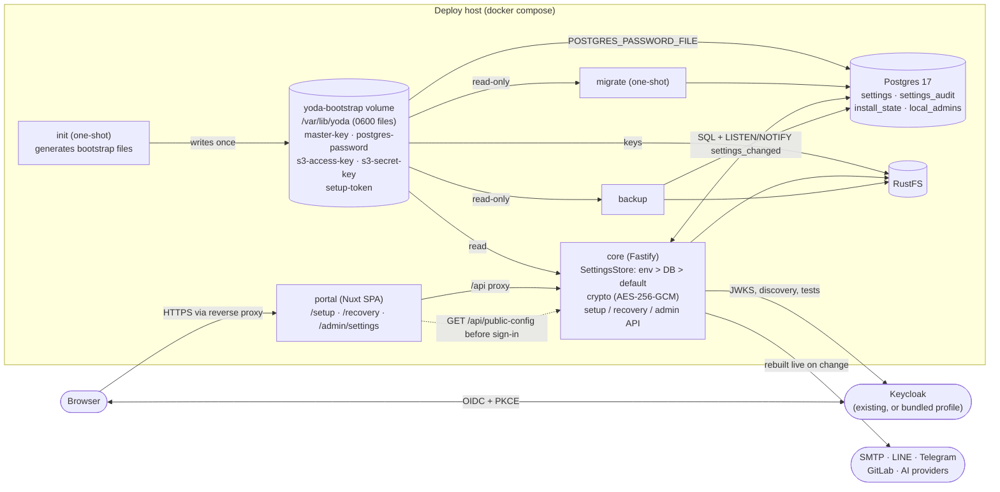

# Web installer and settings UI: proposal

Status: **proposal for owner review**. Nothing under `apps/`, `packages/`, `infra/` or `ops/` changes until this is
approved. Inputs: `apps/core/src/config.ts` (the env schema), `apps/core/src/{server,app}.ts`,
`apps/core/src/auth/*`, the places config is consumed (AI gateway and models, GitLab client, notification channels,
storage, runners), `docker-compose.yml`, `docker-compose.prod.yml`, `.env.example`, `docs/operations.md`,
`ops/deploy/deploy.sh`, `ops/backup/*`, the portal's `nuxt.config.ts` and Keycloak plugin, `infra/keycloak/*`, and
the approved [portal design refresh](portal-design-refresh.md), whose tokens the mockups reuse.

Mockups: [`mockups/installer-*.html`](mockups/) (static HTML; open them in a browser). Screenshots:
[`screenshots/proposed/installer-*.png`](screenshots/proposed/) at 1440×900 (full page) and 390×844:

| Mockup | Shows | Screenshots |
| --- | --- | --- |
| [installer-token.html](mockups/installer-token.html) | (a) setup token gate, where to find the token, plain-HTTP warning (session) | `installer-token-desktop.png`, `installer-token-mobile.png` |
| [installer-organisation.html](mockups/installer-organisation.html) | (a) welcome / organisation step with the detected public URL, step list | `installer-organisation-desktop.png`, `installer-organisation-mobile.png` |
| [installer-oidc.html](mockups/installer-oidc.html) | (b) Keycloak step: values to paste, **Test connection** result with per-check states (pass, warning, running, failed) | `installer-oidc-desktop.png`, `installer-oidc-mobile.png` |
| [installer-admin-settings.html](mockups/installer-admin-settings.html) | (c) Admin → System settings → Notification channels: env-locked field, write-only secret, test result, audit panel | `installer-admin-settings-desktop.png`, `installer-admin-settings-mobile.png` |

Every hostname is a placeholder (`example.org`). There are no secrets in this document.

Owner brief: configuring Yoda through env vars is too hard. Installing it should feel like installing a CMS:
start it, open a page in the browser, answer a few questions, and you are done. Day-to-day changes happen in an
admin UI.

## Contents

1. [Summary](#1-summary)
2. [Architecture](#2-architecture)
3. [Bootstrap: what stays outside the app](#3-bootstrap-what-stays-outside-the-app)
4. [First-run setup wizard](#4-first-run-setup-wizard)
5. [Admin settings](#5-admin-settings)
6. [Migration from env-based installs](#6-migration-from-env-based-installs)
7. [Signing in before Keycloak works](#7-signing-in-before-keycloak-works)
8. [Security](#8-security)
9. [Settings inventory](#9-settings-inventory)
10. [Data model](#10-data-model)
11. [API sketch](#11-api-sketch)
12. [Threat model](#12-threat-model)
13. [Phases, effort and what changes in docs and scripts](#13-phases-effort-and-what-changes-in-docs-and-scripts)
14. [Open decisions for the owner](#14-open-decisions-for-the-owner)

---

## 1. Summary

Today a Yoda install needs a hand-written `.env` with about 70 variables, about 20 of them required or secret,
and every change means editing that file and recreating containers (operations.md §3, §10). The proposal turns
that into:

1. **`docker compose up -d` and nothing else.** A one-shot `init` service generates the few values that have to
   exist before the app can run (master key, Postgres password, RustFS keys) into a private named volume. Nobody
   edits an env file for a standard install. An optional `install.sh` downloads a pinned, checksum-verified
   release bundle, runs compose, and prints the setup URL and token.
2. **A setup wizard at `/setup`**, opened with a one-time setup token from the container log. It asks for the
   organisation and public URL, creates a local **break-glass admin**, connects and *tests* Keycloak, checks
   storage, and offers optional steps (email, LINE, Telegram, GitLab, AI, backups), each with a **Test** button.
   It finishes when a real Keycloak user signs in and becomes the first admin. Then `/setup` returns 404 for good.
3. **Admin → System settings** for everything that is an env var today: values live in a `settings` table,
   secrets encrypted with the master key (AES-256-GCM), write-only once saved, applied live where possible
   (Postgres `LISTEN/NOTIFY` rebuilds the SMTP transport, GitLab client, channel clients and AI models without a
   restart), with an append-only audit log.
4. **Env still wins.** `env > database > default`. Existing installs keep working unchanged: their env values are
   imported on first boot and shown in the UI as locked, "set by environment (`SMTP_HOST`)". Infra-as-code shops
   can keep everything in env.

Key decisions, opinionated:

- **Bootstrap is three things**: where the database is, the master key, and (for the bundled stack) the storage
  credentials. All are generated. The public URL is *not* bootstrap: the wizard detects and confirms it.
- **The master key never enters the database.** Losing it means re-entering secrets, not losing data. The wizard
  makes you download a recovery kit before it lets you finish.
- **Login chicken-and-egg is solved with a break-glass local admin** who can use only `/setup` and `/recovery`,
  never the portal itself. Every portal user, including the first admin, is a Keycloak identity.
- **Existing Keycloak is the default**; a bundled Keycloak is an optional later phase.
- **Some things are never UI-editable**: database connection, master key, ports and bind addresses,
  `MIGRATE_ON_START`, image versions, the fake-API base URLs used in tests. Changing the OIDC issuer needs a
  break-glass re-auth and a passing test sign-in, so nobody locks themselves out.

Effort: about **33–42 dev-days** for phases 0–4 and 6 (section 13), plus 5–7 for the optional bundled Keycloak.

---

## 2. Architecture



Moving parts that are new:

| Part | Where | What it does |
| --- | --- | --- |
| `init` service | core image, `node dist/init.js` | Creates missing bootstrap files; never overwrites one; refuses to guess when data already exists without them (3.3). |
| Settings registry | `packages/shared/src/settings/registry.ts` | One declaration per setting: key, zod schema, category, secret flag, env name, scope, apply mode, UI-editable, test action (5.1). Shared by core (validation, import, override) and the portal (forms). |
| `SettingsStore` | `apps/core/src/settings/` | Resolves each key `env > DB > default`, decrypts secrets, exposes a typed snapshot shaped like today's `Config`, and emits change events (5.3). |
| Live holders | `apps/core/src/settings/live.ts` | Wrap today's boot-time singletons (`gitlab`, `mailTransport`, AI `ModelSet`, JWKS, channel config) so they are rebuilt when their keys change. |
| Setup and recovery | core routes `/setup/*`, `/recovery/*`; portal pages `/setup`, `/recovery` | Wizard, break-glass sessions, test actions, recovery kit. |
| `yoda-admin` CLI | core image, `docker compose exec core yoda-admin …` | Print or regenerate the setup token, reset the break-glass admin, rotate the master key, export settings. The way back in when the UI is not reachable. |

---

## 3. Bootstrap: what stays outside the app

### 3.1 The minimum

| Bootstrap value | Why it cannot live in the database | Default source |
| --- | --- | --- |
| **Database connection** | Needed to read the database. | Bundled stack: derived from the generated Postgres password, `postgres://yoda:<generated>@postgres:5432/yoda`. External Postgres: `DATABASE_URL` env (advanced). |
| **Master key** (`YODA_MASTER_KEY`) | Decrypts the secrets in the database; storing it there defeats the point. | Generated: 32 random bytes, base64. |
| **Bundled storage credentials** (`S3_ACCESS_KEY`, `S3_SECRET_KEY`) | RustFS itself and the `backup` container need them before core runs; core needs storage to be ready. | Generated: 20 and 40 random characters. External S3: env (advanced). |
| **Postgres password** | Applied by the Postgres image when the data volume is first created. | Generated: 32 random characters. |
| Ports, bind addresses, image prefix and version, compose profiles | Compose reads them before any container exists. | Defaults in the compose file; `release.env` pins the version (unchanged). |

**Not** bootstrap: the public URL. The first browser request carries it (`Host`, `X-Forwarded-Host`,
`X-Forwarded-Proto` from the reverse proxy); the wizard shows the detected value and the person confirms or
corrects it. It is stored in the database as `org.publicUrl`, replacing `PORTAL_URL` (which still overrides, 6).

### 3.2 How the values are created: the `init` service

A one-shot `init` service, built from the core image, runs before everything else and writes into the named volume
`yoda-bootstrap` mounted at `/var/lib/yoda`:

```text
/var/lib/yoda/            (0700, owned by the core image's user)
  bootstrap.env           (0600) aggregate, KEY=value lines, read by core, migrate and backup
  master-key              (0600) base64, 32 bytes
  postgres-password       (0600) used by the postgres image via POSTGRES_PASSWORD_FILE
  s3-access-key           (0600)
  s3-secret-key           (0600)
  setup-token             (0600) written by core while setup is incomplete; deleted when setup completes
```

Rules, in order, for each value:

1. **Env set** (`POSTGRES_PASSWORD`, `S3_ACCESS_KEY`, `YODA_MASTER_KEY`, …): write the env value to the file (env
   wins, as everywhere else). This is how existing `.env` installs flow through the same mechanism unchanged.
2. **File exists**: keep it. `init` never overwrites a generated value.
3. **Neither**: generate it with `crypto.randomBytes`, write it `0600`, log `init: generated <name>` (never the
   value).

Then it refuses to guess (3.3) and exits 0. `migrate` and `core` depend on
`init: condition: service_completed_successfully`.

Compose changes (sketch, the real diff comes with phase 3):

```yaml
services:
  init:
    image: ${YODA_IMAGE_PREFIX:?…}/core:${YODA_VERSION:?…}
    command: ['node', 'dist/init.js']
    environment:              # every one optional; set only to override generation
      POSTGRES_PASSWORD: ${POSTGRES_PASSWORD:-}
      S3_ACCESS_KEY: ${S3_ACCESS_KEY:-}
      S3_SECRET_KEY: ${S3_SECRET_KEY:-}
      YODA_MASTER_KEY: ${YODA_MASTER_KEY:-}
    volumes:
      - yoda-bootstrap:/var/lib/yoda
      - pgdata:/probe/pgdata:ro        # only to detect an existing database (3.3)
    restart: 'no'
  postgres:
    environment:
      POSTGRES_PASSWORD_FILE: /var/lib/yoda/postgres-password
    volumes: [pgdata:/var/lib/postgresql/data, yoda-bootstrap:/var/lib/yoda:ro]
    depends_on: { init: { condition: service_completed_successfully } }
  core:
    environment:
      DATABASE_URL: ${DATABASE_URL:-}   # empty = derive from bootstrap.env
      OIDC_ISSUER: ${OIDC_ISSUER:-}     # was :? required; now optional (wizard sets it)
      PORTAL_URL: ${PORTAL_URL:-}       # was :? required
      # … every other variable keeps its ${VAR:-} pass-through so env overrides keep working
    volumes: [yoda-bootstrap:/var/lib/yoda]
volumes:
  yoda-bootstrap:
```

RustFS reads its credentials from env; if the image cannot read `*_FILE` variables, a three-line entrypoint shim
(`. /var/lib/yoda/bootstrap.env && exec rustfs …`) or a thin derived image does it. This is the first thing the
phase-0 spike checks (13.1).

### 3.3 Safety rails for bootstrap

- **Existing data, no bootstrap files, no env**: if `pgdata` already holds a database (`PG_VERSION` exists) but
  there is no `postgres-password` file and no `POSTGRES_PASSWORD` env, `init` exits 1 with: "an existing database
  was found but its password is unknown; restore /var/lib/yoda from your recovery kit or set POSTGRES_PASSWORD".
  Generating a new password here would silently lock core out. The same check applies to the master key: if the
  `settings` table holds encrypted rows (core checks this at boot, see the key canary in 10.1) and the key does not
  decrypt them, core starts in **recovery mode** (section 7.4) instead of crashing or overwriting.
- `/var/lib/yoda` is a named volume, not a bind mount into the deploy directory, so `rsync` of the deploy
  directory or a copied `.env` does not leak it. It is **not** in the `backups` volume (section 3.6).
- Values are generated from `crypto.randomBytes`; base64 for the master key, an unambiguous alphabet
  (`A-Z a-z 0-9`) for passwords so they never need quoting in a URL or a shell.

### 3.4 One-line installer (optional)

For a fresh host, `install.sh` wraps the same steps. The URL is a placeholder: where it is published is an owner
decision (14, D1). The script is only ever run **pinned and verified**: the documented form downloads it, checks
it against a published SHA-256, and only then runs it, rather than piping an unverified script into `sh`:

```bash
# Documented form (the convenience one-liner `curl -fsSL https://example.org/yoda/install.sh | sh` is shown
# only with the checksum step next to it):
curl -fsSLO https://example.org/yoda/releases/1.2.0/install.sh
curl -fsSLO https://example.org/yoda/releases/1.2.0/SHA256SUMS
sha256sum --check --ignore-missing SHA256SUMS && sh install.sh --version 1.2.0 --dir /srv/yoda
```

Outline of `install.sh` (POSIX `sh`, `set -eu`, no `sudo` inside; it tells you when it needs privileges):

1. **Preflight.** Docker Engine 24+, Compose v2.24+, the user can run `docker`, ports 3000/4000 free on
   127.0.0.1, at least 10 GB free. Print what is missing and stop.
2. **Download the release bundle** `yoda-<version>.tar.gz` (compose files, `ops/deploy/deploy.sh`, `.env.example`,
   `SHA256SUMS`, a detached signature). Verify the checksum; verify the signature (minisign or cosign public key
   embedded in the script) when the tool is installed, warn otherwise. Refuse a `latest` or unpinned version.
3. **Unpack** into `--dir` (default `/srv/yoda`), refusing to overwrite an existing install (use `deploy.sh` to
   upgrade). Create an empty `.env` (`0600`) so later `--env-file .env` calls work; nothing has to go in it.
4. **Registry login** if the images are private: prompt for the deploy token interactively (`docker login`), never
   as an argument.
5. **Deploy**: `YODA_VERSION=<version> sh ops/deploy/deploy.sh` (pulls, pins `release.env`, runs `init` and
   `migrate`, starts, waits for `/api/ready`).
6. **Print the next step**:

   ```text
   Yoda 1.2.0 is running.
   Open the setup page:  http://127.0.0.1:3000/setup   (or https://<your proxy>/setup)
   Setup token:          docker compose exec core yoda-admin setup-token
   From another machine: ssh -L 3000:127.0.0.1:3000 <this host>   then open http://127.0.0.1:3000/setup
   ```

   The token is printed by the command, not by the installer's output, so it does not end up in a CI log or a
   pasted terminal transcript by accident.

Without the script, the same is: copy the bundle, `docker compose -f docker-compose.yml -f docker-compose.prod.yml
--env-file release.env up -d`, read the token from `docker compose logs core`.

### 3.5 Master key

- **What it encrypts.** Every `secret: true` setting (API keys, tokens, passwords, webhook secrets, the break-glass
  admin's TOTP seed). Not the rest of the database: disk encryption is the host's job.
- **Envelope format.** Each secret is encrypted with **AES-256-GCM** under a per-secret random **data key**; the
  data key is wrapped with the master key (AES-256-GCM, its own random 12-byte nonce). Stored per row:
  `key_id`, `wrapped_dek`, `dek_nonce`, `nonce`, `ciphertext` (with the GCM tag). The setting key is the AAD, so a
  ciphertext copied onto another key does not decrypt. `key_id` is the first 8 bytes of `SHA-256("yoda-kid" ||
  key)`, hex. Node's built-in `crypto` does all of it; no new dependency.
- **Why envelope**: rotating the master key re-wraps the small data keys only, and a later move to a KMS or HSM
  (hospital IT may ask) swaps only the wrapping step.
- **Never in the database, never in logs, never returned by the API.** Core keeps it in memory; error messages
  name the `key_id` only.
- **Losing it** means the encrypted settings cannot be read; everything else (requests, chats, files) is intact.
  Core starts in recovery mode, lists the secrets it cannot decrypt, and the admin re-enters them. It is an
  inconvenience, not data loss, and the docs say so plainly.
- **Recovery kit.** The wizard's last step (4.2, step 9) produces `yoda-recovery-kit-<first 8 of the install
  id>.txt` (the install id is `setup_state.install_id` in the database; the bootstrap volume has none): install id,
  public URL, date, the master key, the break-glass username and its recovery codes, the Postgres password and the
  storage keys of the bundled services (for a lost bootstrap volume next to a surviving database; an external
  database or bucket is only named), and short instructions.
  Warnings on the page and in the file: *print it or store it in the organisation's password vault; anyone with
  this file and a database backup can read every secret; it is shown once.* Setup cannot finish until the person
  ticks "I have stored the recovery kit". Admin → Security can produce a new kit later (break-glass re-auth;
  it regenerates the recovery codes and invalidates the old ones).
- **Rotation** (`docker compose exec core yoda-admin rotate-master-key`):
  1. generate the new key, write `master-key.next`;
  2. in one transaction re-wrap every data key under the new key and update `key_id`; the key canary too;
  3. move `master-key` to `master-key.prev`, `master-key.next` to `master-key`; core reloads both and accepts
     either `key_id` until `yoda-admin rotate-master-key --finish` deletes `.prev`;
  4. audit `master_key.rotated`; Admin → Security shows "new recovery kit needed".
  If `YODA_MASTER_KEY` comes from env, rotation prints the new key and asks you to update the env (it cannot).

### 3.6 Backups and the bootstrap volume

The `backups` volume holds database dumps whose secrets are encrypted, so an off-host backup copy alone does not
expose the API keys: that is the main protection the master key buys. The other side: **restoring on a new host
needs the master key** (from the recovery kit) or the secrets must be re-entered. `restore.sh` gains a check that
prints this when the key canary does not decrypt after a restore. The bootstrap volume is deliberately not copied
into `backups`; operations.md §6 gets a "keep the recovery kit with your backups, but not in the same place" rule.

---

## 4. First-run setup wizard

### 4.1 How it starts

- While `install_state.setup_completed_at` is null, core is in **setup mode**: every portal API route answers
  `503 {"error":"setup_required"}` except `/health`, `/ready`, `/public-config`, `/setup/*`. Core no longer needs
  `OIDC_ISSUER` to boot (it is optional in the schema; the auth hook refuses all bearer tokens until an issuer is
  set).
- At boot in setup mode core creates a **setup token** (section 8.2), writes it to `/var/lib/yoda/setup-token` and
  logs it once, framed so it is easy to find:

  ```text
  ┌─ Yoda setup ─────────────────────────────────────────────
  │ Open /setup on the portal and enter this token:
  │   ABCD-EFGH-JKLM-NPQR-STUV
  │ It expires in 24 hours and changes when core restarts.
  │ Again later: docker compose exec core yoda-admin setup-token
  └──────────────────────────────────────────────────────────
  ```

- The portal SPA fetches `GET /api/public-config` **before** it initialises keycloak-js. If `setup` is
  `required`, it routes to `/setup` and never starts Keycloak; `/setup` and `/recovery` are pages outside the
  default layout and skip the Keycloak plugin. This replaces the build/runtime `NUXT_PUBLIC_KEYCLOAK_*` values (5.6).

### 4.2 Steps

Mockups: [token](mockups/installer-token.html), [organisation](mockups/installer-organisation.html),
[sign-in](mockups/installer-oidc.html).

| # | Step | Required | Asks | Test button checks |
| --- | --- | --- | --- | --- |
| 0 | **Setup token** | yes | The token from the log. | — (rate-limited; exchanges the token for a setup session) |
| 1 | **Organisation** | yes | Organisation name (Thai, optional English), side-menu line (was `NUXT_PUBLIC_ORG_LINE`), **public URL** (pre-filled with the detected one; refused if it is `http://` and not localhost, D8), default language. | URL is well-formed; the browser's own origin matches it (else "you are reaching Yoda at a different address than the one you entered"). |
| 2 | **Break-glass admin** | yes | Username, password (zxcvbn score ≥ 3, 14+ characters), TOTP (recommended; QR code + one code to confirm). | TOTP code verifies. Recovery codes (10) are generated here and shown on step 9. |
| 3 | **System check** | yes (read-only) | Nothing. | Database (version, `pgvector`, migrations current), storage (put/get/delete a 1 KB object, bucket exists), job queue, free disk on the `backups` volume, time sync (clock skew vs the OIDC server's `Date` header, a frequent cause of token failures). |
| 4 | **Sign-in (OIDC)** | yes | Mode: *existing Keycloak* (default) or *bundled Keycloak* (only when that profile is running, phase 5). Issuer URL, client id (`yoda-portal`), optional internal JWKS URL, staff group (`/it-dev`). Shows the exact redirect URI, post-logout URI and web origin to paste into Keycloak, with copy buttons. | (a) discovery document at `<issuer>/.well-known/openid-configuration`, issuer matches exactly; (b) JWKS reachable from core, has an RS256 key; (c) **test sign-in** in a popup (PKCE, the real client): token `iss`, `azp`, `typ`, `preferred_username`, a `groups` claim with full paths, membership of the staff group. Each check reports separately (mockup b). Next is disabled until (a)–(c) pass. |
| 5 | **Email (SMTP)** | optional | Host, port, TLS mode, user, password, sender. | Connect + `EHLO` + auth, then send a test message to an address typed in the step. |
| 6 | **LINE** | optional | Channel access token, channel secret, add-friend URL. | `GET /v2/bot/info` with the token (shows the bot's name and picture); shows the webhook URL to paste; after the person presses **Verify** in the LINE console the step shows "webhook received ✓". |
| 7 | **Telegram** | optional | Bot token; the bot username is read from `getMe`; the webhook secret is generated (no human ever types it). | `getMe`; then a **Register webhook** button calls `setWebhook` itself (replacing the curl snippet in operations.md §9.3) and shows `getWebhookInfo`. |
| 8 | **GitLab, AI, backups** | optional | GitLab URL + bot token (the webhook secret is generated and shown once with the webhook URL); AI provider keys, OpenAI-compatible base URL, draft/fast/embedding models, department monthly budget; backup time and days kept. | GitLab: `GET /api/v4/user` (bot name, token scopes and expiry). AI: a one-token completion per configured model and one embedding call, with the cost shown. Backups: run one backup now and show its size. |
| 9 | **Recovery kit** | yes | Download the kit; tick "I have stored it". | The download happened in this session. |
| 10 | **Claim admin and finish** | yes | "Sign in with Keycloak to become the first administrator." | The OIDC sign-in returns to `/setup/claim`; core sees the setup session **and** a valid bearer token, creates or updates the person, sets `is_admin`, then completes setup. |

After step 10: `install_state.setup_completed_at` is set, the setup token file is deleted, setup sessions are
revoked, every `/setup*` route returns 404 (core and portal), and the browser lands in the portal as an admin with
a one-time banner: "Setup is done. Settings you skipped are in System settings."

Optional steps 5–8 reuse the same forms and endpoints as the admin settings pages (5.2); the wizard just shows
them in a sequence. Skipping is always allowed and says where to find it later.

Progress is saved after each step (the setting rows are real), so closing the browser and coming back with the
same token (or a new one after a restart) resumes where it stopped.

### 4.3 Wizard layout

A focused, shell-less layout (no side rail or search, nothing to wander off to):

- Navy top band with the Yoda mark and "ติดตั้งระบบ Yoda", the install id and language switch (ไทย / English).
- Left: step list (done ✓, current, upcoming, optional marked "ไม่บังคับ"). On mobile it collapses to
  "ขั้นตอนที่ 2 จาก 10" with a progress bar.
- Right: one card per step, 640 px wide max, two-column form grid on desktop (design refresh 6.4), test results
  as a check list with per-check status chips, and the footer `[ย้อนกลับ] … [ข้าม] [ถัดไป]`.
- The Thai copy is direct and calm; every error names what to do next ("ตรวจสอบว่า Valid redirect URIs ใน
  Keycloak มี https://portal.example.org/*").

---

## 5. Admin settings

### 5.1 The settings registry

One declaration per setting, in `packages/shared/src/settings/registry.ts`, so core and the portal cannot
disagree:

```ts
export type SettingDef<T> = {
  key: string                      // 'smtp.host'
  schema: z.ZodType<T>             // same rules as today's envSchema entry
  category: SettingCategory        // 'organisation' | 'signin' | 'ai' | 'gitlab' | 'email' | 'line' | 'telegram'
                                   // | 'runners' | 'backups' | 'storage' | 'security'
  secret: boolean                  // encrypted at rest, write-only in the API
  envName?: string                 // 'SMTP_HOST': imported on first boot, overrides the DB value
  scope: 'core' | 'portal' | 'backup' | 'keycloak-theme'
  apply: 'live' | 'reconnect' | 'restart'
  uiEditable: boolean              // false = shown read-only (or hidden) in the UI
  bootstrapOnly?: boolean          // never stored in the DB, never imported
  default?: T
  boundTo?: string[]               // credential-bound endpoints: changing these clears this secret (8.6)
  test?: TestActionId              // 'smtp' | 'line' | 'telegram' | 'gitlab' | 'oidc' | 'ai' | 'storage' | 'backup'
  label: { th: string; en: string }; help?: { th: string; en: string }
}
```

A unit test keeps the registry, `envSchema` and the operations.md variable table in sync (it extends the test that
already checks the runbook table), so a new env var cannot be added without deciding its category, secret flag and
apply mode.

Apply modes:

- **live**: read per use from the snapshot (budgets, task cap, staff group, lease time, org line). Effective on
  the next request.
- **reconnect**: the change rebuilds a client: SMTP transport, GitLab client, LINE/Telegram config, AI
  `ModelSet`, JWKS. In-flight work finishes on the old client; the next use gets the new one. Effective in about a
  second.
- **restart**: read once at boot (worker concurrency, MCP route registration if not reworked). The UI saves it,
  shows a "restart needed" banner, and an admin can press **Restart core**: core shuts down gracefully and
  compose's `restart: unless-stopped` brings it back.

### 5.2 Information architecture

The design refresh's rail group ระบบ has บุคลากร, งบประมาณ AI, การเชื่อม GitLab, ช่องทางแจ้งเตือน. Proposal: keep
บุคลากร and งบประมาณ AI (used weekly), and fold the other two into one item **การตั้งค่าระบบ** (System settings,
`mdi-cog-outline`, `/admin/settings/<category>`), with a category list on the left (owner decision D5):

| Category (th / en) | Contents | Status card at the top |
| --- | --- | --- |
| ทั่วไป / General | Organisation name, side-menu line, public URL, default language, runner docs URL | Version, install id, uptime |
| การเข้าสู่ระบบ / Sign-in | OIDC issuer, client id, JWKS URL, staff group; mode (existing/bundled); login theme fun switch note | Last successful token check, issuer reachable |
| AI | Provider keys, OpenAI-compatible base URL, draft/fast/embedding models, workers, department budget and fun switch (moved from today's AI settings page; the budget page keeps usage and project budgets) | Models available per job, month-to-date spend |
| GitLab | URL, bot token, webhook secret (generate / rotate), today's status page content | Configured, reachable, bot user, last webhook (today's Admin → GitLab) |
| ช่องทางแจ้งเตือน / Notification channels | Email (SMTP), LINE, Telegram, each with its **enable switch** (today's `notification_channel_settings`) and credentials in one place | Configured / enabled / last delivery error code |
| รันเนอร์ / Runners | Lease seconds, MCP endpoint on/off, pause, personal unattended (today's `runner_settings`) | Runners online |
| การสำรองข้อมูล / Backups | Backup time, days kept, **Back up now**, last backup and size, (later) off-host target | Healthy / last backup age |
| ที่เก็บข้อมูล / Storage and database | Read-only: endpoint, bucket, region, database host and version, migrations; **Test storage** | Readiness checks |
| ความปลอดภัย / Security | Break-glass admin (change password, TOTP, regenerate recovery codes), master key id and rotation instructions, new recovery kit, active recovery sessions | Last break-glass use |
| บันทึกการเปลี่ยนแปลง / Change log | The full audit log, filter by category, key, person, source | — |

Each category page (mockup c, [admin settings](mockups/installer-admin-settings.html)):

- A two-column form (design refresh 6.4). Each field shows its **source** when not the default: nothing (default),
  "บันทึกโดย <name> · <time>" (DB), or a lock chip **กำหนดโดย environment** with the env var name, the field
  disabled, and help text "To manage it here, remove `SMTP_HOST` from the deploy host's .env and restart."
- **Secret fields are write-only**: after saving they show "ตั้งค่าแล้ว ✓ ••••a1b2" (last 4 shown only for values
  of 20+ characters), who set it and when, and two buttons, **เปลี่ยน** (opens an empty field) and **ลบ**. The API
  never returns the value, not even to admins.
- An apply-mode hint per section: "มีผลทันที" (live), "เชื่อมต่อใหม่อัตโนมัติ" (reconnect), "ต้องรีสตาร์ท" (restart).
- **Test** runs against the *unsaved* form values (draft), so a bad change can be caught before saving; **Save**
  runs the same validation and, for credential changes, recommends a passing test (it does not force it, except
  for the OIDC issuer, 8.6).
- An audit panel on the right (below on mobile) with the last 10 changes in this category and a link to the full
  change log.
- Optimistic concurrency: the form sends the `version` it loaded; a stale save gets 409 "someone else changed this
  — reload".

### 5.3 How core applies changes

- `SettingsStore.load()` at boot: read all rows, decrypt secrets, overlay env, fill defaults, validate the whole
  snapshot with the registry schemas. An invalid DB value (for example from a newer release) is ignored with a
  warning and the default used; an invalid env value still stops core, as today.
- `deps.config` becomes `deps.settings.current` (a frozen object shaped like today's `Config`, so most call sites
  only change the access path), plus `deps.settings.on(keys, handler)`.
- Writes go through `PATCH /admin/settings` → validate → one transaction (upsert rows, append audit rows,
  `version + 1`) → `NOTIFY settings_changed, '<json list of keys>'`. Core `LISTEN`s on a dedicated connection,
  reloads the changed keys and runs the handlers. NOTIFY also covers changes made by `yoda-admin` and lets the
  backup container pick up its schedule.
- Handlers: `smtp.*` → new nodemailer transport; `gitlab.*` → new `GitLabClient` and bot-user refresh; `line.*`,
  `telegram.*` → channel config (the `configured()` checks read the snapshot); `ai.*` → `buildModels()` again and
  swap the `ModelSet` inside `AiGateway`; `oidc.*` → new remote JWKS and the auth hook reads issuer/client id from
  the snapshot; `ai.embeddingModel` → also warns that existing embeddings use the old model and offers a
  re-embed job (the dimension stays 1024).
- `MCP_ENABLED` today decides whether the `/mcp` routes are registered at boot. Making it a per-request guard
  turns it into a live setting; worth the few lines.
- The `backup` container (a bash loop) reads `backup.at` and `backup.keepDays` with one `psql` query before
  each sleep, env still overriding; no restart needed.

### 5.4 Audit log

Every write (UI, wizard, import, CLI, recovery) appends to `settings_audit` (10.1): who (person, or
`break-glass:<username>`, or `system`), when, source, key, old and new value for non-secrets, an **HMAC
fingerprint** of old and new for secrets (HMAC-SHA-256 under a key derived from the master key, so the log shows
*that* a secret changed, and whether two changes set the same value, without being brute-forceable from a DB dump),
IP and request id. Test runs are logged too (action `test`, result, no values). The table is append-only: the
application never updates or deletes rows, and a trigger rejects `UPDATE`/`DELETE`.

### 5.5 Settings that already live in the database

`department_settings` (AI budget, fun mode), `notification_channel_settings` (enable switches) and
`runner_settings` (pause, personal unattended) stay as they are; the settings UI shows them in their categories
and their routes start writing audit rows too. Moving them into the generic table is not worth a migration.

### 5.6 Portal configuration

The portal stops needing runtime env for anything but `NUXT_CORE_URL`:

- `GET /api/public-config` (no auth, cached 60 s, `ETag`): `{ setup: 'required' | 'done', recovery: boolean,
  oidc: { url, realm, clientId } | null, org: { name, line }, defaultLocale, lineAddFriendUrl, runnerDocsUrl }`.
  The Keycloak `url` and `realm` are derived from the one `oidc.issuer` setting (`<url>/realms/<realm>`), so the
  duplicate `NUXT_PUBLIC_KEYCLOAK_URL` / `_REALM` / `_CLIENT_ID` and core's `OIDC_ISSUER` / `OIDC_CLIENT_ID` can no
  longer disagree — a classic source of sign-in loops (operations.md §11).
- The existing signed-in `GET /ui-config` (fun mode) stays for values only signed-in users should see.
- The `NUXT_PUBLIC_*` env vars keep working as overrides for one or two releases (the plugin prefers a non-empty
  runtime value), then are deprecated.

---

## 6. Migration from env-based installs

Principle: **an existing install upgrades with no action and behaves exactly as before**; moving a value into the
UI is optional and one variable at a time.

1. **Precedence: env > database > default**, per key, always. A value set in env is shown locked in the UI.
2. **Import.** On every boot, for each registry key with an `envName` that is set in env and not bootstrap-only,
   core writes the value into `settings` with `source = 'env'` (encrypted if secret) when it differs from the
   stored one, and audits it as `import`. Effect: if the admin later removes the variable from `.env`, the last
   value stays in force from the database, so "move this to the UI" is just "delete the line and restart".
   Owners who never want env secrets copied into the database set `YODA_SETTINGS_IMPORT=false` (decision D4).
3. **Bootstrap-only keys are never imported**: `DATABASE_URL`, `PORT`, `MIGRATE_ON_START`, `POSTGRES_*`,
   `YODA_MASTER_KEY`, the S3 credentials and endpoint, ports and binds, image prefix and version.
4. **`PORTAL_URL`** maps to `org.publicUrl`; **`NUXT_PUBLIC_ORG_LINE`** to `org.line`;
   **`NUXT_PUBLIC_KEYCLOAK_*`** are checked against `OIDC_ISSUER` at boot and a mismatch is logged loudly.
5. **Setup on an existing install.** If the database already has people and an admin, the upgrade marks
   setup as completed (`source = 'upgrade'`) so `/setup` never appears; the break-glass admin does not exist
   until an admin creates one in Admin → Security (recommended by a banner, with the recovery kit).
6. **`BOOTSTRAP_ADMINS`** keeps working for env installs (first sign-in of those usernames), but the wizard's
   claim step replaces it for new installs and the docs deprecate it.
7. **Export for infra-as-code.** Admin → Change log has **Export as env** (non-secret settings only, as
   `KEY=value` lines with comments), so a team that set things up in the UI can move them into its config repo.

What the UI shows for a migrated install: every field that is in `.env` is locked with its variable name; a
category header says "6 of 9 settings in this section are set by environment". Nothing is surprising and nothing
changes until someone deletes a line from `.env`.

---

## 7. Signing in before Keycloak works

### 7.1 The problem

Every portal request is authenticated with a Keycloak access token (`auth/plugin.ts`). On a fresh install there is
no issuer, so nobody can sign in to configure the issuer. And after setup, a wrong issuer change locks everyone out.

### 7.2 Recommendation: setup token, then a break-glass local admin

- **During setup**, only the setup token is needed. It opens a setup session (an `HttpOnly`, `SameSite=Strict`
  cookie, path `/api/setup`). Keycloak is not involved until step 4.
- **Step 2 creates a break-glass admin**: a local username, a password hashed with **argon2id** (memory 64 MiB,
  t = 3, p = 1, via `@node-rs/argon2`; a prebuilt binary, no build toolchain in the image), optional but recommended
  TOTP (RFC 6238, seed encrypted with the master key), and 10 single-use recovery codes (stored as argon2id hashes).
- **What the break-glass admin can do**: use `/setup` (until it is complete) and `/recovery` only. It has **no
  portal session**: it cannot see requests, chats, files or people's data. In `/recovery` it can: view all settings
  (secrets still write-only), change and test the sign-in settings, change any other setting, grant or revoke
  admin to a person by username, run the system check, and download a new recovery kit.
- **Guard rails**: a separate cookie (`yoda_recovery`), 15-minute idle and 60-minute absolute session TTL, IP
  rate limits (8.4), lockout with exponential backoff per account, every sign-in and every action audited, and a
  notification to every portal admin (portal feed and email if configured): "Break-glass account used from
  <ip> at <time>". A banner on every admin page while a recovery session is active.
- **The first real admin is an OIDC identity.** Step 10 makes the person completing setup sign in through
  Keycloak; that person becomes admin. From then on, everything in the portal is done as a Keycloak user.

### 7.3 Option B: bundled Keycloak

A compose profile `keycloak` with a production-mode Keycloak, its own database in the same Postgres, a realm
generated from a template (client `yoda-portal` with PKCE, the `groups` mapper, the staff group, the Yoda login
theme, Thai default) and its admin password generated into the bootstrap volume.

| | Existing Keycloak (default) | Bundled Keycloak |
| --- | --- | --- |
| Hospitals that already run Keycloak or AD/LDAP federation | One identity for every system; their IAM team keeps control of MFA, password policy, leavers | A second identity store to keep in sync, or a federation to configure — usually the IAM team's job anyway |
| Effort for a small team with nothing | Must first install Keycloak somewhere | Works out of the box; the wizard can even create the first users |
| Operations | Not our problem (theme install is documented) | We own Keycloak upgrades, its backups (in our backup job), its hostname/TLS (`KC_HOSTNAME` = `<public URL>/auth` behind the portal's proxy or its own host), memory (+1 GB) |
| Risk | Sign-in depends on another team's change control | A Keycloak CVE in our stack is our patch to ship |

Recommendation: support both in the wizard's sign-in step, **existing as the default**, and build the bundled
profile as a separate later phase (13, phase 5) — the hospitals in view already run Keycloak, so it is not on the
critical path. Not doing it at all is also reasonable (decision D2).

### 7.4 Recovery mode

Core enters recovery mode (portal shows only `/recovery`) when: the master key cannot decrypt the key canary;
or an admin forces it with `yoda-admin recovery on`. Recovery is also reachable while the portal works normally,
for the lockout case: a wrong issuer or a Keycloak outage. `/recovery` is a plain sign-in page with username,
password, TOTP or recovery code; it says clearly that it is for emergencies and that admins are notified.

If the break-glass password is also lost: `docker compose exec core yoda-admin reset-break-glass` (host access is
the root of trust) prints a new one-time password and invalidates sessions; audited and notified.

---

## 8. Security

### 8.1 Setup lock

- `install_state.setup_completed_at` set ⇒ every `/setup*` route answers **404** (not 403: nothing to probe),
  in core and the portal. There is no "re-run setup" button; resetting is `yoda-admin` on the host.
- Completing setup is one transaction that checks: organisation saved, break-glass admin exists, OIDC test passed
  in this session, recovery kit downloaded, a person claimed admin. Partial states cannot be "completed" through a
  crafted request.

### 8.2 Setup token

- 100 bits of randomness, shown as 5 groups of 4 from a Crockford-style alphabet (`ABCD-EFGH-JKLM-NPQR-STUV`);
  case-insensitive, no 0/O/1/I confusion.
- Only its SHA-256 is kept (in `install_state`), the plain value only in the 0600 file and the one log line.
- **Single-use**: exchanging it creates a setup session and burns the token; a new token is created when that
  session expires without completing setup, on restart, or by `yoda-admin setup-token --new`.
- Expires after **24 hours**; regenerated on every restart until setup completes.
- Compared in constant time; 5 wrong tries per IP per 15 minutes, 50 overall per hour, then the endpoint refuses
  until the next restart (a brute force is then impossible at 100 bits anyway; this keeps logs quiet).
- The default prod binding (`127.0.0.1`) means the wizard is reachable only through the reverse proxy or an SSH
  tunnel. The wizard says so when the session itself is plain HTTP (the token and cookie travel unencrypted) and
  recommends the tunnel shown by `install.sh`.
- **Public URL (decision D8, owner decision 2026-11-27).** Setup refuses a public URL on plain `http://` unless its
  host is this machine: `localhost`, a `*.localhost` name, 127.0.0.0/8 or `::1` (the same `isLocalhostHost` rule
  as D3, the hosts a browser treats as a secure context). Anything else on http (a LAN address, a host name,
  `0.0.0.0`) is refused with 422 `invalid_settings` / `https_required` on `org.publicUrl`: browsers allow the
  portal's Keycloak sign-in (PKCE, Web Crypto) only on https or localhost, so nobody could sign in there. The
  organisation step checks it in the browser too and shows the way forward: an SSH tunnel
  (`ssh -L 3000:127.0.0.1:3000 <host>`, then `http://127.0.0.1:3000/setup`) or an https reverse proxy with a
  certificate (`YODA_TRUSTED_PROXY_HOPS=2`; operations.md section 1). `/setup/complete` checks the URL in effect
  again (a value saved before this rule, or set in `PORTAL_URL`, cannot finish setup), and the organisation step
  counts as not done while it fails. System settings → General refuses the same values, for the same reason. The
  setup session itself may still be plain HTTP (the tunnel on 127.0.0.1 is plain HTTP).

### 8.3 CSRF and sessions

- The portal API already uses bearer tokens (not cookies), so it is not CSRF-prone.
- Setup and recovery use cookies: `HttpOnly; Secure (when HTTPS); SameSite=Strict; Path=/api/setup` (or
  `/api/recovery`), plus a **double-submit token** returned at session creation and required as `X-Yoda-CSRF` on
  every non-GET request, plus an `Origin` check against `org.publicUrl` (or the detected origin during setup).
- Session ids are 256-bit random, stored hashed, bound to the user agent, rotated after the TOTP step.

### 8.4 Rate limits

`@fastify/rate-limit`, in memory (one core process):

| Endpoint | Limit |
| --- | --- |
| `POST /setup/session` (token) | 5 / 15 min / IP; 50 / hour global |
| `POST /recovery/session` | 5 / 15 min / IP; per account exponential backoff (1 min → 1 h) after 5 failures |
| `POST /setup/test/*`, `POST /admin/settings/test/*` | 10 / min / session; 60 / hour |
| `PATCH /admin/settings` | 30 / min / person |
| `GET /public-config` | 120 / min / IP |

### 8.5 Outbound tests and SSRF

Test buttons make core connect to an address a person typed, which is an SSRF vector. Rules, in one
`safeOutbound()` helper used by every test and by the live clients:

- Schemes: `https` (and `http` only for hosts the admin marks internal), `smtp`/`smtps` ports only for the SMTP
  test. No `file:`, `gopher:`, redirects not followed (or re-checked per hop, max 3).
- Resolve DNS **once**, check every resolved address, then connect to that address (no DNS rebinding).
- **Allowed**: public addresses and private ranges (`10/8`, `172.16/12`, `192.168/16`, `fc00::/7`): hospitals
  run Keycloak, GitLab, SMTP and LLM gateways on internal hosts.
- **Blocked**: link-local and cloud metadata (`169.254.0.0/16`, `fe80::/10`, `fd00:ec2::254`, `100.100.100.200`,
  `metadata.google.internal`), `0.0.0.0/8`, multicast, and loopback (`127/8`, `::1`) except in dev. The compose
  service names (`postgres`, `rustfs`, `core`, `backup`) are blocked as targets.
- Timeouts: 5 s connect, 10 s total; responses read up to 64 KB.
- Results return **codes, not content** (`tls_failed`, `auth_rejected`, `http_404`, `timeout`,
  `issuer_mismatch`), so a test cannot be used to read an internal page or a banner.
- Tests are admin-only (or setup/recovery session) and rate-limited (8.4).

### 8.6 What the UI cannot change, and dangerous changes

**Never UI-editable** (env/bootstrap only; shown read-only or hidden): `DATABASE_URL`, `YODA_MASTER_KEY`,
`POSTGRES_*`, S3 endpoint and credentials, `PORT`, `CORE_PORT`/`CORE_BIND`/`PORTAL_PORT`/`PORTAL_BIND`,
`MIGRATE_ON_START`, `YODA_IMAGE_PREFIX`/`YODA_VERSION`, `COMPOSE_PROFILES`, `NUXT_CORE_URL`, and the fake-API base
URLs `LINE_API_URL` / `TELEGRAM_API_URL` (they exist for tests; editable, they would let someone send the bot
token to their own host). The server runner's own variables stay on the runner (section 9, runner table).

**Credential-bound endpoints.** A secret is bound to the endpoint it is sent to. Changing `smtp.host` (or
`smtp.port` / `smtp.secure`), `gitlab.url` or `ai.openaiBaseUrl` **clears** the bound secret unless a new one is entered in the same save. A
stolen admin session therefore cannot redirect an existing token to a host of its choosing.

**Re-authentication.** Changing any secret, or any sign-in setting, needs a fresh OIDC sign-in (`auth_time`
within 10 minutes; the portal re-prompts with `prompt=login`) or a recovery session.

**OIDC issuer / client id change** — the one change that can lock everyone out (the JWKS URL is treated the same: a wrong one fails every token check):

1. Only from a **recovery session** (break-glass re-auth), not from a normal admin session.
2. The new values are saved as **pending**; the full OIDC test (discovery, JWKS, test sign-in popup with the
   *new* issuer, token claims, an admin's username present) must pass.
3. Then **Apply** switches. The old values are kept for one-click rollback from `/recovery` for 7 days.

**Secrets are never echoed**: not in API responses, logs (pino redaction gains the settings payload paths), audit
rows (HMAC fingerprints only), error messages or the export. The portal never puts a secret into a field value.

---

## 9. Settings inventory

Every env var read by core (`apps/core/src/config.ts`, 40 keys), the portal (`nuxt.config.ts` runtimeConfig and
dev vars), compose and the backup service, and the server runner. Columns: **Secret** = encrypted at rest and
write-only. **UI** = editable in the admin UI (✓), read-only (ro), or not shown (—). **Apply**: live, reconnect,
restart (5.1); "boot" = only at boot, not a setting. **Boot-only** = bootstrap-only, never stored or imported.

### 9.1 Core

| Env var | Setting key | Category | Secret | UI | Apply | Boot-only | Notes |
| --- | --- | --- | --- | --- | --- | --- | --- |
| `PORT` | — | — | no | — | boot | yes | Fixed 4000 in the container. |
| `DATABASE_URL` | — | storage | yes (contains password) | ro (host and db only) | boot | yes | Derived from bootstrap for the bundled Postgres. |
| `MIGRATE_ON_START` | — | — | no | — | boot | yes | Prod overlay fixes `false`. |
| `OIDC_ISSUER` | `oidc.issuer` | signin | no | ✓ (recovery session + test, 8.6) | reconnect | no | Portal's Keycloak URL/realm derive from it. |
| `OIDC_CLIENT_ID` | `oidc.clientId` | signin | no | ✓ (recovery session + test) | reconnect | no | |
| `OIDC_JWKS_URL` | `oidc.jwksUrl` | signin | no | ✓ (recovery session + test) | reconnect | no | |
| `STAFF_GROUP` | `oidc.staffGroup` | signin | no | ✓ | live | no | Test sign-in shows whether the tester is in it. |
| `BOOTSTRAP_ADMINS` | — | signin | no | ro | live | no | Deprecated; replaced by the wizard's claim step. Still honoured from env. |
| `ANTHROPIC_API_KEY` | `ai.anthropicApiKey` | ai | **yes** | ✓ | reconnect | no | |
| `OPENAI_API_KEY` | `ai.openaiApiKey` | ai | **yes** | ✓ | reconnect | no | Bound to `ai.openaiBaseUrl`. |
| `OPENAI_BASE_URL` | `ai.openaiBaseUrl` | ai | no | ✓ | reconnect | no | Changing it clears the OpenAI key unless re-entered. |
| `AI_MODEL_DRAFT` | `ai.modelDraft` | ai | no | ✓ | reconnect | no | Pick list from `prices.json` plus free text. |
| `AI_MODEL_FAST` | `ai.modelFast` | ai | no | ✓ | reconnect | no | |
| `AI_EMBEDDING_MODEL` | `ai.embeddingModel` | ai | no | ✓ | reconnect | no | Change offers a re-embed job; dimension fixed 1024. |
| `AI_WORKERS` | `ai.workers` | ai | no | ✓ | restart | no | pg-boss concurrency set at boot. |
| `DAILY_TASK_CAP` | `work.dailyTaskCap` | general | no | ✓ | live | no | |
| `S3_ENDPOINT` | — | storage | no | ro | boot | yes | Fixed `http://rustfs:9000` for the bundled stack. |
| `S3_REGION` | — | storage | no | ro | boot | yes | |
| `S3_BUCKET` | — | storage | no | ro | boot | yes | Shared with `backup`. |
| `S3_ACCESS_KEY` | — | storage | **yes** | — | boot | yes | Generated by `init`. |
| `S3_SECRET_KEY` | — | storage | **yes** | — | boot | yes | Generated by `init`. |
| `GITLAB_URL` | `gitlab.url` | gitlab | no | ✓ | reconnect | no | Bound endpoint for the token. |
| `GITLAB_TOKEN` | `gitlab.token` | gitlab | **yes** | ✓ | reconnect | no | Test shows scopes and expiry date. |
| `GITLAB_WEBHOOK_SECRET` | `gitlab.webhookSecret` | gitlab | **yes** | ✓ (generate) | live | no | Generated by the UI, shown once. |
| `PORTAL_URL` | `org.publicUrl` | general | no | ✓ | live | no | Detected in the wizard. Warns that Keycloak redirect URIs must match. |
| `RUNNER_LEASE_SECONDS` | `runners.leaseSeconds` | runners | no | ✓ | live | no | New claims use the new value. |
| `MCP_ENABLED` | `runners.mcpEnabled` | runners | no | ✓ | live (after guard rework, else restart) | no | 5.3. |
| `SMTP_HOST` | `smtp.host` | email | no | ✓ | reconnect | no | Bound endpoint for the password. |
| `SMTP_PORT` | `smtp.port` | email | no | ✓ | reconnect | no | Bound endpoint (with host and TLS mode). |
| `SMTP_SECURE` | `smtp.secure` | email | no | ✓ | reconnect | no | UI: "TLS from the start (465)" / "STARTTLS (587)". |
| `SMTP_USER` | `smtp.user` | email | no | ✓ | reconnect | no | |
| `SMTP_PASSWORD` | `smtp.password` | email | **yes** | ✓ | reconnect | no | |
| `MAIL_FROM` | `smtp.from` | email | no | ✓ | live | no | |
| `LINE_CHANNEL_ACCESS_TOKEN` | `line.accessToken` | line | **yes** | ✓ | reconnect | no | |
| `LINE_CHANNEL_SECRET` | `line.channelSecret` | line | **yes** | ✓ | live | no | Webhook signature key. |
| `LINE_API_URL` | `line.apiUrl` | line | no | — | reconnect | no | Env only (tests/fakes), 8.6. |
| `TELEGRAM_BOT_TOKEN` | `telegram.botToken` | telegram | **yes** | ✓ | reconnect | no | UI re-registers the webhook after a change. |
| `TELEGRAM_BOT_USERNAME` | `telegram.botUsername` | telegram | no | ro (from `getMe`) | live | no | |
| `TELEGRAM_WEBHOOK_SECRET` | `telegram.webhookSecret` | telegram | **yes** | ✓ (generate) | live | no | Rotation re-runs `setWebhook` itself. |
| `TELEGRAM_API_URL` | `telegram.apiUrl` | telegram | no | — | reconnect | no | Env only (tests/fakes), 8.6. |

### 9.2 Portal

| Env var | Setting key | Category | Secret | UI | Apply | Boot-only | Notes |
| --- | --- | --- | --- | --- | --- | --- | --- |
| `NUXT_CORE_URL` (`CORE_URL` in dev) | — | — | no | — | boot | yes | Fixed `http://core:4000`. |
| `PORTAL_PORT` | — | — | no | — | boot | yes | Dev server / compose host port. |
| `NUXT_PUBLIC_KEYCLOAK_URL` | derived from `oidc.issuer` | signin | no | ro | live (next page load) | no | Deprecated override. |
| `NUXT_PUBLIC_KEYCLOAK_REALM` | derived from `oidc.issuer` | signin | no | ro | live | no | Deprecated override. |
| `NUXT_PUBLIC_KEYCLOAK_CLIENT_ID` | `oidc.clientId` | signin | no | ro | live | no | Deprecated override. |
| `NUXT_PUBLIC_RUNNER_DOCS_URL` | `org.runnerDocsUrl` | general | no | ✓ | live | no | |
| `NUXT_PUBLIC_LINE_ADD_FRIEND_URL` | `line.addFriendUrl` | line | no | ✓ | live | no | |
| `NUXT_PUBLIC_ORG_LINE` | `org.line` | general | no | ✓ | live | no | |
| (new) | `org.name`, `org.nameEn`, `org.defaultLocale` | general | no | ✓ | live | no | Wizard step 1. |

### 9.3 Compose, backup and Keycloak theme

| Env var | Setting key | Category | Secret | UI | Apply | Boot-only | Notes |
| --- | --- | --- | --- | --- | --- | --- | --- |
| `YODA_IMAGE_PREFIX` | — | — | no | ro (shown on General) | boot | yes | |
| `YODA_VERSION` | — | — | no | ro | boot | yes | Pinned in `release.env` by `deploy.sh`. |
| `CORE_PORT`, `CORE_BIND`, `PORTAL_PORT`, `PORTAL_BIND` | — | — | no | — | boot | yes | |
| `POSTGRES_USER`, `POSTGRES_DB` | — | storage | no | ro | boot | yes | |
| `POSTGRES_PASSWORD` | — | storage | **yes** | — | boot | yes | Generated by `init`. |
| `COMPOSE_PROFILES` | — | — | no | ro | boot | yes | |
| `BACKUP_AT` | `backup.at` | backups | no | ✓ | live (next loop) | no | Backup container reads it per loop. |
| `BACKUP_KEEP_DAYS` | `backup.keepDays` | backups | no | ✓ | live (next run) | no | |
| (new) `YODA_MASTER_KEY` | — | security | **yes** | — | boot | yes | Generated by `init`; never in DB. |
| (new) `YODA_SETTINGS_IMPORT` | — | security | no | ro | boot | yes | `false` = do not mirror env secrets into DB. |
| `YODA_LOGIN_FUN_MODE` (on Keycloak) | — | signin | no | ro (note) | — | — | Scope `keycloak-theme`: lives on the Keycloak server; the UI explains it. Bundled Keycloak: wired to `ui.funMode`. |

### 9.4 Server runner (unchanged in v1)

`YODA_RUNNER_TOKEN`, `YODA_RUNNER_CORE_URL`, `YODA_RUNNER_ANTHROPIC_API_KEY`, `YODA_GIT_USERNAME`,
`YODA_GIT_PASSWORD`, `YODA_RUNNER_GIT_NAME`, `YODA_RUNNER_GIT_EMAIL`, `YODA_RUNNER_CONFIG_FILE`: runner-side, read by
`apps/runner` only; core never sees them (operations.md §3). They stay env plus `runner-config.json`. A later
improvement: the Runners page creates the server runner's token and the runner reads it from the bootstrap volume.

---

## 10. Data model

### 10.1 New tables

```sql
-- One row per stored setting (env-only and default values have no row).
create table settings (
  key           text primary key,               -- registry key, e.g. 'smtp.host'
  value         jsonb,                          -- non-secret value; null for secrets
  key_id        text,                           -- secrets: master key id
  wrapped_dek   bytea,                          -- secrets: data key wrapped by the master key
  dek_nonce     bytea,
  nonce         bytea,
  ciphertext    bytea,                          -- AES-256-GCM, tag appended, AAD = key
  hint          text,                           -- secrets: last 4 chars when length >= 20, else null
  source        text not null,                  -- 'ui' | 'setup' | 'env' | 'import' | 'cli' | 'recovery' | 'upgrade'
  pending       jsonb,                          -- staged change (OIDC issuer, 8.6)
  version       integer not null default 1,
  updated_by    uuid references people(id) on delete set null,
  updated_by_label text,                        -- 'break-glass:admin', 'system', 'cli'
  updated_at    timestamptz not null default now(),
  check (value is null or ciphertext is null)  -- a row is a plain value or a secret, never both
);

-- Append-only; a trigger raises on update/delete.
create table settings_audit (
  id            bigserial primary key,
  at            timestamptz not null default now(),
  actor_person  uuid references people(id) on delete set null,
  actor_label   text not null,                  -- display name, 'break-glass:<user>', 'system', 'cli'
  source        text not null,                  -- as settings.source, plus 'test'
  action        text not null,                  -- 'set' | 'clear' | 'import' | 'test' | 'apply_pending'
                                                --  | 'rollback' | 'master_key.rotated' | 'recovery.signin' | …
  key           text,
  old_value     jsonb,                          -- non-secrets only
  new_value     jsonb,
  old_fp        text,                           -- secrets: HMAC-SHA-256 fingerprint (base64url, 16 bytes)
  new_fp        text,
  result        text,                           -- tests: 'ok' or an error code
  ip            inet,
  request_id    text
);
create index settings_audit_key_at on settings_audit (key, at desc);
create index settings_audit_at on settings_audit (at desc);

-- Single row (id 1).
create table install_state (
  id                    integer primary key default 1 check (id = 1),
  install_id            uuid not null,
  setup_completed_at    timestamptz,
  setup_completed_by    uuid references people(id) on delete set null,
  setup_token_hash      bytea,
  setup_token_expires   timestamptz,
  setup_progress        jsonb not null default '{}',  -- per step: done/skipped, oidc test passed at, kit downloaded at
  key_canary            bytea,                        -- a known constant encrypted with the master key (key check)
  key_canary_key_id     text,
  recovery_mode         boolean not null default false
);

create table local_admins (
  id               uuid primary key default gen_random_uuid(),
  username         text not null unique,
  password_hash    text not null,              -- argon2id PHC string
  totp_ciphertext  bytea,                      -- encrypted with the master key (same envelope columns in practice)
  totp_enabled     boolean not null default false,
  failed_attempts  integer not null default 0,
  locked_until     timestamptz,
  disabled         boolean not null default false,
  created_at       timestamptz not null default now(),
  last_used_at     timestamptz
);

create table local_recovery_codes (
  id          uuid primary key default gen_random_uuid(),
  admin_id    uuid not null references local_admins(id) on delete cascade,
  code_hash   text not null,                   -- argon2id
  used_at     timestamptz
);

create table local_sessions (
  id_hash     bytea primary key,               -- SHA-256 of the cookie value
  kind        text not null check (kind in ('setup', 'recovery')),
  admin_id    uuid references local_admins(id) on delete cascade,
  csrf_hash   bytea not null,
  ua_hash     bytea,
  ip          inet,
  created_at  timestamptz not null default now(),
  last_seen   timestamptz not null default now(),
  expires_at  timestamptz not null
);
```

### 10.2 Unchanged tables

`department_settings`, `notification_channel_settings`, `runner_settings`, `gitlab_settings` keep their columns
(5.5). `people.is_admin` stays the portal admin flag; the claim step sets it.

---

## 11. API sketch

All core routes; the portal reaches them through its `/api` proxy. Bodies are zod schemas in `packages/shared`.

**Public**

| Method and path | Auth | Purpose |
| --- | --- | --- |
| `GET /public-config` | none | Pre-sign-in config for the SPA (5.6). |
| `GET /health`, `GET /ready` | none | Unchanged; `/ready` adds `settings` (key canary ok). |

**Setup** (all return 404 once setup is complete)

| Method and path | Auth | Purpose |
| --- | --- | --- |
| `GET /setup/status` | none | `{ required, detectedUrl, https, steps: { organisation: 'done', … } }`; no secrets, no settings. |
| `POST /setup/session` | token in body | Burns the token, sets the setup cookie, returns the CSRF token. |
| `PUT /setup/organisation` | setup | Name, line, public URL, locale. |
| `POST /setup/admin` | setup | Break-glass username, password, optional TOTP confirmation. |
| `GET /setup/totp` | setup | Generates a TOTP seed and its `otpauth://` URI for the QR code. |
| `POST /setup/check` | setup | System check (step 3). |
| `POST /setup/test/:action` | setup | `oidc`, `smtp`, `line`, `telegram`, `gitlab`, `ai`, `storage`, `backup`, with draft values. |
| `PATCH /setup/settings` | setup | Same body as `PATCH /admin/settings`, for steps 4–8. |
| `POST /setup/telegram/webhook` | setup | Registers the Telegram webhook with the stored token and secret. |
| `GET /setup/recovery-kit` | setup | The kit as `text/plain` attachment; marks it downloaded. Regenerates recovery codes if called twice. |
| `POST /setup/claim` | setup + bearer | Makes the OIDC user admin. |
| `POST /setup/complete` | setup | Checks every required step (8.1) and locks setup. |

**Admin** (bearer token, `requireAdmin`; secrets and sign-in changes need a recent `auth_time`)

| Method and path | Purpose |
| --- | --- |
| `GET /admin/settings?category=` | `[{ key, value?, secret: { set, hint, updatedAt, updatedBy }?, source: 'default'|'db'|'env', envName?, locked, apply, pendingRestart, version }]` |
| `PATCH /admin/settings` | `{ changes: { [key]: value | null }, versions: { [key]: n } }` → `{ applied: [...], restartNeeded: [...] }`; 409 on stale version; 422 with per-key issues. |
| `POST /admin/settings/test/:action` | Draft values in, `{ ok, checks: [{ id, ok, ms, code?, detail? }] }` out. |
| `POST /admin/settings/generate/:key` | Generate a random webhook secret, store it, return it **once**. |
| `POST /admin/settings/telegram/webhook` | Re-register the Telegram webhook. |
| `GET /admin/settings/audit?category=&key=&cursor=` | Paged audit entries. |
| `GET /admin/settings/export` | Non-secret settings as `KEY=value` text. |
| `POST /admin/system/restart` | Graceful exit; compose restarts core. |
| `POST /admin/backups/run` | Asks the backup container to run now (a `NOTIFY backup_now` its loop listens for). |
| `GET /admin/security` / `POST /admin/security/recovery-kit` | Break-glass state, master key id; new kit (recovery re-auth). |

**Recovery** (cookie session; CSRF header)

| Method and path | Purpose |
| --- | --- |
| `POST /recovery/session` | Username + password + TOTP or recovery code. |
| `GET /recovery/settings`, `PATCH /recovery/settings`, `POST /recovery/test/:action` | As the admin routes. |
| `POST /recovery/oidc/apply`, `POST /recovery/oidc/rollback` | Apply a pending, tested issuer change; roll back within 7 days. |
| `POST /recovery/admins` | `{ username, admin: boolean }` grant or revoke portal admin. |
| `DELETE /recovery/session` | Sign out. |

**CLI** (`docker compose exec core yoda-admin <command>`): `setup-token [--new]`, `reset-break-glass`,
`recovery on|off`, `rotate-master-key [--finish]`, `settings get|set|unset <key>`, `settings export`,
`check`. Each audits with `source = 'cli'`.

---

## 12. Threat model

| # | Threat | Asset | Mitigation | Residual |
| --- | --- | --- | --- | --- |
| T1 | Someone on the network reaches `/setup` before the owner and takes over the install | Whole install | Setup token required (only in the container log and a 0600 file); 100-bit, single-use, 24 h; ports on 127.0.0.1 by default; rate limits | An attacker with host or `docker logs` access — already root-equivalent |
| T2 | Setup token leaks via a pasted log or CI output | Install | Single-use, expires, regenerates on restart; `install.sh` does not print it; log line is the only copy | Window until first use |
| T3 | Brute force of break-glass password | Settings, admin grant | argon2id, length/strength rules, per-IP and per-account limits, lockout, TOTP, admin notification on each use | Weak TOTP-less password if the owner skips TOTP (D3) |
| T4 | Break-glass account used to read people's data | Requests, chats, files | Break-glass has no portal session; `/recovery` exposes settings and admin grants only; granting admin is audited and notified | It can grant admin to an account the attacker controls → notification is the detection |
| T5 | DB dump or off-host backup copy stolen | Secrets in settings | AES-256-GCM envelope with a master key that is never in the DB or `backups`; audit uses HMAC fingerprints | Non-secret data in the dump is plain (unchanged from today) |
| T6 | Host compromise | Everything | Out of scope: master key and DB are both on the host. Optional later: KMS/HSM for the wrapping key | Same as today's `.env` |
| T7 | Master key lost | Secrets | Recovery kit required before setup finishes; recovery mode lists what to re-enter; data unaffected | Secrets must be re-entered |
| T8 | Stolen admin session exfiltrates a token by pointing its endpoint elsewhere | API keys, bot tokens, SMTP password | Credential-bound endpoints clear the secret on change (8.6); fake-API URLs env-only; secrets write-only; re-auth for secret changes | An attacker can still *replace* a credential (detected in audit, notified) |
| T9 | SSRF through test buttons | Internal network, cloud metadata | `safeOutbound()`: metadata/link-local/loopback/compose names blocked, DNS pinned, no redirects, codes not content, admin-only, rate-limited | Internal hosts reachable by design (hospital services are internal) |
| T10 | Lockout by a wrong OIDC change | Availability | Issuer/client changes only from recovery, staged, require a passing test sign-in; 7-day rollback; break-glass works without OIDC | Keycloak outage still blocks normal users (break-glass can only configure) |
| T11 | CSRF on setup/recovery cookies | Settings | SameSite=Strict, double-submit token, Origin check; portal API uses bearer tokens | — |
| T12 | Tampering with the audit log to hide a change | Accountability | Append-only trigger; app never updates/deletes; export | A DB superuser can still bypass the trigger |
| T13 | `install.sh` or bundle swapped on the download server | Host | Pinned version, SHA-256 check, signature check, no `latest` | Users who skip the documented checksum step |
| T14 | Env and DB disagree and nobody knows which applies | Correctness | Lock badge with env var name; source per field; boot log lists env-overridden keys | — |
| T15 | Secrets leak in logs or errors | Secrets | Values never logged; pino redaction extended; tests return codes; settings payloads redacted | — |

---

## 13. Phases, effort and what changes in docs and scripts

### 13.1 Phases

Rough dev-days for one developer familiar with the codebase, including tests and docs.

| Phase | Scope | Days | Risks |
| --- | --- | --- | --- |
| **0. Spike** | RustFS credential files or shim; keycloak-js init after an async config fetch; `@node-rs/argon2` in the core image (arm64 and amd64); `LISTEN/NOTIFY` with the existing `postgres` client; how many call sites read `deps.config` | 2 | RustFS without `*_FILE` needs a shim image |
| **1. Settings foundation** | Registry in `packages/shared` with the inventory above; tables and migration; crypto envelope and key canary; `SettingsStore` (env > DB > default), import on boot, audit trigger; live holders for SMTP, GitLab, channels, AI models, JWKS; `NOTIFY` reload; admin settings API; registry/envSchema/runbook sync test | 8–10 | Refactoring `deps.config` touches ~15 files; races when a client is swapped mid-send (mitigated: handlers swap references, no shared mutable state) |
| **2. Admin settings UI** | `/admin/settings/<category>` pages, secret field, env-lock chip, apply hints, test buttons with `safeOutbound()`, audit panel and change log, restart banner, fold GitLab/channels pages in; Thai and English copy | 7–8 | Scope creep into redesigning each admin page — keep content as is, move it |
| **3. Bootstrap and setup wizard** | `init` service and compose changes; setup mode in core; setup token; `/public-config` and the portal boot change; break-glass admin (argon2id, TOTP, recovery codes), sessions, CSRF, rate limits; wizard steps 0–10; recovery kit; claim; lock; `/recovery`; `yoda-admin` CLI | 10–12 | Portal boot change runs on every page load (test sign-in loops carefully); setup mode must not break existing installs (upgrade marks setup done, 6.5) |
| **4. Installer and release bundle** | `install.sh`, release bundle with `SHA256SUMS` and signature built in CI, publishing location (D1), `deploy.sh` changes, operations.md rewrite, `.env.example` split | 3–4 | Registry access for outside installs (images are on the internal registry today) |
| **5. Bundled Keycloak** (optional) | Compose profile, realm template, hostname/proxy, theme, backups of its DB, wizard path | 5–7 | Owning Keycloak upgrades; proxying `/auth` correctly |
| **6. Hardening** | Master key rotation CLI and docs; threat model review; e2e tests (fresh install, upgrade from env, lockout and recovery, wrong master key); a short external review of setup/recovery | 3–4 | — |

Total phases 0–4 and 6: **33–42 days**; with phase 5: **38–49 days**. Phases 1 and 2 are useful on their own
(admin UI for existing installs) and can ship before the wizard.

### 13.2 docs/operations.md

- **§1 Prerequisites**: unchanged, plus "the wizard is reached through the reverse proxy or an SSH tunnel".
- **§3 Environment variables** becomes **§3 Settings**: "configure in Admin → System settings; every setting can
  also be forced from env". The variable table stays (the sync test still guards it) and gains columns *UI
  setting* and *Apply*; the bootstrap-only variables move into their own short table. New variables:
  `YODA_MASTER_KEY`, `YODA_SETTINGS_IMPORT`.
- **§4 First install** is rewritten: (1) `install.sh` or copy the bundle; (2) `deploy.sh` (unchanged command);
  (3) open `/setup`, token from `yoda-admin setup-token`; (4) the wizard; (5) **store the recovery kit**. No `.env`
  editing; "advanced: external Postgres or S3" keeps the env route.
- **New §4a Bootstrap volume and master key**: what is in `/var/lib/yoda`, never delete it, the recovery kit,
  restoring on a new host, master key rotation.
- **§2 Keycloak**: the checklist stays (it is what the wizard's test checks); the `BOOTSTRAP_ADMINS` item becomes
  "the wizard's last step makes you admin"; the portal no longer needs `NUXT_PUBLIC_KEYCLOAK_*`.
- **§6 Backups**: "a restore on a new host needs the master key"; `BACKUP_AT`/`BACKUP_KEEP_DAYS` in the UI.
- **§7, §9**: set up in Admin → System settings with the test buttons; the Telegram `setWebhook` curl snippet is
  replaced by the **Register webhook** button (kept as a fallback).
- **§10 Rotating secrets**: most rows become "enter the new value in System settings; applies within a second;
  then revoke the old one" (and LINE/Telegram's "restart first, revoke after" warning becomes "save first, revoke
  after"); Postgres password and storage keys stay host-side; new rows for the master key and the break-glass
  admin.
- **§11 Troubleshooting**: new entries — setup token lost or expired; locked out of Keycloak (`/recovery`);
  wrong or missing master key (recovery mode); "set by environment" values that cannot be edited.

### 13.3 Scripts and compose

- **`docker-compose.prod.yml`**: add `init` and the `yoda-bootstrap` volume; `POSTGRES_PASSWORD_FILE`; required
  `:?` checks become optional `:-` for `DATABASE_URL`, `OIDC_ISSUER`, `PORTAL_URL`, `S3_*`,
  `NUXT_PUBLIC_KEYCLOAK_URL`, `POSTGRES_PASSWORD` (only `YODA_VERSION` stays required); mount the bootstrap volume
  read-only in `migrate`, `backup`, `postgres`, `rustfs`, read-write in `core`; optional `keycloak-bundled`
  profile (phase 5).
- **`docker-compose.yml`** (dev): unchanged credentials (dev keeps its throwaway values and the dev realm);
  `init` runs in dev too so the wizard can be developed against it, with `YODA_DEV_SKIP_SETUP=true` keeping
  today's env-only dev flow the default.
- **`ops/deploy/deploy.sh`**: create an empty `.env` (0600) when missing instead of failing; run `init`
  (`dc run --rm init`) before `migrate`; after ready, if `GET /public-config` says `setup: required`, print the
  setup hint and `yoda-admin setup-token`; never touch the bootstrap volume.
- **`ops/backup/*`**: read `backup.at` / `backup.keepDays` from the database before each sleep (env still wins);
  listen for `backup_now`; `restore.sh` checks the key canary after a restore and prints the recovery-kit hint.
- **`.env.example`**: split into "nothing is required for a standard install" and an "Advanced overrides"
  section (external Postgres/S3, infra-as-code), each line pointing to its UI setting. Dev values stay in the dev
  section.
- **Backward compatibility**: an existing deploy directory with a full `.env` and `release.env` upgrades with the
  same `deploy.sh` command; `init` copies the env bootstrap values into the volume, core imports the rest and
  marks setup done (6.5); the UI shows those values locked. Nothing else changes until someone deletes a line from
  `.env`.

---

## 14. Open decisions for the owner

| # | Decision | Options | Recommendation |
| --- | --- | --- | --- |
| D1 | Where `install.sh`, the release bundle and images are published | (a) internal registry and file server only (needs `docker login`); (b) public GitHub Releases + a public image registry; (c) both | (a) now; (b) only if Yoda is offered to other hospitals |
| D2 | Bundled Keycloak | (a) never; (b) later phase 5; (c) in v1 | (b), existing Keycloak as default |
| D3 | Break-glass TOTP | (a) optional; (b) required | (b) required whenever the public URL is not localhost |
| D4 | Mirror env secrets into the DB on boot | (a) yes, default on, `YODA_SETTINGS_IMPORT=false` to opt out; (b) never | (a): makes "move to UI" a one-line change |
| D5 | Rail items for system settings | (a) one "การตั้งค่าระบบ" item absorbing GitLab and channels; (b) keep four items and add a fifth | (a) |
| D6 | Who may change settings | (a) every portal admin, with re-auth for secrets; (b) a new "system admin" role | (a) for v1; a role later if admins become many |
| D7 | Recovery kit contents | (a) master key + break-glass codes in one file; (b) two separate downloads | (a), with the warning; one thing to store |
| D8 | Setup over plain HTTP on the LAN | (a) allowed with a warning; (b) HTTPS or SSH tunnel only | **Owner decision (2026-11-27): (b).** The public URL must be https unless its host is localhost, `*.localhost`, 127.0.0.0/8 or `::1` (§8.2); otherwise 422 `https_required`, in the wizard and in System settings. First boot without a proxy uses the SSH tunnel (`http://127.0.0.1:3000/setup`). Was (a), replaced: a plain-http LAN install finished setup but nobody could sign in. |
| D9 | S3 storage settings in the UI | (a) env/bootstrap only, UI read-only with a test; (b) editable | (a): RustFS and backups depend on them too |
| D10 | Audit log retention | (a) forever; (b) N years then archive | (a): rows are tiny |
| D11 | Language of the wizard on first open | (a) Thai, switchable; (b) follow the browser | (a), matching the portal default |
