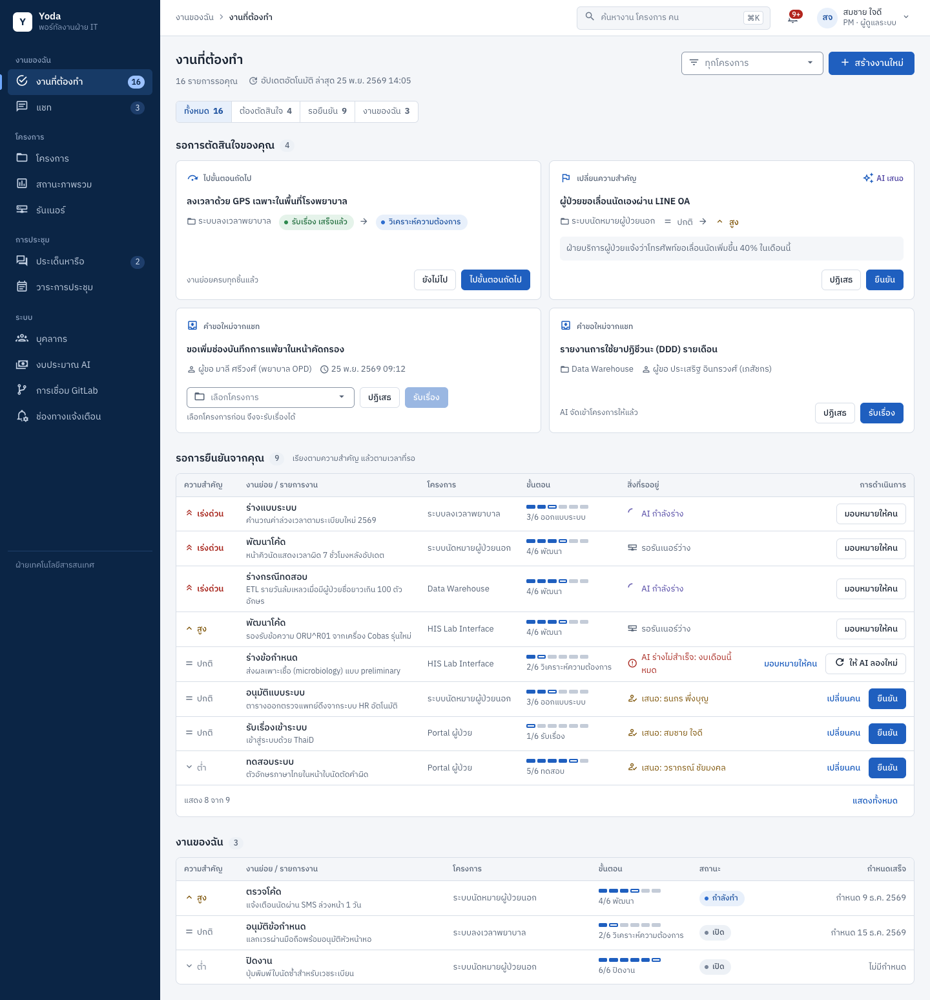
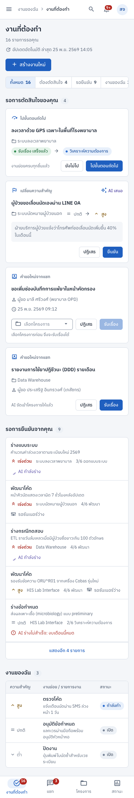
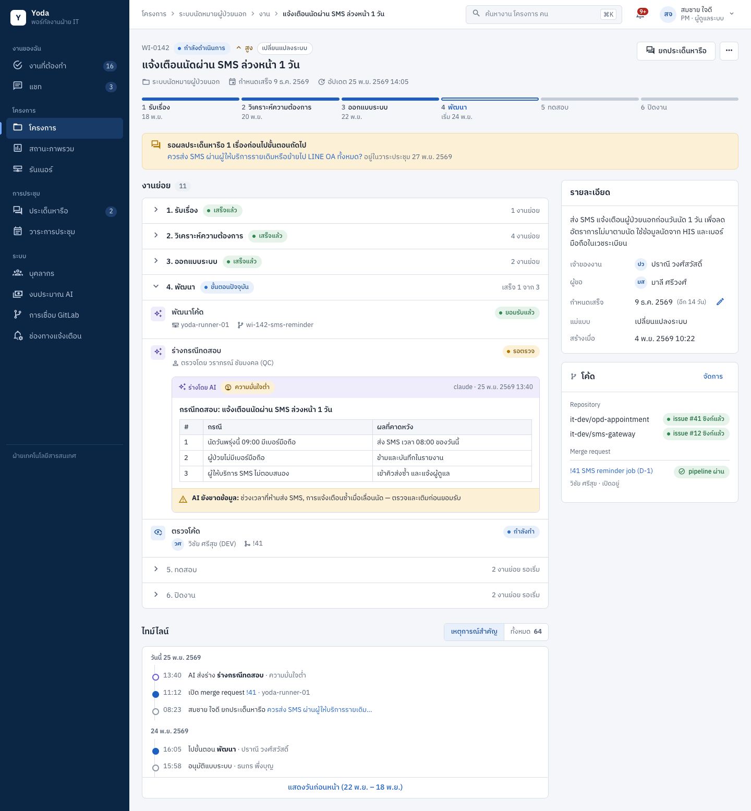
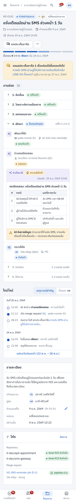
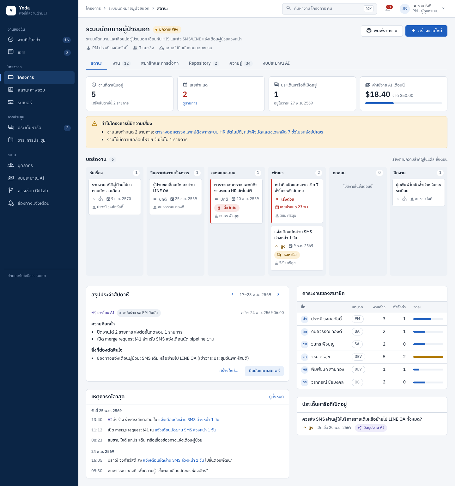
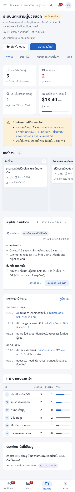
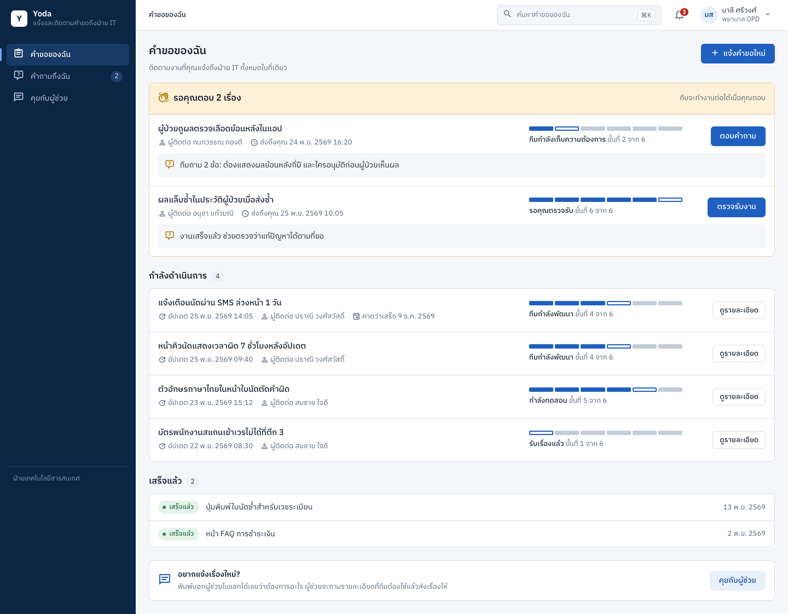
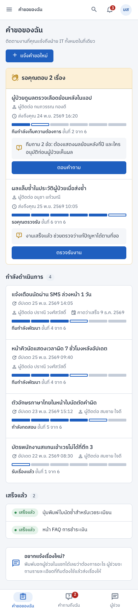

# Portal design refresh: proposal

Status: **proposal for owner review**. Nothing under `apps/` changes until this is approved. Inputs:
[current UI inventory](current-ui-inventory.md) (problems referenced below as "inventory §x") and the screenshots in
[`screenshots/current/`](screenshots/current/). Mockups: [`mockups/`](mockups/) (static HTML, open in a browser);
their screenshots are in [`screenshots/proposed/`](screenshots/proposed/).

Owner brief: clean and minimal but clearly an enterprise system; blue, dark blue and gray; Thai by default with an
English toggle.

## Contents

1. [Summary and principles](#1-summary-and-principles)
2. [Colour](#2-colour)
3. [Typography](#3-typography)
4. [Spacing, density, layout](#4-spacing-density-layout)
5. [Navigation and page header](#5-navigation-and-page-header)
6. [Components](#6-components)
7. [States, accessibility, i18n and dates](#7-states-accessibility-i18n-and-dates)
8. [Per-page problems and fixes](#8-per-page-problems-and-fixes)
9. [Mockups](#9-mockups)
10. [Implementation plan (after approval)](#10-implementation-plan-after-approval)
11. [Open decisions for the owner](#11-open-decisions-for-the-owner)

---

## 1. Summary and principles

The portal today is stock Vuetify with no theme, no component defaults and no Thai web font (inventory §1, top
problems 1–3). The refresh is mostly a **theme and conventions** change, not a rewrite: one `createVuetify` theme
plus component defaults fixes most pages at once. A second pass then reworks the pages that are structurally wrong
(To-do, work item, project status, requester pages, unbounded timelines, mobile overflow).

The look: a **dark navy side rail** that says "enterprise system", a **white work surface on cool gray**, one
**confident blue** for everything you can click, and **status shown as tinted chips** instead of saturated
blocks. Thai text set in **IBM Plex Sans Thai**, with no letter-spacing and no uppercase.

Principles:

1. **Where is it, and what does it wait for?** Every work row answers both: its position in the 6-step workflow
   (the *step track*, see 6.8) and what it is waiting for (AI, a runner, a person, you). The step track is the one
   distinctive element of the system; it appears in To-do rows, the board, the work item header and the
   requester's list, so people learn it once.
2. **Colour means state, never decoration.** Blue = interactive / in progress. Green, amber, red = outcome or
   risk, always with text and a dot or icon (never colour alone). AI content has its own quiet indigo marker.
3. **One action pattern.** Primary action on the right of its row or card; one filled button per area;
   destructive actions sit apart (overflow menu or a separated text button) and always confirm.
4. **Bounded pages.** Lists page or group; timelines group by day and collapse; nothing renders 100+ entries.
5. **Name the object.** Proposals, dialogs, notifications and breadcrumbs say which work item / step they are about.
6. **Plain language for requesters.** Nurses see "ทีมกำลังพัฒนา" and "รอคุณตอบ", not task types, states or "เริ่มทำ".
7. **Thai first.** Thai line-height, no tracking, Buddhist-era dates, no English leaking into the Thai UI except
   proper nouns (GitLab, HIS, Repository names).

---

## 2. Colour

### 2.1 Palette

All ratios are WCAG 2.x contrast ratios computed from the hex values with the relative-luminance formula
(rounded to 2 decimals). AA needs 4.5:1 for normal text, 3:1 for large text
(≥ 18.66 px bold / 24 px) and non-text UI indicators.

**Brand and neutrals**

| Token (Vuetify colour name) | Hex | Usage | Contrast (pair → ratio) |
| --- | --- | --- | --- |
| `nav` | `#0B2545` | Side rail background, brand mark text | `on-nav` text → 9.85 |
| `nav-hover` | `#12305A` | Rail item hover | — |
| `nav-active` | `#173A66` | Rail active item background | white text → 11.45 |
| `on-nav` | `#C3D0E2` | Rail item text and icons | on `nav` 9.85 |
| `nav-label` | `#8BA0BF` | Rail group labels, footer | on `nav` 5.77 |
| `nav-accent` | `#6FA8FF` | 3 px active indicator bar on the rail | on `nav` 6.39 (non-text, ≥ 3) |
| `primary` | `#1F5FBF` | Primary buttons, links, focus ring, active tab, progress, step track | white on it 6.09; as text on `surface` 6.09, on `background` 5.63 |
| `primary-darken-1` | `#184C99` | Primary hover/pressed | white on it 8.29 |
| `primary-soft` | `#E8F0FB` | Tonal buttons, selected rows/segments, info chip bg | `on-primary-soft` `#1A4F9E` on it 6.89 |
| `background` | `#F4F6F9` | App background behind cards | `on-surface` 14.43, secondary text 5.72 |
| `surface` | `#FFFFFF` | Cards, top bar, dialogs, tables | `on-surface` 15.62 |
| `surface-light` | `#EDF1F6` | Board columns, table header, neutral chip bg, segment track | secondary text 5.46 |
| `on-surface` | `#1A2433` | Body text (slate near-black) | 15.62 on white |
| text secondary (`medium-emphasis-opacity` 0.72 → `#5A616C`; explicit token `#556275`) | `#556275` | Meta lines, captions, table headers | 6.19 on white, 5.72 on `background` |
| text placeholder | `#6B7789` | Input placeholder, tertiary icons | 4.54 on white |
| text disabled (0.45 opacity) | `#989CA3` | Disabled controls only | 2.76 (disabled text is exempt from AA) |
| `border` (`border-color` `#0B2545` × `border-opacity` 0.15 → `#DADEE3`; explicit `#D8DEE7`) | `#D8DEE7` | Card, table and divider lines | decorative (1.35); never the only cue |
| `border-strong` | `#8A95A5` | Input outlines, unchecked checkbox/radio | 3.03 on white (non-text, ≥ 3) |
| `surface-variant` | `#1A2433` | **Tooltips** (Vuetify uses this token for `VTooltip`); keep it dark | `on-surface-variant` `#FFFFFF` → 15.62 |

**Status colours** (each is a trio: strong text, soft background, dot / icon / bar)

| Status | Text (`success` etc.) | Soft bg (`*-soft`) | Dot / bar (`*-dot`) | Text on soft | Text on white | Dot on soft / white |
| --- | --- | --- | --- | --- | --- | --- |
| success | `#1D6B3A` | `#E5F3EA` | `#2F8A4F` | 5.70 | 6.53 | 3.77 / 4.31 |
| warning | `#7A4F00` | `#FCF0D7` | `#B07800` | 6.31 | 7.13 | 3.36 / 3.80 |
| error | `#B3261E` (chip text `#A8261D`) | `#FBE8E6` | `#D0342C` | 6.01 (`#A8261D`) | 6.54 (`#A8261D`: 7.09) | 4.23 / — |
| info | `#1A4F9E` | `#E8F0FB` | `#2F6FD0` | 6.89 | 7.91 | 4.25 / — |
| neutral | `#465264` | `#EDF1F6` | `#7A8699` | 6.98 | 7.92 | 3.25 / — |
| ai | `#4A3FA0` | `#EFEDFB` | `#6A5CD6` | 7.24 | 8.37 | 4.42 / — |

Solid (white-text) uses: only `primary` (6.09), `error` for the confirm button of a destructive dialog (white on
`#B3261E` 6.54) and `success` if ever needed (6.53). **No white text on amber**, ever. The notification badge is
white on `error` (6.54). Progress/budget bars use `primary` below 80 %, `warning-dot` 80–99 %, `error` at 100 %.

Why these values: the brief's navy and blue are kept (`#0B2545`, `#1F5FBF`); status colours are desaturated and
darkened until their text passes AA *on their own soft background*, so chips are readable at 12 px. Amber text is
brown-amber (`#7A4F00`) because a true orange cannot pass AA on a light tint. AI gets a muted indigo so that "this
was written by a model" is recognisable without looking like an error or a success.

### 2.2 Vuetify theme and defaults

Light theme only for now. **Dark theme: later** (section 11) — the tokens are named so a `dark` theme can be
added without touching components.

```ts
// apps/portal/app/plugins/vuetify.ts (proposed)
import { createVuetify } from 'vuetify'
import { en, th } from 'vuetify/locale'

const field = { variant: 'outlined', density: 'compact', color: 'primary', hideDetails: 'auto' } as const

export const vuetifyOptions = {
  icons: { defaultSet: 'mdi' },
  theme: {
    defaultTheme: 'light',
    themes: {
      light: {
        dark: false,
        colors: {
          background: '#F4F6F9',
          surface: '#FFFFFF',
          'surface-bright': '#FFFFFF',
          'surface-light': '#EDF1F6',
          'surface-variant': '#1A2433', // tooltips
          'on-surface-variant': '#FFFFFF',
          'on-surface': '#1A2433',
          'on-background': '#1A2433',
          primary: '#1F5FBF',
          'primary-darken-1': '#184C99',
          'primary-soft': '#E8F0FB',
          'on-primary-soft': '#1A4F9E',
          secondary: '#0B2545', // navy: rail, strong secondary emphasis
          'secondary-darken-1': '#071A33',
          nav: '#0B2545',
          'on-nav': '#C3D0E2',
          'nav-active': '#173A66',
          'nav-label': '#8BA0BF',
          'nav-accent': '#6FA8FF',
          success: '#1D6B3A',
          'success-soft': '#E5F3EA',
          'success-dot': '#2F8A4F',
          warning: '#7A4F00',
          'warning-soft': '#FCF0D7',
          'warning-dot': '#B07800',
          error: '#B3261E',
          'error-soft': '#FBE8E6',
          'error-dot': '#D0342C',
          info: '#1A4F9E',
          'info-soft': '#E8F0FB',
          'info-dot': '#2F6FD0',
          neutral: '#465264',
          'neutral-soft': '#EDF1F6',
          'neutral-dot': '#7A8699',
          ai: '#4A3FA0',
          'ai-soft': '#EFEDFB',
          'ai-dot': '#6A5CD6',
          'border-strong': '#8A95A5',
        },
        variables: {
          'border-color': '#0B2545',
          'border-opacity': 0.15, // ≈ #DADEE3 on white
          'high-emphasis-opacity': 1, // body text is exactly #1A2433
          'medium-emphasis-opacity': 0.72, // ≈ #5A616C, 6.25:1 on white
          'disabled-opacity': 0.45,
          'hover-opacity': 0.04,
          'focus-opacity': 0.12,
          'selected-opacity': 0.08,
          'activated-opacity': 0.12,
          'pressed-opacity': 0.12,
          'theme-kbd': '#EDF1F6',
          'theme-on-kbd': '#1A2433',
          'theme-code': '#EDF1F6',
          'theme-on-code': '#1A2433',
        },
      },
    },
  },
  defaults: {
    VAppBar: { flat: true, border: 'b', height: 56, color: 'surface' },
    VNavigationDrawer: { color: 'nav', width: 248, border: 0 },
    VBtn: { variant: 'flat', rounded: 'md', class: 'text-none' }, // 36 px tall by default; no uppercase
    VTab: { class: 'text-none' },
    VTabs: { color: 'primary', density: 'compact' },
    VCard: { variant: 'flat', border: true, rounded: 'lg' }, // 1 px border, 8 px radius
    VChip: { size: 'small', variant: 'tonal', rounded: 'pill' },
    VTextField: field,
    VTextarea: { ...field, autoGrow: true, rows: 3 },
    VSelect: field,
    VAutocomplete: field,
    VCombobox: field,
    VCheckbox: { density: 'compact', color: 'primary', hideDetails: 'auto' },
    VSwitch: { density: 'compact', color: 'primary', inset: true, hideDetails: 'auto' },
    VTable: { density: 'comfortable', hover: true }, // 40 px rows with $table-row-height 48 (below)
    VDataTable: { density: 'comfortable', hover: true, itemsPerPage: 25 },
    VList: { density: 'compact' },
    VDialog: { maxWidth: 560, scrollable: true },
    VAlert: { variant: 'tonal', density: 'compact', border: 'start' },
    VProgressLinear: { color: 'primary', rounded: true, height: 6 },
    VTooltip: { location: 'top', openDelay: 400 },
    VMenu: { offset: 4 },
  },
  locale: { /* unchanged */ },
}

export default defineNuxtPlugin((nuxtApp) => {
  nuxtApp.vueApp.use(createVuetify(vuetifyOptions))
  // ...existing locale watcher unchanged
})
```

SASS settings (checked against the installed Vuetify 3.13.8 variable names), loaded through
`vite-plugin-vuetify` `styles: { configFile: 'app/assets/vuetify-settings.scss' }` instead of the plain
`vuetify/styles` import:

```scss
// app/assets/vuetify-settings.scss
@use 'vuetify/settings' with (
  $body-font-family: ('IBM Plex Sans Thai', 'IBM Plex Sans', 'Leelawadee UI', 'Thonburi', system-ui, sans-serif),
  $heading-font-family: ('IBM Plex Sans Thai', 'IBM Plex Sans', 'Leelawadee UI', 'Thonburi', system-ui, sans-serif),
  $button-text-transform: none,
  $button-text-letter-spacing: 0,
  $button-height: 36px,
  $table-row-height: 48px,   // 'comfortable' density (-8) → 40 px rows; 'default' → 48 px for two-line cells
  $card-border-radius: 8px,
  $typography: (
    // Thai: zero tracking everywhere; sizes per the scale in section 3
    'h5': ('size': 1.25rem, 'weight': 600, 'line-height': 1.4, 'letter-spacing': 0),
    'h6': ('size': 1rem, 'weight': 600, 'line-height': 1.5, 'letter-spacing': 0),
    'subtitle-1': ('size': 1rem, 'weight': 500, 'line-height': 1.5, 'letter-spacing': 0),
    'subtitle-2': ('size': .875rem, 'weight': 600, 'line-height': 1.5, 'letter-spacing': 0),
    'body-1': ('size': .875rem, 'weight': 400, 'line-height': 1.6, 'letter-spacing': 0),
    'body-2': ('size': .8125rem, 'weight': 400, 'line-height': 1.6, 'letter-spacing': 0),
    'button': ('size': .875rem, 'weight': 500, 'letter-spacing': 0, 'text-transform': none),
    'caption': ('size': .75rem, 'weight': 400, 'line-height': 1.5, 'letter-spacing': 0),
    'overline': ('size': .75rem, 'weight': 500, 'letter-spacing': 0, 'text-transform': none),
  )
);
```

Notes:

- Vuetify's `tonal` variant tints with the colour at ~12 %; for `success`/`warning`/`error`/`info` that lands
  within a few RGB steps of the `*-soft` tokens, so `<v-chip color="success">` is acceptable. The exact
  treatment (soft bg + strong text + dot) is a small `StatusChip` component (6.5) so every status goes through one
  mapping table.
- Do **not** set `surface-variant` to a light gray: Vuetify uses it for tooltips and some overlays. The light gray
  token is `surface-light`.
- `body-1` is set to 14 px (not Vuetify's 16 px) because the portal is a dense work tool; long-form reading
  (AI drafts, knowledge) gets 15 px in the Markdown container (3.3).

---

## 3. Typography

### 3.1 Fonts

**IBM Plex Sans Thai** for Thai and **IBM Plex Sans** for Latin (same design family, so mixed lines like
"รองรับข้อความ ORU^R01 จากเครื่อง Cobas" look like one voice). Both are SIL Open Font License 1.1 (free for
commercial and internal use, can be self-hosted and bundled).

Why not the alternatives:

- **Sarabun** is the Thai government document face; it reads as "official letter" and its Latin is weak for UI
  data (IDs, branch names).
- **Noto Sans Thai + Inter**: good and also OFL, but two unrelated families; Thai looped/loopless mismatch with
  Inter's tight Latin. A fine fallback choice if Plex is rejected.
- Plex Sans Thai is loopless (modern, legible at 12–13 px on screens), has 7 weights, and has matching metrics
  with Plex Sans.

Fallback stack: `'IBM Plex Sans Thai', 'IBM Plex Sans', 'Leelawadee UI', 'Thonburi', system-ui, sans-serif`
(Leelawadee UI on Windows hospital PCs, Thonburi on macOS).

### 3.2 Loading — recommendation: self-host

Self-host with `@fontsource/ibm-plex-sans-thai` and `@fontsource/ibm-plex-sans` (weights 400, 500, 600; 700 only
if needed), Thai + Latin subsets, `font-display: swap`. Reasons: hospital networks often filter or slow external
CDNs; no third-party request carrying staff IPs (PDPA hygiene); works on the intranet when the internet link is
down; versions are pinned with the app. Cost: ~200–260 KB of WOFF2 for 3 weights × 2 families, cached after first
load. Preload the 400 Thai file only.

The mockups use Google Fonts purely for convenience.

### 3.3 Scale

| Role | Size / line-height | Weight | Vuetify class | Use |
| --- | --- | --- | --- | --- |
| Display / KPI | 24 / 1.3 | 600, tabular nums | `text-h4` (remapped) | KPI numbers, agenda present mode body is larger (see 8.x) |
| Page title | 20 / 1.4 | 600 | `text-h5` | One per page, in the page header |
| Section title | 16 / 1.5 | 600 | `text-h6` | Card titles, section headings |
| Body | 14 / 1.6 | 400 (500 for row titles) | `text-body-1` | Default text, table cells, form values |
| Meta | 13 / 1.6 | 400, secondary colour | `text-body-2` | Meta lines, sub-rows, breadcrumbs |
| Caption | 12 / 1.5 | 400 / 500 for chips | `text-caption` | Chips, helper text, table headers, time stamps |
| Reading (Markdown) | 15 / 1.7 | 400 | `.md` container | AI drafts, knowledge, discussion briefs |

Rules:

- **Minimum 12 px** anywhere (today chips are 10–11 px).
- **Letter-spacing 0** for all text, including buttons and tabs; never `text-transform: uppercase` (Thai has no
  case, and the current tracked Thai "ย้อนกลับขั้นตอน" is hard to read).
- **Line-height ≥ 1.5** for any Thai text (stacked vowels and tone marks above and below need room; 1.6 for body).
  Never set fixed heights that clip above/below marks; chips and buttons are `display:flex` with centred content.
- **Markdown headings are capped below the page title**: inside `MarkdownView`, `h1`/`h2` → 16 px/600,
  `h3`–`h6` → 14 px/600; the rendered block sits in a bordered container (6.10) so it never competes with the
  page's own headings.
- **Tabular numbers** (`font-variant-numeric: tabular-nums`) for tables, KPIs, counts, times and money.
- Weights: 400 regular, 500 for row titles/labels/buttons, 600 for headings and emphasis. No 300 / 700+ in UI.
- Proper nouns and code (`it-dev/opd-appointment`, `!41`, HL7 types) stay in Plex Sans; code blocks use
  `IBM Plex Mono` only inside Markdown code fences.

---

## 4. Spacing, density, layout

### 4.1 Spacing and density

- **8 px grid** (4 px allowed inside components). Card padding 16; page padding 24 desktop / 16 mobile; gap
  between sections 24–28; between cards 12–16.
- Controls: buttons 36 px (32 px `size="small"` in table rows and cards), inputs 36–40 px (`outlined`,
  `density="compact"`), chips 24 px, table rows 40 px (48 px when a cell has two lines), list rows 40 px,
  rail items 40 px.
- Radii: 8 px cards/dialogs/alerts, 6 px buttons/inputs/menus, pills for chips and counts.
- Elevation: flat. Cards have a 1 px border, no shadow. Shadows only on things that float (menus, dialogs,
  snackbars): `0 8px 24px rgba(11,37,69,.12)`.

### 4.2 Layout grid and content widths

| Page type | Width rule | Examples |
| --- | --- | --- |
| Lists and tables | Full content width (fluid, 24 px gutters) | To-do, project work items, runners, people, knowledge list, discussions list, requester requests |
| Board | Full width; columns `minmax(176px, 1fr)`; horizontal scroll with snap below 1,280 px | Project status board |
| Detail with side panel | Main column fluid (max ~880 px reading width for prose) + **340 px side panel**; panel stacks under main below 1,280 px | Work item, task, discussion, request detail |
| Reading | Max line length ~80 Thai characters (≈ 720 px at 15 px) | Markdown, AI brief context, knowledge entry |
| Forms / settings | Two-column label/field grid up to 880 px, **left-aligned in a card that spans the width** — no half-empty pages; supporting help text goes in the right column | Notification settings, admin AI, GitLab, runner settings |
| Dialogs | 480 (confirm), 560 (form, default), 800 (editor: knowledge, raise discussion) | |

The current `v-container` (fixed max widths per breakpoint) is replaced by `<v-container fluid class="pa-6">`
with per-page max widths from the table.

### 4.3 Breakpoints and mobile rules

Vuetify breakpoints are kept (`sm` 600, `md` 960, `lg` 1280, `xl` 1920). Rules:

- **≥ 1280** full layout; **960–1279** side panels stack under the main column; **< 1024** (`md` and down) the
  rail becomes a temporary drawer opened from the top bar, and a **bottom navigation** shows the 3–4 daily pages
  (staff: งานที่ต้องทำ, แชท, โครงการ, สถานะ; requester: คำขอของฉัน, คำถามถึงฉัน, ผู้ช่วย).
- **No horizontal page scroll at 390 px.** Only boards, tab bars and segmented filters may scroll horizontally,
  inside their own container.
- Tables with more than 3 columns become **stacked rows** on mobile (title + meta line + action), not squeezed
  columns.
- Header actions wrap under the title; secondary/destructive ones move into a `⋯` menu.
- Touch targets ≥ 44 × 44 px on mobile (buttons keep 36 px visual height with a 44 px hit area).
- Chat on mobile is master/detail: thread list → conversation full screen with the composer pinned to the bottom.

---

## 5. Navigation and page header

### 5.1 Side rail (staff)

Navy (`nav`), 248 px, fixed. Top: brand mark + product name "Yoda" + sub-line "พอร์ทัลงานฝ่าย IT" (logo TBD,
section 11). Grouped sections with 12 px labels in `nav-label`:

| Group | Items (icon) | Badge |
| --- | --- | --- |
| งานของฉัน | งานที่ต้องทำ (`mdi-checkbox-marked-circle-outline`), แชท (`mdi-message-text-outline`) | to-do count, unread threads |
| โครงการ | โครงการ (`mdi-folder-outline`), สถานะภาพรวม (`mdi-chart-box-outline`), รันเนอร์ (`mdi-server-network-outline`) | — |
| การประชุม | ประเด็นหารือ (`mdi-forum-outline`), วาระการประชุม (`mdi-calendar-text-outline`) — **agendas join the nav** | open discussions needing your vote |
| ระบบ (admins only) | บุคลากร, งบประมาณ AI (`mdi-cash-multiple`), การเชื่อม GitLab (`mdi-source-branch`), ช่องทางแจ้งเตือน | — |

Active item: `nav-active` background, white 500-weight text, 3 px `nav-accent` bar at the left edge,
`aria-current="page"`. Count badges: pill, 12 px tabular; active item's badge inverts to `#9CC2FF` on navy (8.48).
Counts cap at **99+**. Rail can collapse to a 64 px icon rail (tooltips on icons) — user preference stored locally.
Bottom of rail: department name (and later the app version).

### 5.2 Requester variant

Same shell, simpler rail with no group labels: **คำขอของฉัน**, **คำถามถึงฉัน** (badge), **คุยกับผู้ช่วย**.
Sub-line "แจ้งและติดตามคำขอถึงฝ่าย IT". Plain-language wording everywhere (see 8.3). The search placeholder
is "ค้นหาคำขอของฉัน".

### 5.3 Top bar

White, 56 px, bottom border. Left to right:

1. Menu button (mobile only).
2. **Breadcrumbs** (13 px, secondary; last item 500 weight, ellipsis): e.g. โครงการ › ระบบนัดหมายผู้ป่วยนอก › งาน ›
   แจ้งเตือนนัดผ่าน SMS ล่วงหน้า 1 วัน. Replaces all per-page "back" buttons. On mobile the breadcrumbs collapse to
   the parent + current item.
3. **Global search** slot (300 px, `⌘K` / `Ctrl K` hint; icon-only on mobile). Phase 1 can ship it as a
   work item/project jump box; full search is later.
4. **Notifications** bell; badge white on `error`, **caps at 9+**. Menu items get a kind icon, the object name
   ("ประเด็นหารือใหม่ใน *แจ้งเตือนนัดผ่าน SMS…*"), relative time, unread dot, and "อ่านทั้งหมดแล้ว".
5. **User menu**: avatar (initials on `primary-soft`) + name + role line ("PM · ผู้ดูแลระบบ"); menu holds
   ภาษา (ไทย / English radio), การแจ้งเตือนของฉัน, divider, ออกจากระบบ. The TH/EN toggle and the bare logout
   icon leave the bar (inventory §1).

### 5.4 Page header (standard)

```
[ID · state chip · priority · template]          (optional context line, 13 px)
Page title (20/600)                              [secondary] [primary] [⋯]
meta: project · due date · updated time          (13 px, icons 16 px)
─ tabs ─────────────────────────────────────────  (40 px, primary underline, counts)
```

- One `PageHeader` component: `title`, `meta` (slot), `actions` (slot), `tabs` (slot).
- At most one filled primary button; secondary actions `outlined`; anything destructive or rare goes into the
  `⋯` menu, separated by a divider, red text, ending in "…" because it opens a confirm dialog.
- Tabs: no uppercase, Thai labels ("Repository" is the only allowed English tab label, as a proper noun), counts
  in a small pill.

---

## 6. Components

### 6.1 Buttons

| Kind | Vuetify | Use |
| --- | --- | --- |
| Primary | `variant="flat" color="primary"` | The one main action of a page, card or dialog (ยืนยัน, ไปขั้นตอนถัดไป, ส่งงาน) |
| Secondary | `variant="outlined"` (neutral border) or `variant="tonal" color="primary"` | Alternatives (ปฏิเสธ, ยกประเด็นหารือ, มอบหมายให้คน); tonal for "soft primary" inside cards |
| Text | `variant="text" color="primary"` | Low-weight links in rows (เปลี่ยนคน, แสดงทั้งหมด) |
| Destructive | Text/outlined in `error` in a menu or separated; the **confirm dialog** button is `flat color="error"` | ยกเลิกงาน, ลบวาระ, เพิกถอนรันเนอร์ |
| Icon | `icon` + `aria-label` + tooltip | Only when the icon is unambiguous (close, more, edit) |

Order: secondary left of primary; in dialogs `[ยกเลิก] [Primary]` right-aligned. Labels are verbs that say what
happens ("ไปขั้นตอนถัดไป", not "ยืนยัน" when the action is advancing). Disabled primary buttons always have a
visible reason (helper text or tooltip), e.g. "เลือกโครงการก่อน จึงจะรับเรื่องได้".

### 6.2 Cards

Flat, 1 px `border`, 8 px radius, white. Optional header row (48 px, section title + actions, bottom border).
No coloured card backgrounds except the soft-status "attention" variants (amber for "waiting for you",
indigo-tinted border for AI drafts). Do not nest bordered cards more than one level.

### 6.3 Tables

`v-data-table` / `v-table` with 40 px rows, 36 px header on `background` with 12 px/500 secondary labels,
row hover `#F8FAFC`, 1 px row dividers, no vertical lines. Title column = 500 weight + 12 px sub-line. Numbers
right-aligned and tabular. Row actions right-aligned, small buttons. Every table has: empty state, loading
skeleton rows, pagination or "แสดงทั้งหมด" when > 25 rows, and a stacked-row variant below 1,024 px.

### 6.4 Forms

Outlined, compact, label above value (Vuetify floating label is fine), helper text 12 px under the field,
errors in `error` text with an icon (not colour alone). Two-column grid on desktop for settings forms; dialogs
are single-column. Required fields marked with "(จำเป็น)" in the label, optional with "(ไม่บังคับ)" only when
mixed. Inline editors (target date) open as a small menu/popover from a pencil icon, not an always-open field.
Dates use a Thai date picker showing Buddhist-era years (7.4); never a native `type="date"`.

### 6.5 Status, priority and health chips — single mapping

One `StatusChip` component takes `{ kind, value }` and looks up colour, icon and label from one table
(`app/utils/statusStyle.ts`). Chip = soft background + strong text + 6 px dot (or an icon where listed).
**Priority is not a chip**: it is a glyph + word in text colour, so a list of mostly "ปกติ" stays quiet and
"เร่งด่วน" stands out.

| Kind | Value | Colour | Dot / icon | Thai label | English label |
| --- | --- | --- | --- | --- | --- |
| work item | `active` | info | dot | กำลังดำเนินการ | In progress |
| work item | `done` | success | dot | เสร็จสิ้น | Done |
| work item | `cancelled` | neutral | `mdi-close-circle-outline` | ยกเลิกแล้ว | Cancelled |
| task | `proposed` | warning | dot | รอยืนยันผู้รับผิดชอบ | Awaiting assignment |
| task | `open` | neutral | dot | ยังไม่เริ่ม | Not started |
| task | `in_progress` | info | dot | กำลังทำ | In progress |
| task | `submitted` | warning | dot | รอตรวจ | Awaiting review |
| task | `accepted` | success | dot | ยอมรับแล้ว | Accepted |
| task | `rejected` | error | dot | ไม่ผ่าน | Rejected |
| task type | `ai` / `human` / `review` / `approval` | ai / neutral / info / info | `mdi-creation-outline` / `mdi-account-outline` / `mdi-eye-check-outline` / `mdi-check-decagram-outline` | AI / คน / ตรวจทาน / อนุมัติ | AI / Person / Review / Approval |
| step | `done` / `current` / `pending` | success / info / neutral | dot | เสร็จแล้ว / ขั้นตอนปัจจุบัน / รอเริ่ม | Done / Current / Not started |
| request (requester) | `submitted` | neutral | dot | รับเรื่องแล้ว | Received |
| request | `in_progress` | info | dot | กำลังดำเนินการ | In progress |
| request | `waiting_for_you` | warning | `mdi-hand-wave-outline` | รอคุณตอบ | Waiting for you |
| request | `done` | success | dot | เสร็จแล้ว | Done |
| request | `cancelled` | neutral | dot | ยกเลิกแล้ว | Cancelled |
| health | `on_track` | success | dot | ตามแผน | On track |
| health | `at_risk` | warning | dot | มีความเสี่ยง | At risk |
| health | `blocked` | error | dot | ติดขัด | Blocked |
| AI status | drafting | ai | spinner | AI กำลังร่าง | AI drafting |
| AI status | failed | error | `mdi-alert-circle-outline` | AI ร่างไม่สำเร็จ | AI draft failed |
| AI draft | low confidence | warning | `mdi-gauge-low` | ความมั่นใจต่ำ | Low confidence |
| AI draft | normal | ai | `mdi-creation-outline` | ร่างโดย AI | AI draft |
| waiting | runner | neutral | `mdi-server-network-outline` | รอรันเนอร์ว่าง | Waiting for a runner |
| run | `running` / `succeeded` / `failed` / `expired` | info / success / error / warning | spinner / check / alert / timer | กำลังรัน / สำเร็จ / ล้มเหลว / หมดเวลา | Running / Succeeded / Failed / Expired |
| runner | active / paused / revoked | success / warning / neutral | dot / `mdi-pause` / `mdi-cancel` | ใช้งาน / หยุดชั่วคราว / เพิกถอนแล้ว | Active / Paused / Revoked |
| issue sync | synced / failed / pending | success / error / neutral | dot | ซิงก์แล้ว / ซิงก์ไม่สำเร็จ / รอซิงก์ | Synced / Sync failed / Pending |
| pipeline | passed / failed / running | success / error / info | check / alert / spinner | ผ่าน / ไม่ผ่าน / กำลังรัน | Passed / Failed / Running |
| discussion | open / on agenda / decided / withdrawn | info / info / success / neutral | dot / `mdi-calendar-text-outline` / dot / dot | เปิดอยู่ / อยู่ในวาระ / ตัดสินแล้ว / ถอนแล้ว | Open / On agenda / Decided / Withdrawn |
| weekly summary | draft / published | neutral / success | dot | ฉบับร่าง / เผยแพร่แล้ว | Draft / Published |
| yes/no (admin) | yes / no | success / neutral | dot | ใช่ / ไม่ใช่ | Yes / No |

Priority glyphs:

| Priority | Glyph | Style | Thai / English |
| --- | --- | --- | --- |
| urgent | `mdi-chevron-double-up` | `error` text, 600 | เร่งด่วน / Urgent |
| high | `mdi-chevron-up` | `warning` text, 500 | สูง / High |
| normal | `mdi-equal` | secondary text | ปกติ / Normal |
| low | `mdi-chevron-down` | placeholder text | ต่ำ / Low |

Overdue and stuck are **flags**, not states: red text with `mdi-calendar-alert` ("เลยกำหนด 23 พ.ย.") or an error
chip with `mdi-timer-sand` ("นิ่ง 6 วัน"); board cards with a flag get a 3 px red left edge.

### 6.6 Dialogs

`VDialog` + a `DialogCard` wrapper: title names the object ("ยกเลิกงาน *แจ้งเตือนนัดผ่าน SMS…*?"), body text
says the consequence in one or two sentences, actions right-aligned `[ยกเลิก] [Primary]`. Widths from 4.2.
Destructive confirm: primary is `flat error` with the same verb as the trigger ("ยกเลิกงาน"); the safe button is
focused by default. Forms in dialogs validate inline and keep the primary enabled once anything is entered,
showing errors on submit. Escape and backdrop close only when nothing is dirty. Mobile: full-screen dialogs below
600 px.

### 6.7 Alerts and banners

Tonal soft background + 1 px tinted border + icon + bold title + one line of help, optional action on the right.
Warning banners use `warning` (brown-amber) text, never orange-on-cream (inventory §2.3, §2.4). Errors use the
error pattern in 7.1, not a solid red bar.

### 6.8 Step track (signature element)

Six segments, one per workflow step (รับเรื่อง / วิเคราะห์ความต้องการ / ออกแบบระบบ / พัฒนา / ทดสอบ / ปิดงาน;
Intake / Analysis / Design / Development / QC / Close). Done = filled `primary`; current = **hollow outlined
segment** (`primary` 2 px inset) so "in this step now" reads differently from "done"; pending = `#C4CCD8`.
Always paired with a text label ("4/6 พัฒนา") — the bar alone is not the information (pending gray is
decorative, 1.62:1). Sizes: 96 px compact in table rows, full-width with labels in the work item header,
8 px tall in the requester list with a plain-language label ("ทีมกำลังพัฒนา ขั้นที่ 4 จาก 6"). Templates with
fewer steps render fewer segments; the label always states "n จาก N".

### 6.9 Timeline

`EventTimeline` becomes: **grouped by day** (sticky day header "วันนี้ 25 พ.ย. 2569", "24 พ.ย. 2569"),
time-only rows (`14:05`), actor and object in one sentence, key events (step change, MR, decision) with a filled
primary dot, AI events with an indigo hollow dot, everything else hollow gray. A segmented filter
**เหตุการณ์สำคัญ / ทั้งหมด (64)** defaults to key events. Show the latest 2 days (≤ 20 rows), then
"แสดงวันก่อนหน้า (22 พ.ย. – 18 พ.ย.)" loads the next page. Project "เหตุการณ์ล่าสุด" shows 5 rows + "ดูทั้งหมด".

### 6.10 AI content

- Any AI-written block sits in a container with a 1 px indigo-tinted border (`#D9D4F3`) and a header strip on
  `ai-soft`: **"ร่างโดย AI"** (`mdi-creation-outline`), model + time on the right, and a **confidence chip**
  when the draft reports gaps ("ความมั่นใจต่ำ", warning). Missing points are listed in a warning footer inside the
  container ("AI ยังขาดข้อมูล: … — ตรวจและเติมก่อนยอมรับ").
- After a person accepts or edits it, the header changes to "ร่างโดย AI · แก้ไขโดย วราภรณ์" — the provenance stays.
- AI proposals (priority change, step advance, intake routing) carry an "AI เสนอ" label; AI-generated briefs and
  weekly summaries carry "ร่างโดย AI" + draft state until a person confirms.
- AI never uses the primary blue for its labels, so it is never confused with an action.
- Runner/AI output written in English inside a Thai page is shown as-is but with `lang="en"` so screen readers
  switch voice; prompts ask the runner to report in Thai (follow-up for core, not a portal change).

### 6.11 Empty, loading, error

See 7.1.

---

## 7. States, accessibility, i18n and dates

### 7.1 State patterns

| State | Pattern |
| --- | --- |
| App shell loading | Render the shell (rail + top bar) immediately with skeleton nav items; centered spinner + "กำลังเข้าสู่ระบบ…" while Keycloak / `/api/me` resolve. Never a blank white page. |
| Page / section loading | `v-skeleton-loader` shaped like the content (table rows, cards, board columns). The linear bar only for background refresh. |
| Empty | Icon (48 px, `neutral-dot`), one-line title, one sentence of what to do, and the action button: e.g. To-do: "ไม่มีงานรอคุณ" + "งานใหม่จะมาที่นี่เมื่อมีคนมอบหมายหรือ AI ร่างเสร็จ"; project items: "ยังไม่มีงานในโครงการนี้" + [สร้างงานใหม่]; requester: "ยังไม่มีคำขอ" + [คุยกับผู้ช่วย]. |
| Server error (5xx) | Inline card in the failed section: error icon, "โหลดข้อมูลไม่สำเร็จ", "เซิร์ฟเวอร์ตอบกลับผิดพลาด (500)", [ลองอีกครั้ง]. The rest of the page keeps working. |
| Network down | Same card, text "เชื่อมต่อเซิร์ฟเวอร์ไม่ได้ ตรวจการเชื่อมต่อเครือข่าย", [ลองอีกครั้ง], plus a global offline snackbar. Distinct from 5xx. |
| Action failed | Snackbar (bottom, 6 s, with ลองอีกครั้ง when idempotent) + inline field errors; not a page-top alert. |
| Not found | Full-page state inside the shell: "ไม่พบรายการงานนี้", "อาจถูกลบ หรือคุณไม่ได้เป็นสมาชิกโครงการ", [ไปที่โครงการของฉัน]. |
| Forbidden | Instead of a silent redirect, a full-page state: "หน้านี้สำหรับผู้ดูแลระบบ" / "หน้านี้สำหรับเจ้าหน้าที่ IT" + [กลับหน้าแรก]. The not-a-member project case uses the same pattern. |
| Unknown route (404) | Custom `error.vue` in the portal shell, Thai, no URL echo (the current Nuxt page prints the OAuth fragment). |
| Success | Snackbar with the same verb as the action ("ไปขั้นตอนถัดไปแล้ว"); live list updates animate the changed row once. |

### 7.2 Accessibility

- Contrast: every text pair in section 2 is ≥ 4.5:1; non-text indicators (dots, input outlines, focus ring,
  active rail bar) ≥ 3:1. Status is never colour-only (always a word, plus dot or icon).
- **Focus ring**: 2 px `primary` outline, 2 px offset, on every interactive element (`:focus-visible`); on the navy
  rail the ring is `nav-accent` (6.39:1). Vuetify's overlay-only focus is not enough on its own.
- Target sizes: 36 px desktop, 44 px hit area on touch. Icon-only buttons have `aria-label` and a tooltip.
- Landmarks: `nav` (rail, breadcrumbs), `header`, `main`; `aria-current="page"` on the active rail item and
  `aria-current="step"` on the current step; tables use real `<th>`.
- Live updates (SSE) announce only meaningful changes via a polite live region ("มีงานใหม่ 1 รายการ").
- `prefers-reduced-motion`: no spinners rotating, no row flash animation.
- Keyboard: `⌘K`/`Ctrl K` search; agenda present mode keeps ←/→.

### 7.3 Language

- Thai default; English via the user menu (remembered per user). All UI strings through i18n, including tab
  labels and chip labels (mapping table in 6.5).
- No uppercase/tracking in either language (English also uses sentence case).
- Proper nouns stay as is: GitLab, HIS, LINE, Telegram, Repository, merge request IDs.
- Keycloak login theme: a light custom theme with the same navy/blue and Thai text (separate small task).

### 7.4 Dates and numbers

- Thai: Buddhist era, short month, 24 h, **no seconds**, Asia/Bangkok:
  `new Intl.DateTimeFormat('th-TH', { day: 'numeric', month: 'short', year: 'numeric', hour: '2-digit', minute: '2-digit', hour12: false, timeZone: 'Asia/Bangkok' })`
  → `25 พ.ย. 2569 14:05` (verified with Node). Date only → `25 พ.ย. 2569`.
- English: Gregorian, `25 Nov 2026, 14:05`.
- Within the current year on dense surfaces (board cards, timeline rows) the year may drop: `25 พ.ย.`; tooltips
  always show the full form.
- Relative time ("5 นาทีที่แล้ว") only in notifications and "อัปเดตล่าสุด" meta, with the absolute time in a
  tooltip. Timeline rows use day headers + `HH:mm`.
- ISO weeks ("2026-W47") are never shown; weekly summaries show the date range "17–23 พ.ย. 2569".
- One `useDateFormat()` composable replaces the ~10 ad-hoc `toLocaleString` calls.
- Money: `$18.40` (2 decimals, tabular), "จาก $50.00"; no "$3.6000" (inventory §4.2).

---

## 8. Per-page problems and fixes

Each subsection: current screenshot(s), then fixes referencing the spec. Inventory section numbers in brackets.

### 8.1 Global shell [§1]

Current: [staff-todo-desktop](screenshots/current/staff-todo-desktop.png),
[staff-nav-drawer-mobile](screenshots/current/staff-nav-drawer-mobile.png),
[menu-user](screenshots/current/menu-user.png), [menu-notifications](screenshots/current/menu-notifications.png),
[login-keycloak-desktop](screenshots/current/login-keycloak-desktop.png).

- Navy grouped rail with counts and active accent; agendas added (5.1). Requester rail variant (5.2).
- Top bar: breadcrumbs, search slot, bell capped at 9+, user menu with language and logout (5.3).
- Remove TH/EN toggle and bare logout icon from the bar (fixes mobile clipping).
- Display name fallback: show "ผู้ใช้ nurse1" style only as last resort; ask Keycloak for `name` (follow-up).
- Bottom navigation on mobile (4.3). Notifications menu redesign (5.3).
- Custom Keycloak login theme (7.3). Initial load shows the shell (7.1).

### 8.2 Staff pages

#### Home `/` [§2.1]

[staff-home-redirect-desktop](screenshots/current/staff-home-redirect-desktop.png)

- Keep the redirect to To-do for now (To-do *is* the dashboard after the redesign: decisions first). A PM
  dashboard is a later, separate proposal.

#### To-do `/todo` [§2.2]

[staff-todo-desktop](screenshots/current/staff-todo-desktop.png),
[staff-todo-mobile](screenshots/current/staff-todo-mobile.png),
[state-empty-todo-desktop](screenshots/current/state-empty-todo-desktop.png),
[state-error-500-todo](screenshots/current/state-error-500-todo.png). Mockup: 9.1.

- Page header with count and "updated" meta; segmented filter ทั้งหมด / ต้องตัดสินใจ / รอยืนยัน / งานของฉัน with
  counts; project filter.
- **Decision cards in a 2-column grid**, each naming the kind ("ไปขั้นตอนถัดไป", "เปลี่ยนความสำคัญ",
  "คำขอใหม่จากแชท"), the work item title, the project, and the change ("รับเรื่อง เสร็จแล้ว → วิเคราะห์ความต้องการ";
  "ปกติ → สูง") with the reason; actions bottom-right `[ปฏิเสธ] [Primary]` with a specific verb.
- Intake proposal: compact project select inline with the buttons, disabled primary explained.
- Confirmations become a **table**: priority glyph, task + work item, project, step track, "สิ่งที่รออยู่"
  (AI กำลังร่าง / รอรันเนอร์ว่าง / AI ร่างไม่สำเร็จ / เสนอ: ธนกร พึ่งบุญ), and right-aligned actions. Sorted by
  priority then waiting time; 8 rows + "แสดงทั้งหมด".
- "งานของฉัน" table with state chip and due date.
- Empty / loading / error per 7.1 (500 ≠ network, with retry).
- Mobile: stacked rows, decisions full width.

#### Task detail `/todo/:id` [§2.3]

[staff-task-ai-draft-desktop](screenshots/current/staff-task-ai-draft-desktop.png),
[staff-task-approval-desktop](screenshots/current/staff-task-approval-desktop.png),
[staff-task-proposed-desktop](screenshots/current/staff-task-proposed-desktop.png),
[dev-task-review-desktop](screenshots/current/dev-task-review-desktop.png),
[inline-request-changes-validation](screenshots/current/inline-request-changes-validation.png),
[dialog-assign-task](screenshots/current/dialog-assign-task.png),
[staff-task-ai-draft-mobile](screenshots/current/staff-task-ai-draft-mobile.png).

- Breadcrumbs (โครงการ › project › work item › task); header shows state chip, type chip, priority glyph,
  step track position; meta: assignee, due.
- Layout: main column (instructions, inputs from previous step, result) + side panel (work item summary,
  assignee, attachments).
- AI drafts in the AI container with confidence chip and missing points (6.10); Markdown headings capped (3.3).
- Actions per task type: review/approval → `[ขอให้แก้ไข…] [อนุมัติ]` (no "เริ่มทำ"); human → `[เริ่มทำ]` then
  `[ส่งงาน]`. "ขอให้แก้ไข…" opens a dialog that requires the comment (replaces the easy-to-miss helper text).
- No green/orange filled buttons (contrast, 2.1).
- Attachment drop zone collapses into an "แนบไฟล์" button + list; hidden for approval tasks without files.
- Assign: a person picker dialog listing members with role chip and current load ("งานค้าง 5"), proposed person
  pre-selected.

#### Work item `/work-items/:id` [§2.4]

[staff-work-item-awaiting-advance-desktop](screenshots/current/staff-work-item-awaiting-advance-desktop.png),
[staff-work-item-done-desktop](screenshots/current/staff-work-item-done-desktop.png),
[staff-work-item-running-desktop](screenshots/current/staff-work-item-running-desktop.png),
[staff-work-item-mobile](screenshots/current/staff-work-item-mobile.png),
[dialog-cancel-work-item](screenshots/current/dialog-cancel-work-item.png),
[dialog-reopen-step](screenshots/current/dialog-reopen-step.png). Mockup: 9.2.

- Header: ID, state chip, priority, template; title; meta (project, due, updated). Actions: primary
  "ไปขั้นตอนถัดไป" when allowed, "ยกประเด็นหารือ" outlined, `⋯` menu with เปลี่ยนวันกำหนดเสร็จ, ย้อนกลับขั้นตอน…,
  divider, **ยกเลิกงาน…** in red (destructive separated, 5.4).
- Full-width **step track** with step names and dates; current step hollow + primary label. Mobile: track +
  "ขั้นตอน 4 จาก 6: พัฒนา" (fixes 518 px overflow).
- Blocking discussion banner names the discussion and agenda date (6.7).
- Main column: **tasks grouped by step**, done steps collapsed to one row ("เสร็จแล้ว · 4 งานย่อย"), current
  step expanded; each task row: type icon, title, assignee/runner/branch meta, state chip, row actions. AI drafts
  inline in the AI container with confidence.
- Side panel: description, owner, requester, due date with pencil (no always-open date field; Buddhist-era
  picker), template, created; **Code** card (repos with issue sync chips, MRs with pipeline chips, one hint).
- Timeline per 6.9 (key events by default, day groups, paged) — page height drops from ~5,700 px to ~1,600 px.
- Not found → 7.1 pattern.

#### Chat `/chat` [§2.5]

[staff-chat-desktop](screenshots/current/staff-chat-desktop.png),
[staff-chat-mobile](screenshots/current/staff-chat-mobile.png),
[state-empty-chat-dev-desktop](screenshots/current/state-empty-chat-dev-desktop.png).

- Scroll to the latest message on load and on new messages (unless the user scrolled up; then a "ข้อความใหม่ ↓" pill).
- Assistant bubbles: white card with border and a small "ผู้ช่วย" label; person bubbles `primary-soft` with
  `on-primary-soft` text (no near-black bubbles).
- Action cards: one `ActionCard` layout with kind icon + title naming the object + state chip + a real button
  ("ดูคำขอ"), proposal cards show the same content as To-do decision cards.
- Thread list 300 px with two-line titles (no truncation at 12 characters), unread count pills.
- Mobile master/detail (4.3); composer pinned; placeholder "พิมพ์ข้อความ…" with the Enter hint as helper text on
  desktop only; send button stays primary-outlined when empty.
- Empty state with suggestions ("ลองถาม: สถานะงานของฉัน").

#### Discussions `/discussions`, `/discussions/:id` [§2.6]

[staff-discussions-desktop](screenshots/current/staff-discussions-desktop.png),
[staff-discussion-detail-desktop](screenshots/current/staff-discussion-detail-desktop.png),
[staff-discussion-detail-mobile](screenshots/current/staff-discussion-detail-mobile.png),
[staff-discussion-brief-failed-desktop](screenshots/current/staff-discussion-brief-failed-desktop.png),
[dialog-record-decision](screenshots/current/dialog-record-decision.png),
[dialog-withdraw-discussion](screenshots/current/dialog-withdraw-discussion.png).

- List: tabs with counts; filters as compact selects in the header row; table rows with question, work item,
  priority glyph, brief chip (from 6.5, full text in tooltip), vote count as plain number.
- Detail: reading width (3.3); AI brief in the AI container; **options as cards with a vote bar and
  percentage**, recommended option marked "AI แนะนำ" (indigo label) and a primary border; your vote shown on
  the option; one "ลงความเห็น" composer.
- Responses: votes summarised on the option cards; opinions as a comment list (avatar, name, time, text).
- Decide dialog shows each option with its pros/cons summary; withdraw dialog uses the destructive pattern.

#### Agendas `/agendas`, `/agendas/:id`, `/agendas/:id/present` [§2.7]

[staff-agendas-desktop](screenshots/current/staff-agendas-desktop.png),
[staff-agenda-detail-desktop](screenshots/current/staff-agenda-detail-desktop.png),
[staff-agenda-present-desktop](screenshots/current/staff-agenda-present-desktop.png),
[dialog-new-agenda](screenshots/current/dialog-new-agenda.png).

- In the rail under การประชุม (5.1).
- Detail: ordered list with drag handle (plus "เลื่อนขึ้น/ลง" in a row menu for keyboard), no disabled arrows;
  add-discussion autocomplete; delete agenda in `⋯` menu with confirm.
- Present mode: projector scale — question 32 px, options 20 px in large cards with vote bars, progress
  "ข้อ 1 จาก 2" as a step dots bar at the top, prev/next as large buttons, "บันทึกการตัดสินใจ" primary.
- New agenda dialog: Thai date-time picker (Buddhist era).

#### Projects list and project page `/projects`, `/projects/:id` [§2.8]

[staff-projects-desktop](screenshots/current/staff-projects-desktop.png),
[staff-project-status-desktop](screenshots/current/staff-project-status-desktop.png),
[staff-project-status-mobile](screenshots/current/staff-project-status-mobile.png),
[staff-project-overview-desktop](screenshots/current/staff-project-overview-desktop.png),
[staff-project-items-desktop](screenshots/current/staff-project-items-desktop.png),
[staff-project-items-mobile](screenshots/current/staff-project-items-mobile.png),
[staff-project-knowledge-desktop](screenshots/current/staff-project-knowledge-desktop.png),
[staff-project-ai-near-budget-desktop](screenshots/current/staff-project-ai-near-budget-desktop.png),
[staff-project-archived-desktop](screenshots/current/staff-project-archived-desktop.png),
[dev-project-not-member-desktop](screenshots/current/dev-project-not-member-desktop.png),
[dialog-create-work-item](screenshots/current/dialog-create-work-item.png),
[dialog-knowledge-entry-new](screenshots/current/dialog-knowledge-entry-new.png). Mockup: 9.3.

- **Projects list**: table with name + description, health chip, PM, active items, overdue, last activity;
  archived projects in a separate "เก็บถาวร" tab.
- **Project header**: name + health chip, description, meta (PM, members, autonomy mode); actions
  "สร้างงานใหม่" + secondary. Tabs: สถานะ / งาน (12) / สมาชิกและการตั้งค่า / Repository (2) / ความรู้ (34) /
  งบประมาณ AI — Thai, no uppercase, counts.
- **Status tab**: KPI row (active, overdue in red with link, open discussions, AI spend with bar); a "ทำไม
  โครงการนี้มีความเสี่ยง" panel listing reasons with links; **board fits 6 columns at 1,440 px**
  (`minmax(176px,1fr)`), scrolls with snap below 1,280 px; cards with priority glyph, due date, flags, owner.
  Then two columns: weekly summary (AI label, draft chip, week date range with prev/next, actions
  สร้างใหม่… / ยืนยันและเผยแพร่) + recent events (5 rows, day groups); member load table with load bars +
  open discussions.
- **Work items tab**: data table with search, state/priority/step filters, sort; title links not underlined;
  priority glyph; state chip; step track; owner avatar; due date; done/cancelled under a filter (default
  active only). Mobile stacked rows.
- **Members & settings**: read-only member table (name, roles as chips, load) with an "แก้ไขบทบาท" row action
  opening a small dialog; remove member in row menu with confirm; autonomy as a 2-option radio card with one
  line of help each.
- **Knowledge**: grouped by type (ข้อกำหนด, แบบระบบ, กรณีทดสอบ, ความคืบหน้า), plain-text preview (strip
  Markdown), source/author as meta text, AI-generated progress drafts collapsed under "ร่างความคืบหน้าจาก AI
  (24)"; paginated. Upload area becomes a button.
- **AI budget tab**: bar colour per 2.1 thresholds (warning from 80 %), spend table per month.
- Archived: info banner "โครงการนี้เก็บถาวรแล้ว แก้ไขไม่ได้" and disabled actions.
- Not a member: forbidden pattern (7.1).
- Create work item dialog: 560 px; title, template as radio cards with a one-line description, priority as a
  segmented control, requester autocomplete with role hint, due date picker; primary enabled when title present.

#### Status `/status` [§2.9]

[staff-status-desktop](screenshots/current/staff-status-desktop.png),
[staff-status-mobile](screenshots/current/staff-status-mobile.png),
[state-error-500-status](screenshots/current/state-error-500-status.png).

- KPI cards as in the project status tab, each linking to a filtered list; overdue in `error`.
- Projects as a **table** (or uniform cards in a 3-column grid): name, health chip, reason count with the top
  reason as one line (full list in a popover), active / overdue / discussions numbers, AI spend bar, mini
  board (6 numbers aligned to the step names). Equal heights; empty projects collapse into a "ไม่มีงานที่
  ดำเนินอยู่ (1)" group at the bottom.
- "($0.00 (ไม่จำกัดงบ))" becomes "$0.00 · ไม่กำหนดงบ" in secondary text.

#### Runners `/runners` [§2.10]

[staff-runners-desktop](screenshots/current/staff-runners-desktop.png),
[staff-runners-mobile](screenshots/current/staff-runners-mobile.png),
[dialog-runner-create](screenshots/current/dialog-runner-create.png),
[dialog-runner-token-once](screenshots/current/dialog-runner-token-once.png),
[dialog-runner-revoke-confirm](screenshots/current/dialog-runner-revoke-confirm.png).

- Tabs รันเนอร์ของฉัน / ทั้งหมด (same tab component as elsewhere, not a button toggle).
- Table with a **status column** (active / paused / revoked chips, 6.5), capabilities as compact chips,
  last contact as relative time with tooltip (no seconds); revoked rows dimmed and sorted last.
- Admin runner settings move to the System group as a settings card (two-column form) — or a collapsible
  "ตั้งค่ารันเนอร์ (ผู้ดูแล)" card at full width.
- Token-once dialog: token in a read-only monospace field with copy button; primary "คัดลอกแล้ว ปิดหน้าต่าง".
- Mobile stacked rows.

#### Notification settings `/settings/notifications` [§2.11]

[staff-notification-settings-desktop](screenshots/current/staff-notification-settings-desktop.png),
[dialog-link-telegram](screenshots/current/dialog-link-telegram.png).

- Channel cards first (Portal, LINE, Telegram) with linked state chip and a "เชื่อมบัญชี / ยกเลิกการเชื่อม"
  button in the card; then the kind × channel grid with a note on disabled columns ("เชื่อม Telegram ก่อน").
- Full-width card, two-column layout (4.2).
- Link dialog: code in a copyable field, countdown as a small progress ring.

### 8.3 Requester pages (`nurse1`)

Plain-language glossary (requester view only):

| Internal | Requester wording |
| --- | --- |
| step `intake` / `ba` / `sa` / `dev` / `qc` / `close` | รับเรื่องแล้ว / ทีมกำลังเก็บความต้องการ / ทีมกำลังออกแบบ / ทีมกำลังพัฒนา / กำลังทดสอบ / รอคุณตรวจรับ |
| task (REQUESTER, human) | คำถามถึงคุณ |
| task (REQUESTER, approval) | ตรวจรับงาน |
| owner / PM | ผู้ติดต่อ |
| target date | คาดว่าเสร็จ |

#### My requests `/requests` [§3.1]

[requester-requests-desktop](screenshots/current/requester-requests-desktop.png),
[requester-requests-mobile](screenshots/current/requester-requests-mobile.png),
[state-empty-requester-requests](screenshots/current/state-empty-requester-requests.png). Mockup: 9.4.

- **"รอคุณตอบ" pinned on top** in an amber attention card with the question summary and a primary button
  (ตอบคำถาม / ตรวจรับงาน).
- In-progress list with **step track + plain label**, last update, contact person, expected date; done items
  in a separate quiet list.
- "แจ้งคำขอใหม่" primary button (opens chat) and a help card explaining that requests are made by chatting
  with the assistant.
- Empty state with [คุยกับผู้ช่วย].

#### Request detail `/requests/:id` [§3.2]

[requester-request-detail-desktop](screenshots/current/requester-request-detail-desktop.png),
[requester-request-detail-waiting-desktop](screenshots/current/requester-request-detail-waiting-desktop.png),
[requester-request-detail-done-mobile](screenshots/current/requester-request-detail-done-mobile.png).

- Header: title, status chip, plain-language step track with all 6 labels.
- Main: "สิ่งที่ต้องทำ" (questions to answer, delivery to accept) as action cards; a short **requester
  timeline** (received, assigned, questions asked/answered, delivered) in plain words.
- Side: contact person, project, expected date, last update (no seconds), [เปิดแชท].

#### Answers `/answers` [§3.3]

[requester-answers-desktop](screenshots/current/requester-answers-desktop.png),
[state-empty-requester-answers](screenshots/current/state-empty-requester-answers.png).

- Rename to "คำถามถึงฉัน"; grouped by request; each item shows what is asked and who asked; empty state
  "ไม่มีคำถามค้างอยู่".

#### Answer / accept task `/todo/:id` (requester view) [§3.4]

[requester-answer-task-desktop](screenshots/current/requester-answer-task-desktop.png),
[requester-accept-delivery-task-desktop](screenshots/current/requester-accept-delivery-task-desktop.png),
[requester-accept-delivery-task-mobile](screenshots/current/requester-accept-delivery-task-mobile.png).

- No task type / state / priority chips; title in plain words ("ทีมถามคุณ 2 ข้อ", "ตรวจรับงาน").
- Delivery acceptance shows **what was delivered**: the QC summary / release note, links to try it, and the
  questions "ใช้งานได้ตามที่ขอไหม?" with `[ยังไม่ผ่าน — แจ้งสิ่งที่ต้องแก้] [ตรวจรับงาน]`.
- No "เริ่มทำ". Field label "คำตอบของคุณ". Breadcrumb goes back to the request, not to Answers.

#### Requester chat [§3.5]

[requester-chat-desktop](screenshots/current/requester-chat-desktop.png),
[requester-chat-mobile](screenshots/current/requester-chat-mobile.png).

- Pending request card shows the request title and "ส่งให้ทีมแล้ว รอรับเรื่อง" with a neutral chip and a link
  to the request page.

### 8.4 Admin pages

#### People `/admin/people` [§4.1]

[admin-people-desktop](screenshots/current/admin-people-desktop.png)

- Read-only table (name, username, type chip staff/requester, admin chip, skills as chips, projects count),
  search + type filter, sorted by Thai collation; "แก้ไข" row action opens a dialog with the editable fields.

#### AI budget `/admin/ai` [§4.2]

[admin-ai-desktop](screenshots/current/admin-ai-desktop.png),
[admin-ai-configured-desktop](screenshots/current/admin-ai-configured-desktop.png)

- Two-column settings card (budget field with helper on the right); spend card with bar + per-project table
  and month history; money with 2 decimals.

#### GitLab `/admin/gitlab` [§4.3]

[admin-gitlab-desktop](screenshots/current/admin-gitlab-desktop.png)

- Connection card with status chips from the mapping (yes/no consistently chips); webhook URL as read-only
  field + copy; instructions as a numbered list (it is a sequence). Full-width two-column layout.

#### Notification channels `/admin/notifications` [§4.4]

[admin-notifications-desktop](screenshots/current/admin-notifications-desktop.png)

- One row per channel with configured chip and an aligned switch (`density="compact"`, `hide-details`, vertically
  centred); the explanation as helper text.

### 8.5 Dialogs and menus [§5]

| Dialog / menu | Current | Fix |
| --- | --- | --- |
| Create work item | [dialog-create-work-item](screenshots/current/dialog-create-work-item.png) | 8.2 projects; 560 px; template radio cards |
| Assign task | [dialog-assign-task](screenshots/current/dialog-assign-task.png), [dialog-assign-inline-work-item](screenshots/current/dialog-assign-inline-work-item.png) | Person picker dialog with role + load, title "มอบหมาย *พัฒนาโค้ด*" |
| Request changes | [inline-request-changes-validation](screenshots/current/inline-request-changes-validation.png) | Dialog with required comment, primary "ส่งกลับให้แก้ไข" |
| Raise discussion | [dialog-raise-discussion](screenshots/current/dialog-raise-discussion.png), [dialog-raise-discussion-from-task](screenshots/current/dialog-raise-discussion-from-task.png) | 800 px; question, context, option editor as repeatable rows; title names the work item |
| Record decision | [dialog-record-decision](screenshots/current/dialog-record-decision.png) | Option cards with pros/cons + votes; reason textarea |
| Withdraw discussion | [dialog-withdraw-discussion](screenshots/current/dialog-withdraw-discussion.png) | Destructive pattern; reason required |
| Reopen step | [dialog-reopen-step](screenshots/current/dialog-reopen-step.png) | Step chooser as a mini step track; consequence text; primary "ย้อนกลับไป *ออกแบบระบบ*" |
| Cancel work item | [dialog-cancel-work-item](screenshots/current/dialog-cancel-work-item.png) | Destructive pattern; title names the item |
| New agenda | [dialog-new-agenda](screenshots/current/dialog-new-agenda.png) | Thai date-time picker |
| Knowledge entry | [dialog-knowledge-entry-new](screenshots/current/dialog-knowledge-entry-new.png), [dialog-knowledge-entry-edit](screenshots/current/dialog-knowledge-entry-edit.png) | 800 px editor with Markdown preview tab; version info as meta |
| Weekly summary regenerate | [dialog-weekly-regenerate-confirm](screenshots/current/dialog-weekly-regenerate-confirm.png) | Primary "สร้างสรุปใหม่" (filled), cost note as helper |
| Runner create / token / view / revoke | [dialog-runner-create](screenshots/current/dialog-runner-create.png), [dialog-runner-token-once](screenshots/current/dialog-runner-token-once.png), [dialog-runner-view](screenshots/current/dialog-runner-view.png), [dialog-runner-revoke-confirm](screenshots/current/dialog-runner-revoke-confirm.png) | 8.2 runners; revoke = destructive pattern |
| Link Telegram | [dialog-link-telegram](screenshots/current/dialog-link-telegram.png) | Copyable code field |
| Notifications menu | [menu-notifications](screenshots/current/menu-notifications.png), [requester-menu-notifications](screenshots/current/requester-menu-notifications.png) | 5.3 |
| User menu | [menu-user](screenshots/current/menu-user.png) | 5.3 |

### 8.6 States [§6]

| State | Current | Fix |
| --- | --- | --- |
| App shell | [state-loading-app-shell](screenshots/current/state-loading-app-shell.png) | Shell + "กำลังเข้าสู่ระบบ…" (7.1) |
| Loading | [state-loading-todo](screenshots/current/state-loading-todo.png), [state-loading-projects](screenshots/current/state-loading-projects.png), [state-loading-chat](screenshots/current/state-loading-chat.png) | Skeletons shaped like content |
| Empty | [state-empty-todo-desktop](screenshots/current/state-empty-todo-desktop.png), [state-empty-project-items-desktop](screenshots/current/state-empty-project-items-desktop.png), [state-empty-agendas-desktop](screenshots/current/state-empty-agendas-desktop.png) | Icon + title + next step + action |
| 500 | [state-error-500-todo](screenshots/current/state-error-500-todo.png), [state-error-500-projects](screenshots/current/state-error-500-projects.png) | Inline error card with retry; 500 wording |
| Network | [state-error-network-discussions](screenshots/current/state-error-network-discussions.png) | Network wording + offline snackbar |
| Not found | [state-error-work-item-not-found](screenshots/current/state-error-work-item-not-found.png), [state-error-task-not-found](screenshots/current/state-error-task-not-found.png) | Full-page not-found in shell with a way out |
| 404 route | [state-error-404-route](screenshots/current/state-error-404-route.png) | Custom `error.vue`, no URL echo |
| Forbidden | [dev-admin-forbidden-redirect-desktop](screenshots/current/dev-admin-forbidden-redirect-desktop.png), [requester-staff-path-redirect-desktop](screenshots/current/requester-staff-path-redirect-desktop.png) | Forbidden page instead of silent redirect |

---

## 9. Mockups

Static, self-contained HTML in [`mockups/`](mockups/): plain HTML/CSS that mirrors what the Vuetify theme and
defaults above produce (same tokens, 36 px buttons, 40 px rows, outlined compact fields, tonal chips), with IBM
Plex Sans Thai/Plex Sans from Google Fonts and Material Design Icons 7.4.47 (the icon font the app already
uses). Content follows the demo seed (projects, people, steps, AI drafts). Screenshots: desktop 1440 × 900 full
page, mobile 390 × 844 full page; for the mobile full-page captures the bottom navigation is placed at the end of
the page (in use it stays fixed at the bottom of the screen).

### 9.1 To-do



- Decisions first, each naming the work item, the step change or priority change, and the reason; consistent
  bottom-right actions with specific verbs.
- Confirmations as a 40 px table: priority glyph (only urgent/high draw the eye), step track, what it waits for,
  right-aligned actions.



- Stacked rows, bottom navigation with counts, filters scroll horizontally inside their own control.

### 9.2 Work item



- Step track header, blocking discussion banner, tasks grouped by step with done steps collapsed, AI draft with
  low-confidence footer, side panel with details and code; timeline by day with key-events filter.
- Destructive "ยกเลิกงาน…" lives in the `⋯` menu (closed in the screenshot) below a divider.



- No horizontal overflow at 390 px; step track becomes a bar + "ขั้นตอน 4 จาก 6: พัฒนา"; side panel stacks below.

### 9.3 Project status



- Health chip in the title (the at-risk state the demo never showed), KPI row, reasons panel, all six board
  columns visible at 1,440 px, weekly summary with AI/draft labels and a date range instead of an ISO week,
  bounded recent events, member load bars.



- KPIs 2 × 2, board scrolls horizontally inside its own container with snap, tables drop the role column.

### 9.4 Requester: my requests



- Waiting-for-you pinned in an amber card with the question and the action; plain-language progress; contact
  person and expected date; how-to-request help card.



---

## 10. Implementation plan (after approval)

**Not started. To be scheduled only after the owner approves this proposal** (one issue + branch per phase,
each phase a separate MR with a checkbox test plan).

| Phase | Scope | Effort (rough) | Risks |
| --- | --- | --- | --- |
| 1. Foundation | Theme + defaults + SASS settings (2.2), self-hosted fonts (3.2), `useDateFormat`, `StatusChip` + `statusStyle.ts` mapping, `PageHeader`, `EmptyState` / `ErrorState` / skeleton helpers, `MarkdownView` heading cap + AI container | 3–4 days | Vuetify SASS `configFile` changes build time; global defaults change every page at once → screenshot regression pass on all inventory pages; Playwright e2e selectors use `data-testid` so they should survive |
| 2. Shell | Rail with groups/counts (needs a small `/me/counts` endpoint or reuse To-do + notifications), top bar with breadcrumbs (route meta), notifications menu, user menu with language/logout, bottom nav, `error.vue`, forbidden page, app-shell loading | 3 days | Counts endpoint is a core change (companion core MR); breadcrumbs need titles for dynamic routes |
| 3. Daily pages | To-do, task detail (incl. request-changes dialog, assign picker), work item (grouped tasks, side panel, timeline paging — core endpoint for paged events), chat fixes | 6–8 days | Timeline paging/filter needs core support; task actions per type must match core rules; chat scroll behaviour with SSE |
| 4. Project & status | Projects list, project tabs (status board, work items data table with filters, members read-only + dialogs, knowledge grouping/pagination, AI tab), Status page | 5–6 days | Data table filtering client vs server side; knowledge pagination endpoint |
| 5. Requester | My requests, request detail (requester timeline), answers, requester task view, glossary strings | 3 days | Plain-language strings need nurse review; delivery summary needs QC/release text from core |
| 6. Meetings & admin | Discussions (vote bars), agendas (+ present mode), runners, notification settings, admin pages, dialogs sweep | 4–5 days | Present mode on the real projector to verify sizes |
| 7. Polish | Keycloak login theme, a11y audit (axe + keyboard pass), mobile pass at 390 px, re-shoot the inventory screenshots for before/after | 2–3 days | Keycloak theme deployment is outside the portal repo |

Total ≈ 26–32 working days for one developer, deliverable incrementally (phase 1 alone fixes the most visible
problems: font, colours, contrast, uppercase/tracking, chip language, Markdown hierarchy).

---

## 11. Open decisions for the owner

1. **Font hosting and licence**: IBM Plex Sans Thai / Plex Sans are OFL 1.1 (free, bundling allowed).
   Recommend self-hosting via `@fontsource` (3.2). Alternative if a different face is preferred: Noto Sans Thai +
   Inter (also OFL).
2. **Dark mode**: proposed for later. Tokens are named to allow a `dark` theme; cost ≈ 2 days plus a review of
   every soft-status pair on dark backgrounds.
3. **Logo / brand mark**: mockups use a placeholder white "Y" tile and the name "Yoda". Need: final product name
   in Thai ("พอร์ทัลงาน AI" today), a logo or the hospital/department mark, and whether the hospital name appears
   in the rail.
4. **AI colour**: a muted indigo marks AI content. Alternative: keep AI in neutral gray with only the "ร่างโดย AI"
   label (more conservative, less distinct).
5. **Rail groups and names**: confirm "สถานะภาพรวม" (was "สถานะ"), "ประเด็นหารือ" (was "การสนทนา"), "คำถามถึงฉัน"
   (was "สิ่งที่ต้องตอบ"), and that agendas join the rail.
6. **Bottom navigation on mobile**: which 4 staff pages (proposed: งานที่ต้องทำ, แชท, โครงการ, สถานะ).
7. **Global search**: ship as a jump box in phase 2, or hide the slot until full search exists.
8. **Requester wording**: have one or two nurses review the plain-language glossary (8.3) before phase 5.
