# Admin guide

[All guides](../README.md)

This guide is for Yoda administrators. It covers the pages under **System** in the side menu (**People**,
**AI budget**, **System settings**) and the admin parts of other pages. For host-side work (install, upgrades,
backups, rotating secrets, troubleshooting) see the [install guide](install.md) and the
[operations runbook](../operations.md).

- [Who is an admin](#who-is-an-admin)
- [System settings](#system-settings)
  - [Secrets](#secrets)
  - [Settings set by the environment](#settings-set-by-the-environment)
  - [Signing in again before sensitive changes](#signing-in-again-before-sensitive-changes)
  - [Change log](#change-log)
- [AI providers and the AI budget](#ai-providers-and-the-ai-budget)
- [Notification channels: email, LINE, Telegram](#notification-channels-email-line-telegram)
- [GitLab](#gitlab)
- [Runners](#runners)
- [Fun touches (the "Jedi" switch)](#fun-touches-the-jedi-switch)
- [People and admins](#people-and-admins)
- [Recovery overview](#recovery-overview)

## Who is an admin

The first admin is the person who claims the install at the end of the setup wizard. After that an admin grants
admin rights to others on **People**. Staff are the members of the Keycloak staff group (`/it-dev` by default,
**System settings → Sign-in**); everyone else who signs in is a requester. If no admin can sign in any more, the
break-glass account can grant admin at `/recovery` ([below](#recovery-overview)).

## System settings

**System → System settings** holds every setting that used to be an environment variable, in categories:
**General**, **Sign-in**, **AI**, **GitLab**, **Notification channels**, **Runners**, **Backups**, **Storage and
database**, **Security** and **Change log**.

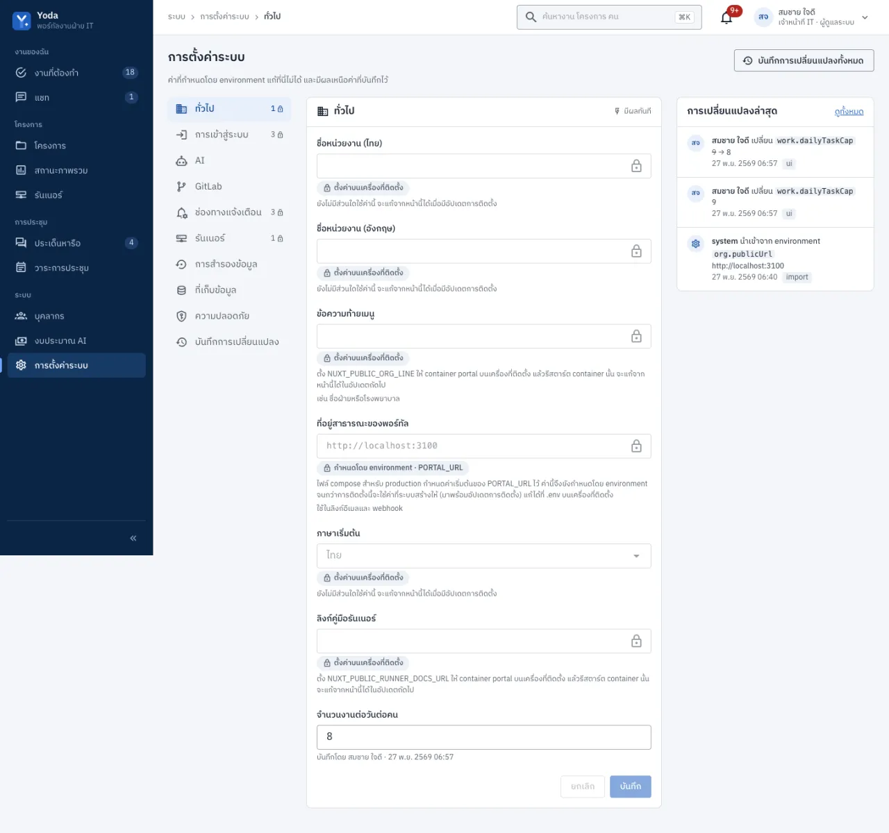

- Each card says when a change applies: *Applies at once*, *Reconnects automatically*, *Applies within a minute*
  or *Needs a restart* (then run `dc up -d --no-build` on the host).
- **Test** buttons (SMTP, LINE, Telegram, GitLab, AI, sign-in, storage, backups) try the values on the form,
  saved or not, and say what failed in plain words.
- **Save** writes the category; **Cancel** drops your edits. Leaving with unsaved edits asks first. If someone
  else saved the same setting meanwhile, the page says so and offers to reload their value.
- **Recent changes** (right) shows who changed what in this category; **Change log** shows everything.
- Sign-in settings that could lock everyone out (issuer, client, JWKS URL) are changed only from `/recovery`, after
  a test sign-in passes. The database and storage values are set at install and shown read-only.

### Secrets

API keys, tokens, passwords and webhook secrets are stored encrypted with the install's master key. After saving,
a secret shows only as **Set** with its last four characters; nobody can read it back, admins included.

- **Replace** types a new value; **Clear** removes it (saved on **Save**).
- **Generate** (webhook secrets) creates a random value and shows it once, with a copy button, so you can paste
  it into GitLab or Telegram.
- Some secrets are tied to an address: changing the SMTP server, the GitLab URL or the AI base URL clears the
  stored secret unless you type it again, so a key is never sent to a new address by mistake.

### Settings set by the environment

A value set in the host's `.env` wins over the database. Such a field shows a lock chip
**Set by environment · NAME** and cannot be edited here; focus the chip for how to change it.

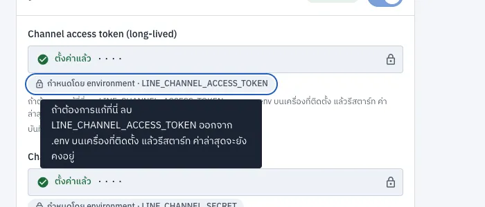

To manage it in the UI instead, delete the line from `.env` on the host and run `dc up -d --no-build`; the current
value is kept. An upgrade from an env-based install imports every value and shows them locked until you do this
([runbook, section 3](../operations.md#3-settings)).

### Signing in again before sensitive changes

Saving a secret, a sign-in setting or the public address needs a sign-in within the last 10 minutes. When yours is
older, Yoda asks you to **Sign in again**: Keycloak asks for your password, and you come back to the same page with
your edits restored. Secrets you typed are not kept across the round trip; the page asks you to type them again.

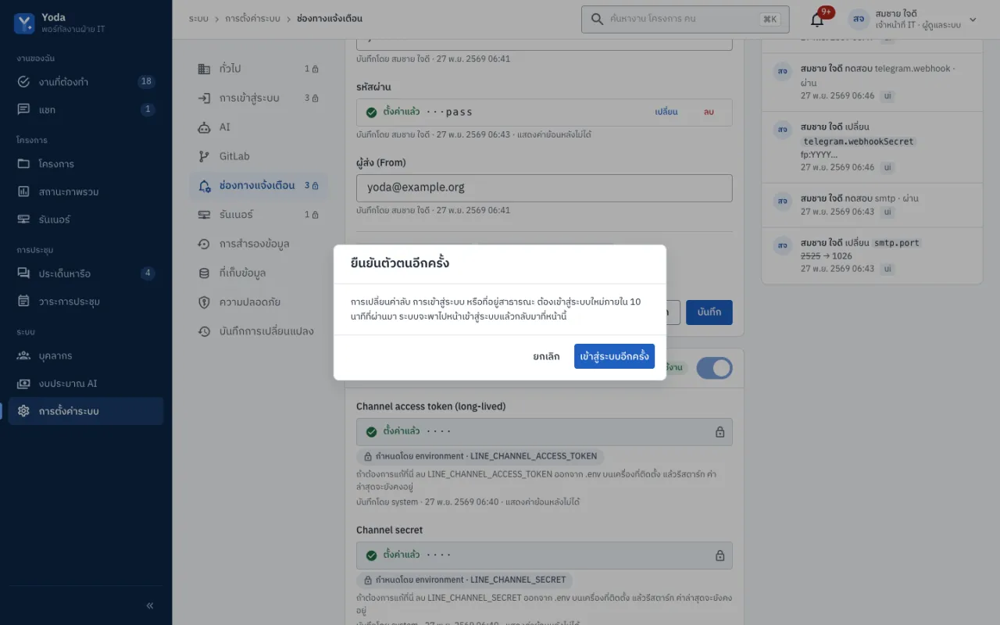

### Change log

**Change log** lists every change, test and import: who, when, from where (UI, CLI, environment import, the
system), the old and new value for plain settings, and only a short fingerprint for secrets. Filter by category or
setting.

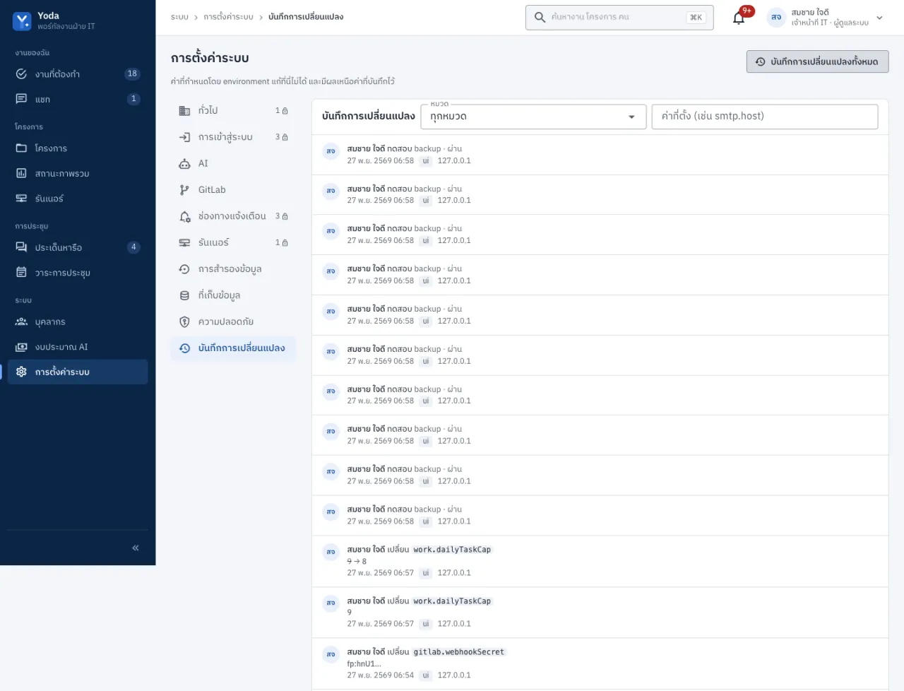

## AI providers and the AI budget

**System settings → AI** sets the providers and models:

- **Anthropic API key** and/or an **OpenAI-compatible API key** with its **base URL** (for example an internal
  gateway). Jobs whose provider has no key are unavailable; the portal says "AI is not configured" on such tasks.
- **Model for drafts** and **model for quick jobs**, as `provider:model` (defaults `anthropic:claude-opus-5-5`
  and `anthropic:claude-haiku-5-5`), the optional **embedding model** (empty: keyword search only) and the number
  of **concurrent AI jobs** (needs a restart).
- **Monthly budget (USD)** for the whole department; empty means no limit.

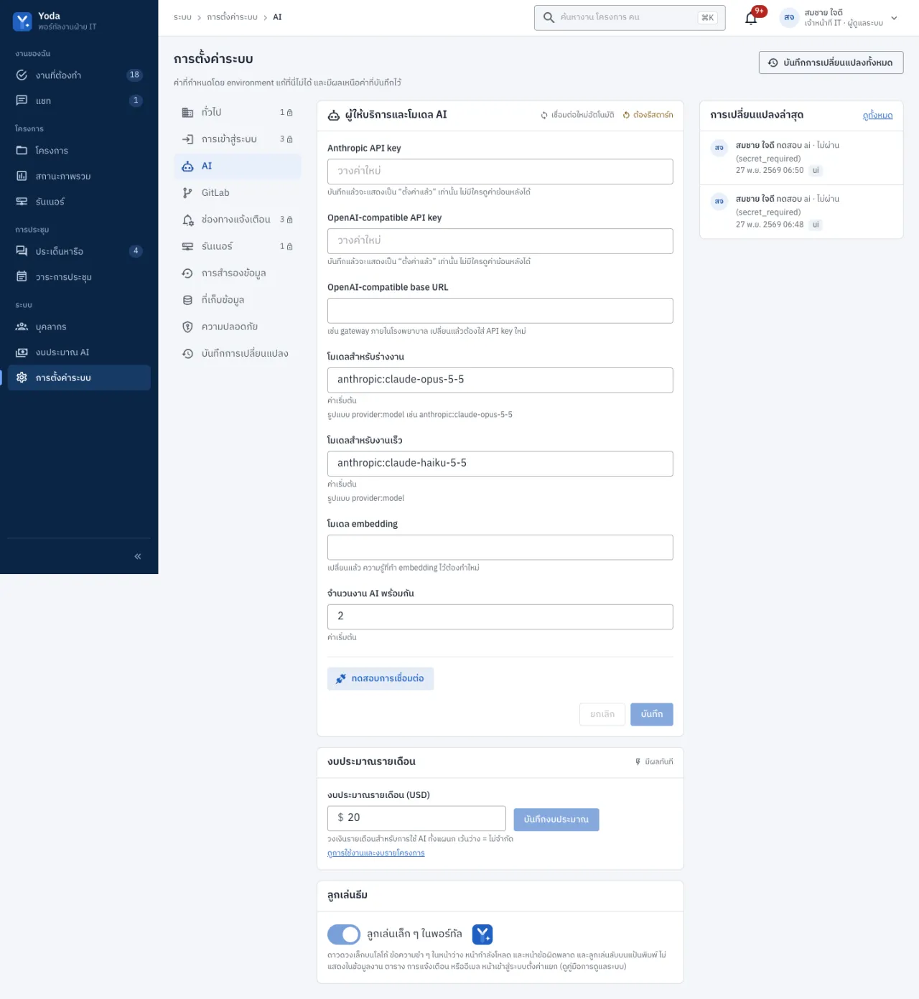

**System → AI budget** shows this month's spend against the department budget and per project.

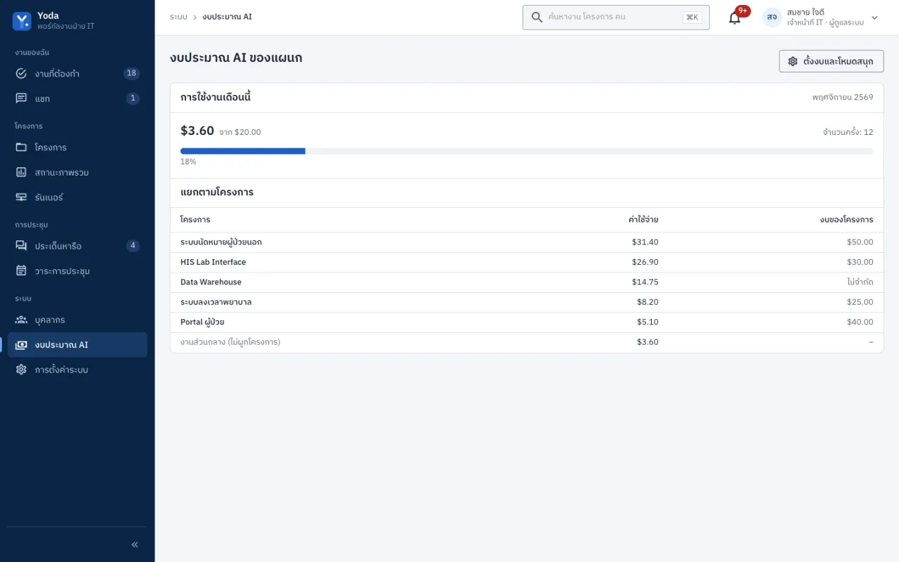

Each project's budget, or its "no AI" flag, is set by an admin on the project's **AI budget** tab. A project that uses
up its budget stops getting AI drafts until next month (people can still do the work), and the people who chose
**AI budget alerts** are notified. A model missing from the price list is refused for projects with a budget. Set
a spending limit in the provider's console as well.

## Notification channels: email, LINE, Telegram

**System settings → Notification channels** has one card per channel. Turn a channel on with its switch once its
test passes; people then link their own accounts in their notification settings.

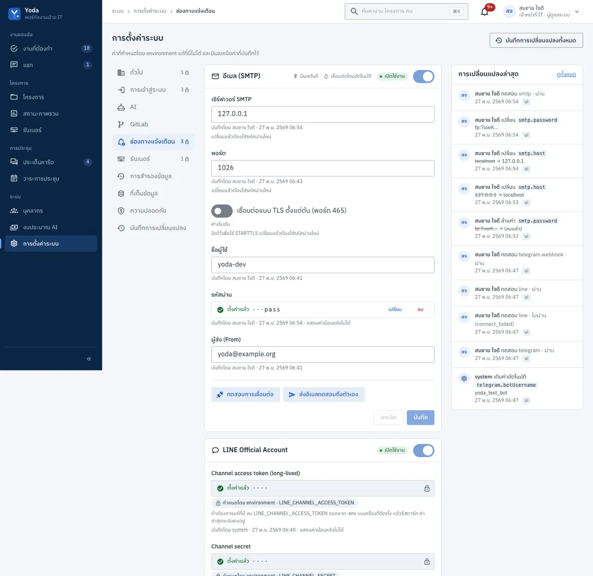

- **Email (SMTP)**: server, port, TLS, user, password and sender. **Test connection**, then **Send a test email to
  myself**.
- **LINE Official Account**: the channel access token and channel secret from LINE Developers, and the add-friend
  link shown to people when they link. Copy the **Webhook URL** into LINE Developers.
- **Telegram**: the bot token from BotFather (the bot's name fills in by itself) and a webhook secret
  (**Generate**). **Register webhook** points Telegram at Yoda; tick *Drop pending messages* to discard what
  queued while it was off.

Step-by-step provider setup is in the [runbook, section 9](../operations.md#9-email-line-and-telegram).

## GitLab

**System settings → GitLab** connects a GitLab bot account: the GitLab URL, the bot's personal access token (scope
`api`, at least Developer on every linked repository) and the webhook secret.

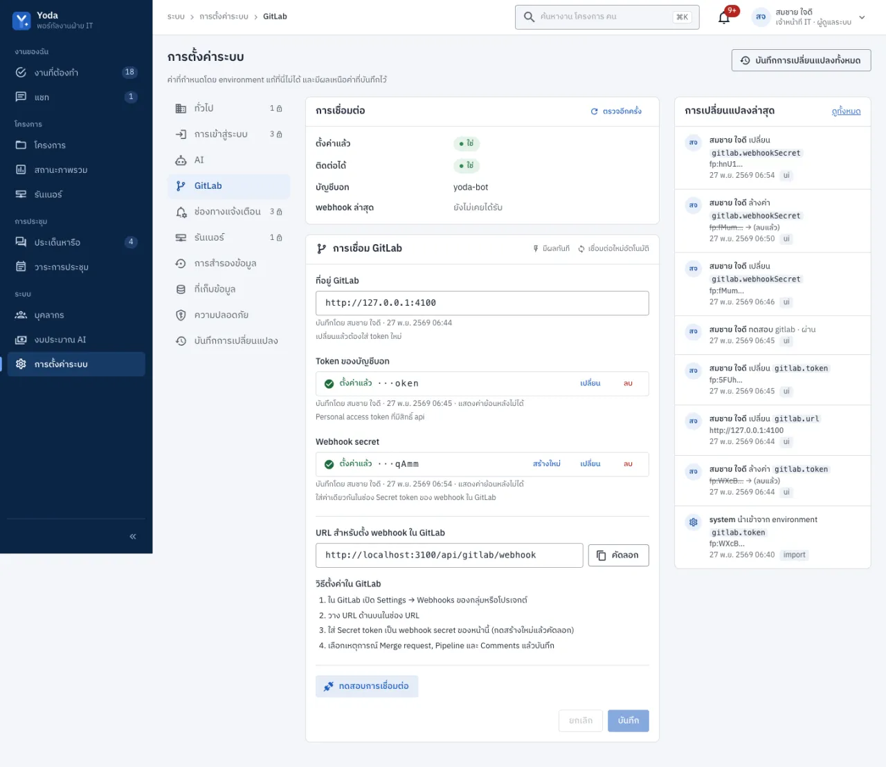

The **Connection** card shows whether GitLab is configured and reachable, the bot user and the last webhook
received. In GitLab, add a webhook on each linked project (or once on the group) with the **URL for the GitLab
webhook** shown here, the webhook secret as *Secret token*, and the **Merge request**, **Pipeline** and
**Comments** events. Projects link their repositories on their **Repository** tab. Details:
[runbook, section 7](../operations.md#7-gitlab-integration).

## Runners

**System settings → Runners** holds the runner lease time and the switch for core's MCP endpoint (which runners
use; needs a restart).

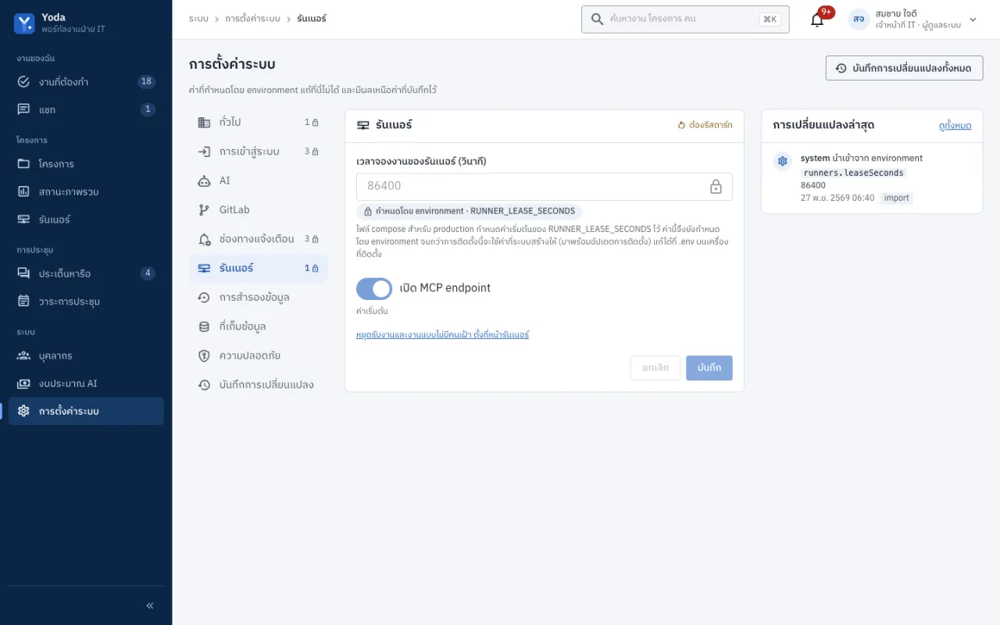

On the **Runners** page admins also see **All runners**, can create server runners for a chosen staff owner, and
can pause or revoke any runner. The admin section **Runner settings (admin)** there has **Pause all runners**
(no runner claims new tasks) and **Allow personal subscriptions unattended**: turn it on only after checking the provider's current terms.
Installing a runner: [development guide, Runners](../development.md#runners).

## Fun touches (the "Jedi" switch)

The portal has a few light, original touches that fit the name: a light-blade "Y" mark with a star, an extra line
on some empty pages and loading screens, and a hidden keyboard easter egg. They never appear in work data, tables,
notifications or email. They are on by default.

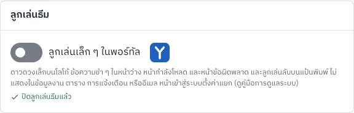

- **Portal:** **System settings → AI**, card **Fun touches**, switch **Playful touches in the portal**. The change
  applies at once for everyone.
- **Sign-in page:** Keycloak has its own switch: set `YODA_LOGIN_FUN_MODE=false` on the Keycloak server, or use
  the `yoda-plain` login theme ([runbook, section 2](../operations.md#login-theme-optional)).

What each touch is and why it is original: [jedi-touch.md](../design/jedi-touch.md).

## People and admins

**System → People** lists everyone who has signed in. Names and usernames come from Keycloak; here you edit only
skills, staff status and the admin right.

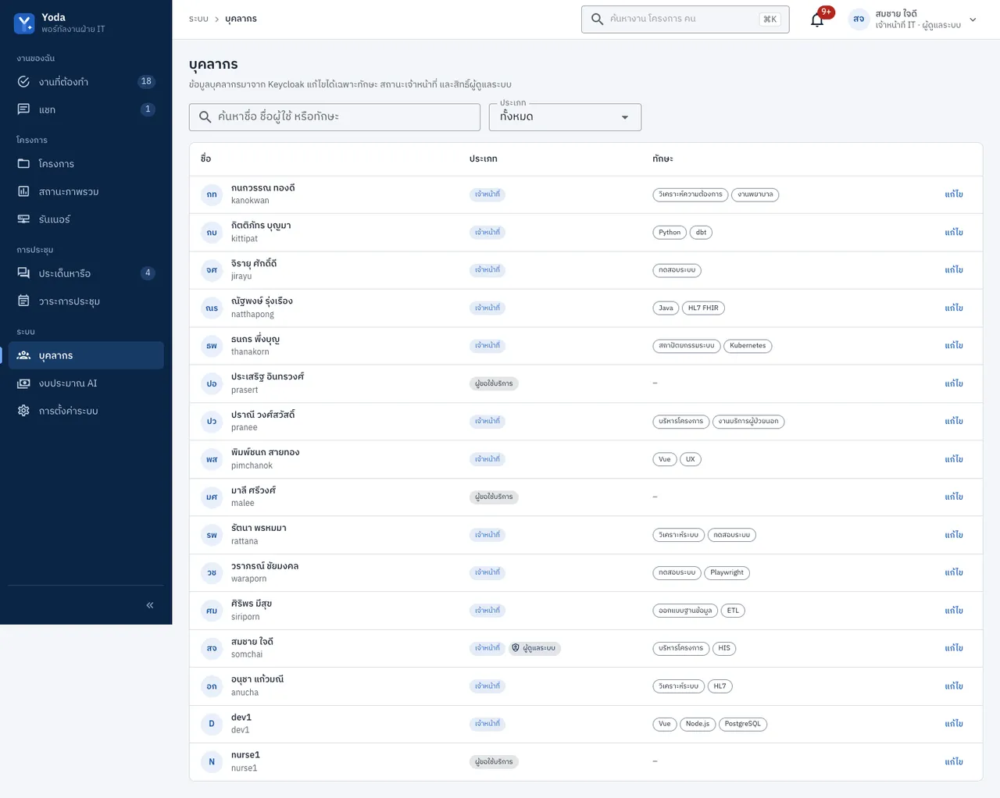

- **Skills** help the AI propose the right assignee.
- **Admin**: grant or remove the admin right. Keep at least two admins.
- Project membership and roles are set on each project's **Members & settings** tab (a project keeps at least
  one PM).

## Recovery overview

Yoda keeps a way in when Keycloak sign-in fails (a wrong issuer, Keycloak down, no admin left):

- The **break-glass account**, created in the setup wizard, signs in at `/recovery` with its password and an
  authenticator code (or a recovery code from the recovery kit). Every use notifies all admins and is logged.
- At `/recovery` it can stage, test and apply a new sign-in configuration (with a 7-day rollback), grant admin to a
  username, and manage its own password, authenticator and recovery codes. It cannot see any work data.
- The **recovery kit** (downloaded once at setup) holds the master key, the break-glass recovery codes and the
  bootstrap values. Keep it off the server and apart from the backups.
- On the host, `yoda-admin` covers the rest: a new setup token, a reset of the break-glass account, master key
  rotation, a new recovery kit and a maintenance lock-down.

How to use each of these: [install guide, recovery](install.md#recovery). Troubleshooting:
[runbook, section 11](../operations.md#11-troubleshooting).
