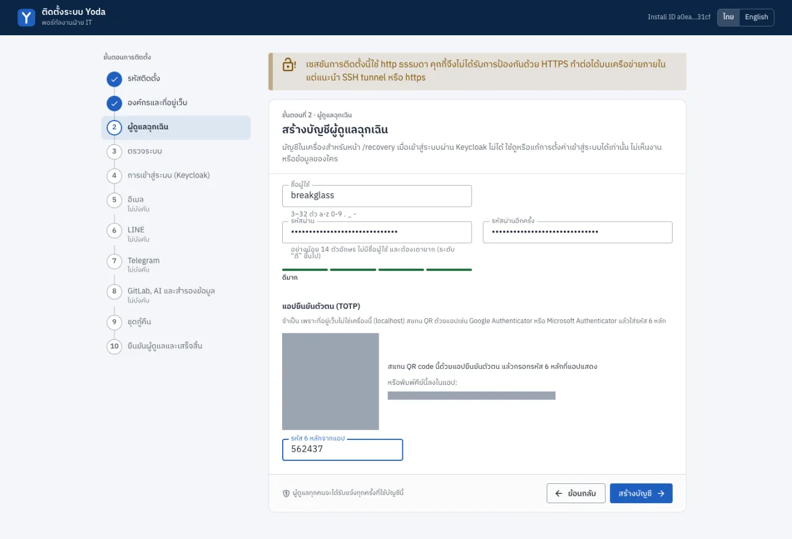
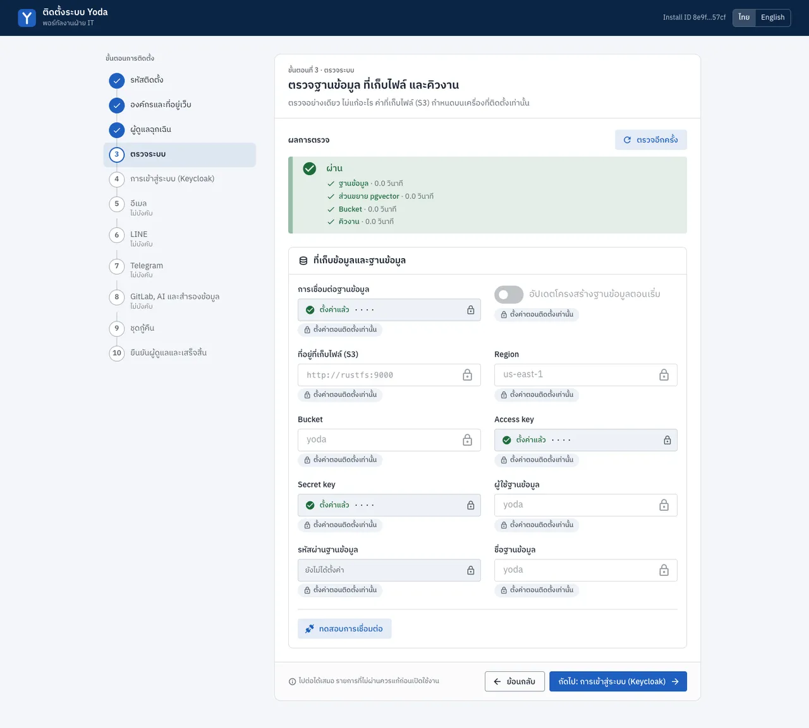
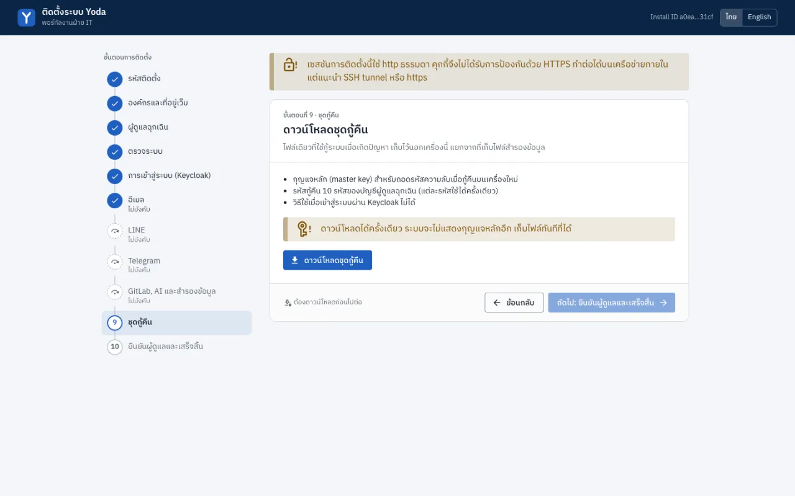
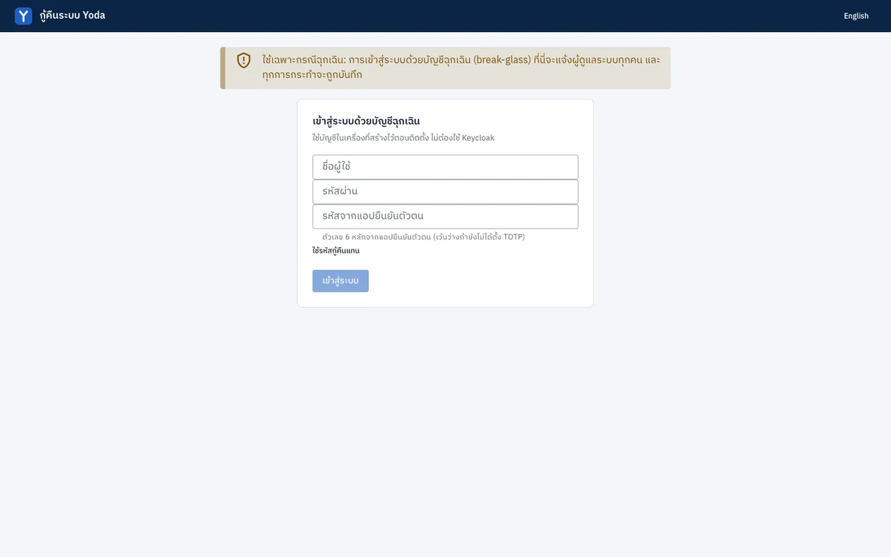

# Install and upgrade

[All guides](../README.md)

How to install Yoda on a server, finish the setup wizard, keep a way back in, and upgrade. This guide walks the
common path; every detail and edge case is in the [operations runbook](../operations.md). Hostnames here are
placeholders (`portal.example.org`, `sso.example.org`); use your own. Releases are published on
[GitHub Releases](https://github.com/tantee/yoda/releases), with the images on `ghcr.io/tantee/yoda`.

- [Before you start](#before-you-start)
- [1. Install the release](#1-install-the-release)
- [2. The setup wizard](#2-the-setup-wizard)
- [3. After setup](#3-after-setup)
- [Recovery](#recovery)
- [yoda-admin commands](#yoda-admin-commands)
- [Upgrading](#upgrading)
- [For maintainers](#for-maintainers)

## Before you start

- A Linux host with Docker Engine 24+, Docker Compose v2.24+ and about 10 GB free, and a deploy user who may run
  `docker` and owns the install directory (for example `/srv/yoda`).
- On that host: `minisign` (to check the release signature), `tar`, and `curl` or `wget`. `install.sh` stops and
  names any that are missing.
- A Keycloak realm with a client for the portal and a staff group
  ([runbook, section 2](../operations.md#2-keycloak)).
- HTTPS in front of the portal: a reverse proxy with a certificate (set `YODA_TRUSTED_PROXY_HOPS=2` in `.env`).
  The public URL must use `https://`. Plain `http://` is accepted only when the host is this machine: `localhost`
  or a `*.localhost` name, an address in `127.0.0.0/8`, or `::1`. Any other `http://` address (a LAN address or
  host name) is refused, because browsers allow the portal's Keycloak sign-in only over HTTPS or on localhost.
  When it refuses, the organisation step shows both ways forward: the SSH-tunnel command and how to put HTTPS in
  front. Until HTTPS is ready, run the wizard through an SSH tunnel (`ssh -L 3000:127.0.0.1:3000 <host>`, then open
  `http://127.0.0.1:3000/setup`).
- Optional: SMTP, a LINE Official Account, a Telegram bot, a GitLab bot account, AI provider keys. Each can be
  added later in System settings.

Every command below runs in the install directory. The runbook uses `dc` for the compose command with the right
files; define it once:

```bash
alias dc='docker compose --env-file .env --env-file release.env -f docker-compose.yml -f docker-compose.prod.yml'
```

## 1. Install the release

Download `install.sh` and the checksums of a pinned release from GitHub Releases, check the signature, then run
it. Never pipe a download into `sh`. Use the latest release from
[the releases page](https://github.com/tantee/yoda/releases); `1.0.0` below is an example.

```bash
curl -fsSLO https://github.com/tantee/yoda/releases/download/v1.0.0/install.sh
curl -fsSLO https://github.com/tantee/yoda/releases/download/v1.0.0/SHA256SUMS
curl -fsSLO https://github.com/tantee/yoda/releases/download/v1.0.0/SHA256SUMS.minisig
out=$(minisign -Vm SHA256SUMS -P RWSErktAr/A+x5Gvgr0x29wiu41FmYEVlJYoXyB6oJk4kvwQLOZs9O9j) &&
  printf '%s\n' "$out" | grep -Fx 'Trusted comment: yoda release 1.0.0' &&
  sha256sum --check --ignore-missing SHA256SUMS &&
  sh install.sh --version 1.0.0 --dir /srv/yoda
```

Each command runs only when the one before it passed: `minisign` checks the signature (`out=$(…) &&` keeps its
exit status), `grep` that the signed
trusted comment names this release (`Trusted comment: yoda release 1.0.0`; a different version means you
downloaded the wrong files), and `sha256sum` the checksum of `install.sh`. Nothing runs if any of them fails.
For another release, change the version in the URLs, the `grep` and `--version`.

The key after `-P` is the Yoda release key, minisign key id `C73EF0AF404BAE84`. It is also in
[`keys/yoda-release.pub`](../../keys/yoda-release.pub) and built into `install.sh`
([verifying releases](../releasing.md#verifying-releases)).

`install.sh` checks the prerequisites, downloads the **signed release bundle**, verifies its signature and checksum
(the release key is built into the script) and refuses on any mismatch. It refuses `latest` and an existing
install. It then unpacks the bundle (compose files, `deploy.sh`, `.env.example`, the runbook), creates an empty
`.env` (mode `600`) and runs the first deploy. The images come from `ghcr.io/tantee/yoda`, which is public: no
`docker login` is needed (if a pull fails because the packages are not public yet, `install.sh` offers
`docker login ghcr.io`). The deploy runs exactly the images the release was built with: their digests are in the
signed bundle (`bundle.env`), and `deploy.sh` pins them in `release.env`. The deploy fills the
**bootstrap volume** (generated database password, storage keys, master key and setup token), runs the database
migrations, starts everything and prints the setup address.

Options: `--base-url` (another file server), `--image-prefix` (another registry path), `--no-login`. **Internal
mirror:** a host that cannot reach GitHub installs from a copy inside the network with
`--base-url 'https://files.example.org/yoda/releases/{version}/' --image-prefix registry.example.org/group/yoda`
(a registry mirror of the images; `install.sh` asks for a `docker login` to it), see
[releasing, internal mirror](../releasing.md#internal-mirror). Nothing is required in `.env` for a standard install. To use an external Postgres or S3, or to fix settings from outside the
UI, see the runbook ([section 4, "Advanced"](../operations.md#4-first-install)).

## 2. The setup wizard

Open `https://portal.example.org/setup`. The wizard is in Thai by default; switch to English at the top right.

**Setup token.** Paste the token printed on the host:

```bash
dc exec core yoda-admin setup-token
```

It is valid for 24 hours, single use, and also appears in `dc logs core`. The page allows five wrong tries per 15
minutes.


**Step 1 · Organisation.** The organisation name (Thai, optional English), a line under the menu, the default
language and the **public URL** of the portal. Check the detected URL: it is used in links, emails and the Keycloak
redirect.


**Step 2 · Break-glass admin.** A local account for `/recovery`, used only when Keycloak sign-in fails. Choose a
username and a strong password (14+ characters), scan the QR code with an authenticator app and enter its code
(the authenticator is optional only when both the public URL and the address in your browser are `localhost`).



**Step 3 · System check.** Checks the database, the pgvector extension, the file storage bucket and the job queue.
The storage and database values are set on the host and shown read-only.



**Step 4 · Sign-in (Keycloak).** The issuer URL, client ID, optional internal JWKS URL and the staff group. Copy
the redirect URIs and web origin shown into the Keycloak client, then **Test connection**: the wizard checks
discovery, the keys and the client before it lets you on.


**Steps 5–8 (optional).** Email (SMTP), LINE, Telegram, then GitLab, AI and backups. Each has a test button and can
be skipped and set later in **System settings**.

**Step 9 · Recovery kit.** Download the kit: one text file, `yoda-recovery-kit-<install id>.txt`, with the master
key, the break-glass username and its ten recovery codes, the bootstrap values (database password, storage keys) and
how to use them. **It is shown once.** Print it or put it in the organisation's password vault, off this server and
apart from the backups: anyone with the kit and a database backup can read every secret. Setup continues only once
you confirm you stored it.



**Step 10 · Claim admin.** Sign in through Keycloak with your own account; you become the first administrator.
The wizard checks the whole sign-in round trip and that you are in the staff group. **Finish setup** closes the
wizard for good.


Through an SSH tunnel the wizard sees `http://127.0.0.1:3000` as the public URL: enter the real one in step 1, and
do the claim on the public URL (`dc exec core yoda-admin setup-token --new` gives a new token there; finished steps
are kept). See the [runbook, section 4](../operations.md#4-first-install).

## 3. After setup

- [ ] Set the AI budgets (**System settings → AI**, and each project's **AI budget** tab).
- [ ] Connect GitLab and its webhooks, and set up runners ([admin guide](admin.md)).
- [ ] Turn on the notification channels you configured.
- [ ] Copy the `backups` volume off the host on a schedule, and try a restore
      ([runbook, section 6](../operations.md#6-backups-and-restore)).
- [ ] Alert on the `core`, `portal` and `backup` containers turning unhealthy.

## Recovery

**Locked out of Keycloak** (wrong issuer or client, Keycloak down, no admin left): open
`https://portal.example.org/recovery` and sign in with the break-glass account (password plus an authenticator code,
or **Use a recovery code instead**, from the kit). Every sign-in notifies all admins.



The recovery page shows the install state and lets you:

- **Sign-in (Keycloak)**: stage a new issuer, client or JWKS URL, test a real sign-in with it, then apply it. The
  previous values can be restored for 7 days.
- **Portal admins**: grant admin to a username (a username that has never signed in gets it at the first sign-in),
  or revoke it.
- **Break-glass account**: change the password, enrol a new authenticator, make new recovery codes.


Lost the break-glass password or authenticator: `dc exec core yoda-admin reset-break-glass` prints a temporary
password; the next sign-in sets a new password and authenticator. If the master key is wrong or missing, core starts
in recovery mode and `/recovery` offers a status-only view until the key is back
([runbook, section 11](../operations.md#11-troubleshooting)).

## yoda-admin commands

Run them on the host as `dc exec core yoda-admin <command>`. Redirect commands that print a recovery kit to a
private file: `(umask 077; dc exec -T core yoda-admin recovery-kit > yoda-recovery-kit.txt)`.

| Command | What it does |
| --- | --- |
| `setup-token [--new]` | Prints the setup token (a new one with `--new`) while setup is not finished |
| `status` | Setup state, master key, break-glass account and sign-in state |
| `create-break-glass [--username <u>]` | Creates the break-glass account on an install set up without the wizard; prints a temporary password once |
| `reset-break-glass [--username <u>]` | New temporary break-glass password; the authenticator is enrolled again after sign-in |
| `recovery-kit` | A new recovery kit on standard output; makes new recovery codes (the old ones stop working) |
| `rotate-master-key [--dry-run]` | New master key; the new recovery kit goes to standard output. Then `rotate-master-key --finish` once every core runs on it |
| `reset-master-key --yes` | The master key is lost for good: drops the secrets it cannot open, so they can be entered again |
| `recovery on` / `recovery off` | Forces maintenance mode: the portal shows only `/recovery` |

Rotation and lost keys in detail: [runbook, section 10](../operations.md#10-rotating-secrets).

## Upgrading

1. Read `CHANGELOG.md` for the release. The deploy never changes `.env`; add any new variable yourself (most new
   options are System settings now).
2. Take a backup: `dc run --rm backup --now`.
3. Get the new release's files and deploy it. On the host, in the install directory (`1.1.0` stands for the new
   version):

   ```bash
   curl -fsSLO https://github.com/tantee/yoda/releases/download/v1.1.0/yoda-1.1.0.tar.gz
   curl -fsSLO https://github.com/tantee/yoda/releases/download/v1.1.0/SHA256SUMS
   curl -fsSLO https://github.com/tantee/yoda/releases/download/v1.1.0/SHA256SUMS.minisig
   out=$(minisign -Vm SHA256SUMS -P RWSErktAr/A+x5Gvgr0x29wiu41FmYEVlJYoXyB6oJk4kvwQLOZs9O9j) &&
     printf '%s\n' "$out" | grep -Fx 'Trusted comment: yoda release 1.1.0' &&
     sha256sum --check --ignore-missing SHA256SUMS &&
     tar -xzf yoda-1.1.0.tar.gz --no-same-owner &&
     rm yoda-1.1.0.tar.gz SHA256SUMS SHA256SUMS.minisig &&
     YODA_VERSION=1.1.0 sh ops/deploy/deploy.sh
   ```

   As at install, each command runs only when the one before it passed, and the `grep` checks that the
   signature is for `1.1.0`. The bundle never holds `.env` or `release.env`, so unpacking it only replaces the compose files, `deploy.sh`
   and the runbook files. An internal GitLab mirror's **deploy** job does the same in one step. The deploy pulls
   the images, pins the version and the bundle's image digests in `release.env`, updates the bootstrap volume, runs the migrations (a failed
   migration stops before anything is replaced), starts the new containers and waits until the portal answers.
4. Check the portal. To roll back, deploy the previous version the same way: download, check and unpack its
   bundle, then deploy it ([runbook, rollback](../operations.md#5-upgrade-and-rollback)).

**From an env-based install** (one with a full `.env`, from before the setup wizard): upgrade the same way.
The `init` step copies the database password, storage keys and master key from `.env` into the bootstrap volume; core
imports the other values into System settings and marks setup done. Those values show **Set by environment** until
you delete their lines from `.env`. Then create the break-glass account, which such an install does not have yet:

```bash
dc exec core yoda-admin create-break-glass       # prints a temporary password once
# sign in at /recovery, set a new password, enrol the authenticator
(umask 077; dc exec -T core yoda-admin recovery-kit > yoda-recovery-kit.txt)   # store it off the host
```

Full upgrade and rollback notes: [runbook, section 5](../operations.md#5-upgrade-and-rollback).

## For maintainers

Releases are cut by pushing a `v<version>` tag; `.github/workflows/release.yml` builds the images, signs the
bundle and publishes the GitHub Release. The signing key, the repository secrets, the package visibility and the
release checklist are in [Releasing Yoda](../releasing.md).
