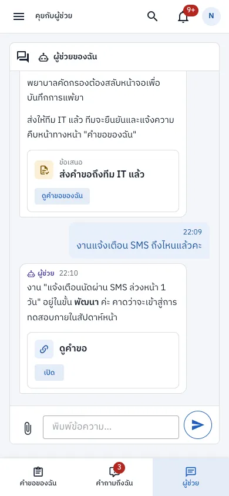
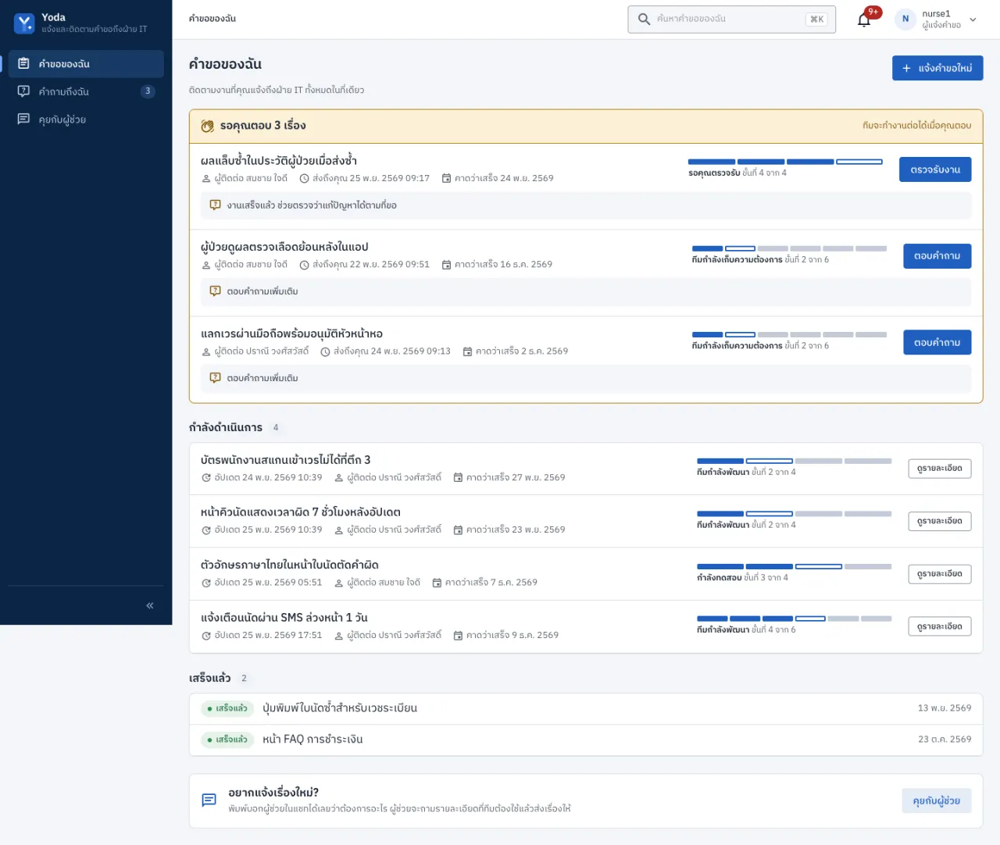
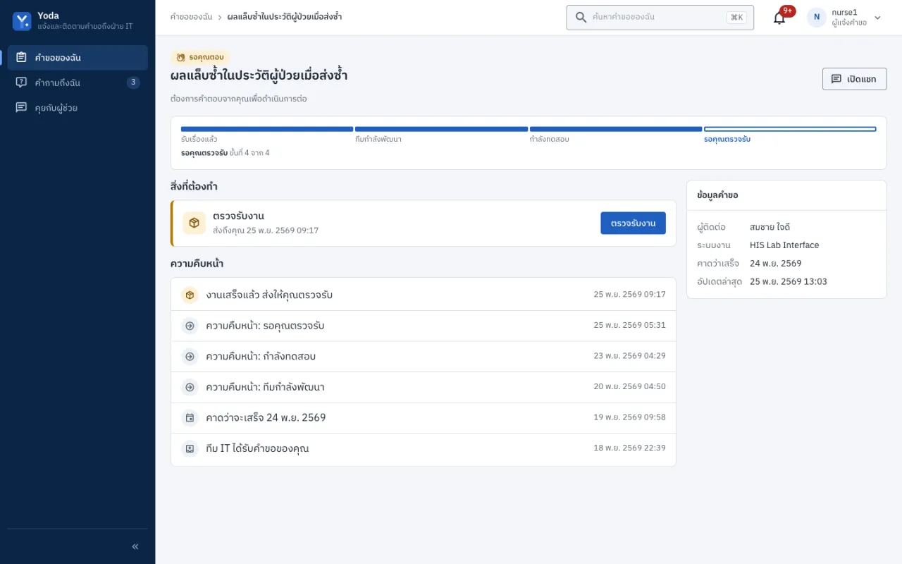
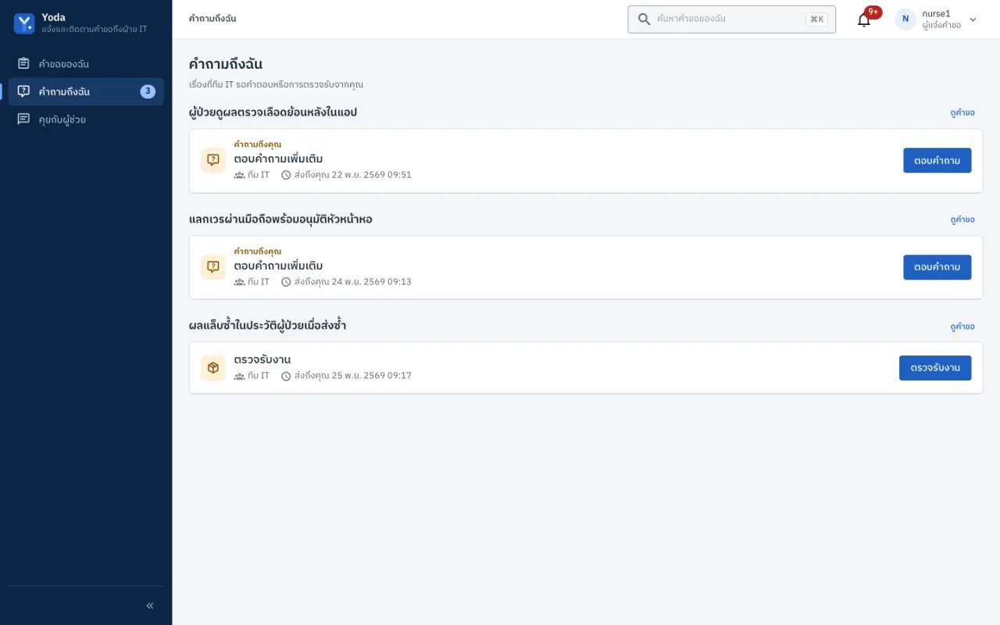
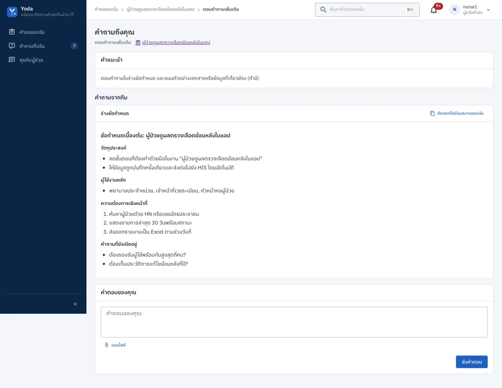
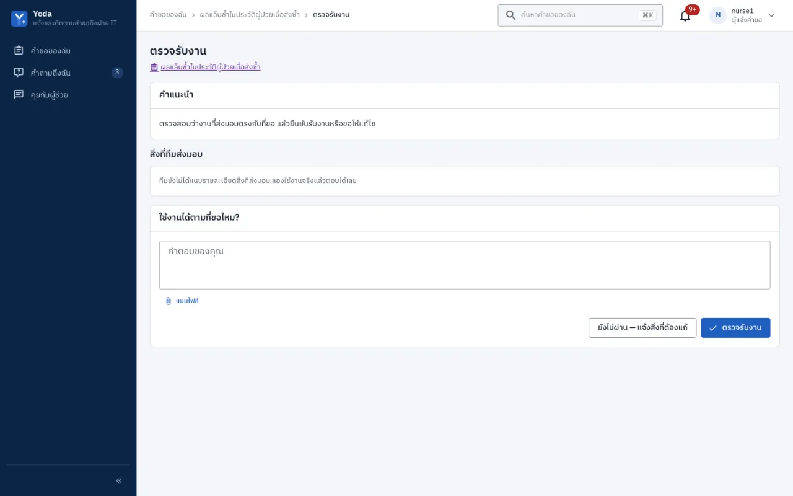

# Requester guide

[ภาษาไทย](requester.th.md) · [All guides](../README.md)

This guide is for people outside the IT team who ask IT for work: a new report, a change to a screen, a fix.
You tell the assistant what you need, answer the team's questions, and accept the result when it is done.

- [Signing in](#signing-in)
- [Ask for something new](#ask-for-something-new)
- [My requests](#my-requests)
- [Answer a question](#answer-a-question)
- [Accept the delivery](#accept-the-delivery)
- [Notifications](#notifications)

## Signing in

Open the portal and sign in with your organisation account. You see three pages in the menu (on a phone, at the
bottom of the screen):

- **My requests**: everything you asked IT for, in one place
- **Questions for me**: what the IT team is waiting for you to answer or accept
- **Chat with the assistant**: your conversation with Yoda's AI assistant

You only ever see your own requests. Switch between Thai and English from the user menu (top right).

## Ask for something new

Press **New request** on **My requests**, or open **Chat with the assistant**, and describe what you need in your
own words, for example: "Nurses at the screening desk have to switch screens to record allergies. Can the screening
page have an allergy field?"

- The assistant asks follow-up questions until the team has what it needs, then sends the request to the IT
  team. A card confirms it: **Request sent to the IT team**, with a link to the request.
- Attach a screenshot, a sample form or a file with the paper clip.
- Ask the assistant at any time how a request is going: "Where is the SMS reminder?"

## My requests

**My requests** lists your requests in three groups.

- **Waiting for you** (at the top, highlighted): the team cannot continue until you act. Press **Answer** or
  **Accept delivery**.
- **In progress**: what the team is working on, with the current step, your contact in the IT team and the
  expected date.
- **Finished**: completed requests.

Open a request to see its progress bar, what you need to do, the full history and the contact person.
**Open chat** talks to the assistant about this request.

The steps you see are: *Received*, *The team is gathering requirements*, *The team is designing*, *The team is
building it*, *Testing*, and *Waiting for you to accept*. Not every request goes through all of them.

## Answer a question

When the team needs more information, the question shows on **Questions for me** (with a count in the menu), on
the request, and as a notification.

Press **Answer**. The page shows the team's question, often a draft of the requirements with the open points
listed at the end. Type your answer, attach files if they help (a sample report, a form, a screenshot) and press
**Send answer**.

Tip: **Copy into my result** copies the team's draft into your answer so you can reply point by point.

## Accept the delivery

When the work is done, the team sends it to you to check. Try it out the way you would use it, then open the
request and press **Accept delivery**.

- If it works the way you asked, press **Accept delivery**. The request is
  then complete.
- If something is not right, press **Not yet — tell us what to fix**, describe what needs fixing and press
  **Send to the team**. The request goes back to the team with your notes.

## Notifications

The bell at the top shows updates on your requests and new questions. To also get them by email, LINE or
Telegram, open the bell menu → **Notification settings**, link the channel (for LINE: add Yoda's LINE Official
Account as a friend and send it the code shown) and tick the kinds you want. Channels appear only once your IT
team has turned them on.
