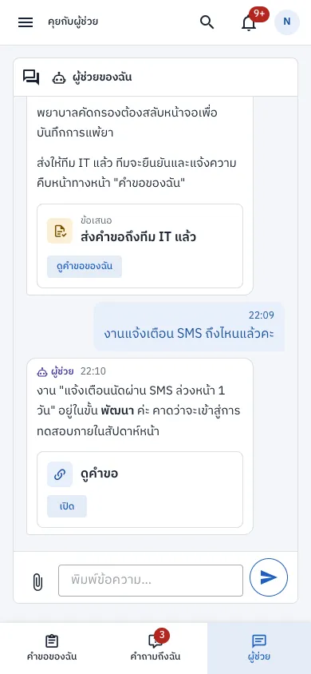
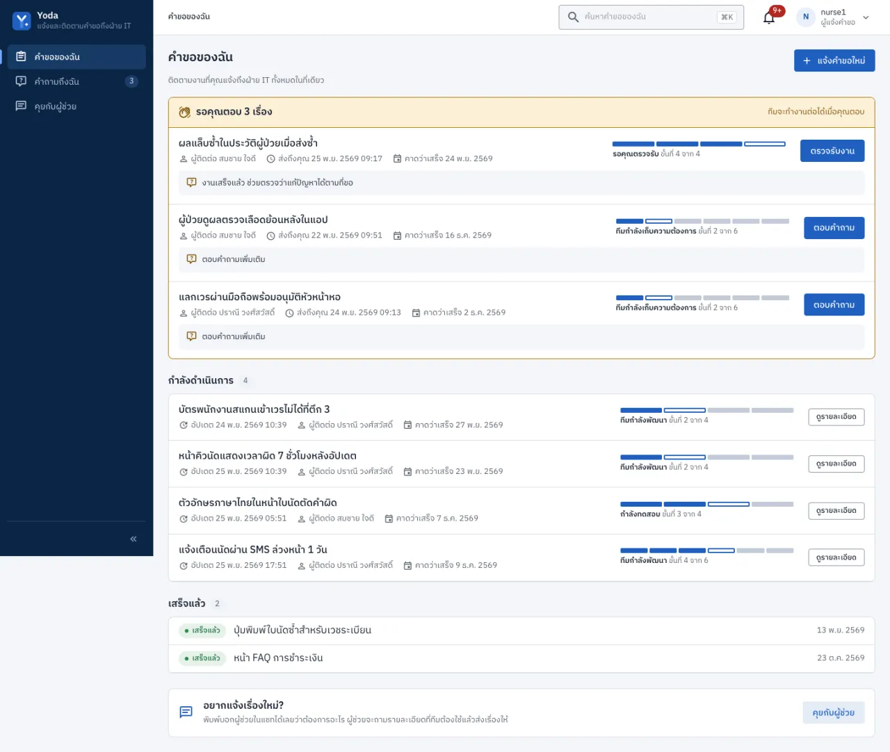
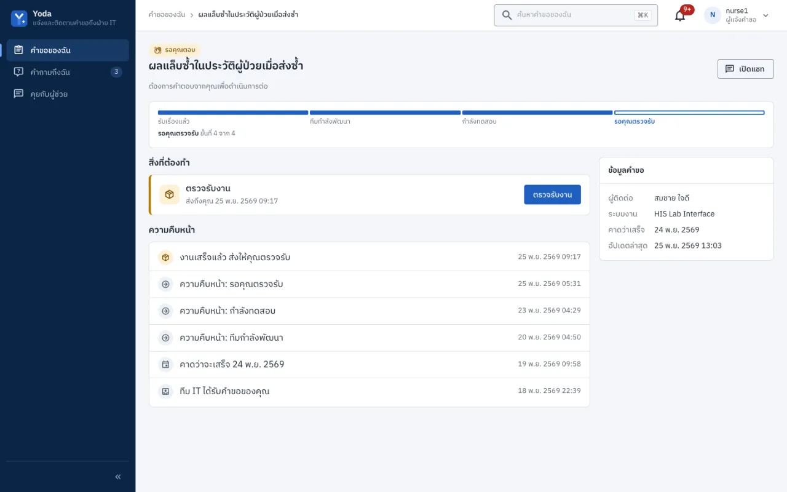
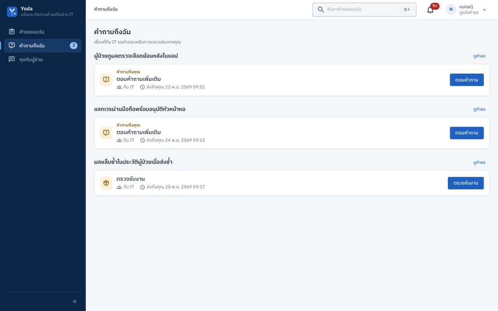
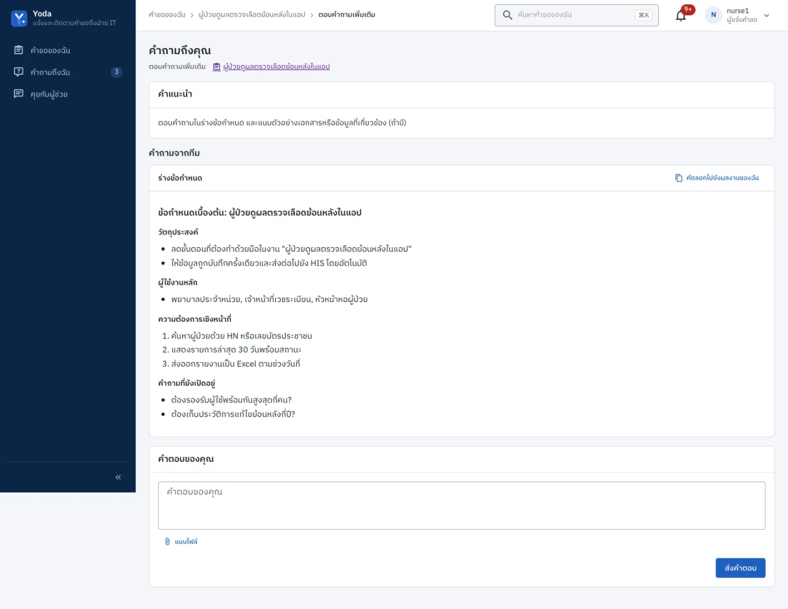
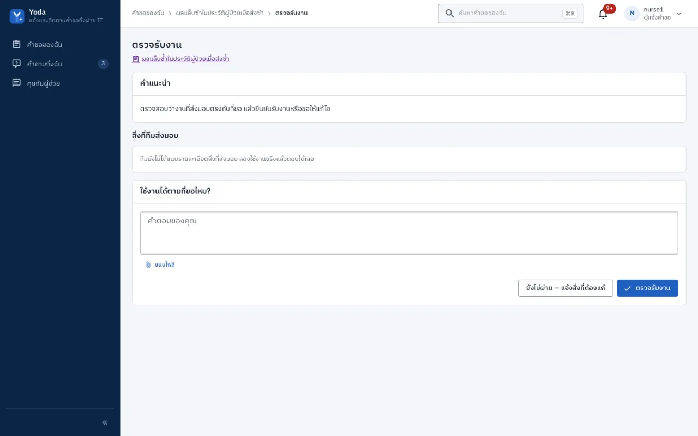

# คู่มือสำหรับผู้แจ้งคำขอ

[English](requester.md) · [คู่มือทั้งหมด](../README.md)

คู่มือนี้สำหรับผู้ใช้นอกฝ่าย IT ที่ต้องการให้ฝ่าย IT ช่วยทำงาน เช่น รายงานใหม่ ปรับหน้าจอ หรือแก้ปัญหา
คุณเพียงเล่าให้ผู้ช่วยฟังว่าต้องการอะไร ตอบคำถามของทีม และตรวจรับงานเมื่อทำเสร็จ

- [การเข้าสู่ระบบ](#การเข้าสู่ระบบ)
- [แจ้งคำขอใหม่](#แจ้งคำขอใหม่)
- [คำขอของฉัน](#คำขอของฉัน)
- [ตอบคำถามจากทีม](#ตอบคำถามจากทีม)
- [ตรวจรับงาน](#ตรวจรับงาน)
- [การแจ้งเตือน](#การแจ้งเตือน)

## การเข้าสู่ระบบ

เปิดพอร์ทัลแล้วเข้าสู่ระบบด้วยบัญชีขององค์กร ในเมนูจะมีสามหน้า (บนมือถือ เมนูอยู่ด้านล่างของจอ)

- **คำขอของฉัน**: ทุกเรื่องที่คุณแจ้งถึงฝ่าย IT รวมไว้ในที่เดียว
- **คำถามถึงฉัน**: เรื่องที่ทีม IT รอคำตอบหรือรอให้คุณตรวจรับ
- **คุยกับผู้ช่วย**: ห้องแชทของคุณกับผู้ช่วย AI ของ Yoda

คุณจะเห็นเฉพาะคำขอของตัวเองเท่านั้น เปลี่ยนภาษาไทยหรืออังกฤษได้ที่เมนูผู้ใช้มุมขวาบน

## แจ้งคำขอใหม่

กด **แจ้งคำขอใหม่** ที่หน้าคำขอของฉัน หรือเปิด **คุยกับผู้ช่วย** แล้วเล่าสิ่งที่ต้องการด้วยภาษาของคุณเอง เช่น
"พยาบาลคัดกรองต้องสลับหน้าจอเพื่อบันทึกการแพ้ยา อยากให้หน้าคัดกรองมีช่องบันทึกการแพ้ยาได้ไหม"

- ผู้ช่วยจะถามรายละเอียดเพิ่มจนได้ข้อมูลที่ทีมต้องใช้ แล้วส่งคำขอถึงทีม IT
  จากนั้นจะมีการ์ด **ส่งคำขอถึงทีม IT แล้ว** พร้อมลิงก์ไปยังคำขอ
- แนบภาพหน้าจอ ตัวอย่างแบบฟอร์ม หรือไฟล์อื่นได้ด้วยปุ่มคลิปหนีบกระดาษ
- ถามผู้ช่วยได้ทุกเมื่อว่าคำขอไปถึงไหนแล้ว เช่น "งานแจ้งเตือน SMS ถึงไหนแล้ว"

## คำขอของฉัน

หน้า **คำขอของฉัน** แบ่งคำขอเป็นสามกลุ่ม

- **รอคุณตอบ** (ด้านบน มีกรอบเน้น): ทีมทำงานต่อไม่ได้จนกว่าคุณจะดำเนินการ กด **ตอบคำถาม**
  หรือ **ตรวจรับงาน**
- **กำลังดำเนินการ**: เรื่องที่ทีมกำลังทำ พร้อมขั้นตอนปัจจุบัน ผู้ติดต่อในทีม IT และวันที่คาดว่าจะเสร็จ
- **เสร็จแล้ว**: คำขอที่เสร็จสมบูรณ์

เปิดคำขอเพื่อดูแถบความคืบหน้า สิ่งที่คุณต้องทำ ประวัติทั้งหมด และผู้ติดต่อ
ปุ่ม **เปิดแชท** ใช้คุยกับผู้ช่วยเกี่ยวกับคำขอนี้

ขั้นตอนที่คุณจะเห็นคือ *รับเรื่องแล้ว*, *ทีมกำลังเก็บความต้องการ*, *ทีมกำลังออกแบบ*, *ทีมกำลังพัฒนา*,
*กำลังทดสอบ* และ *รอคุณตรวจรับ* คำขอบางเรื่องอาจไม่ผ่านครบทุกขั้นตอน

## ตอบคำถามจากทีม

เมื่อทีมต้องการข้อมูลเพิ่ม คำถามจะขึ้นที่หน้า **คำถามถึงฉัน** (มีตัวเลขที่เมนู) ที่หน้าคำขอ
และในการแจ้งเตือน

กด **ตอบคำถาม** หน้าจอจะแสดงคำถามจากทีม ซึ่งมักเป็นร่างข้อกำหนดที่มีคำถามที่ยังเปิดอยู่ไว้ท้ายเอกสาร
พิมพ์คำตอบ แนบไฟล์ถ้ามีประโยชน์ (เช่น ตัวอย่างรายงาน แบบฟอร์ม หรือภาพหน้าจอ) แล้วกด **ส่งคำตอบ**

เคล็ดลับ: ปุ่ม **คัดลอกไปยังผลงานของฉัน** จะคัดลอกร่างของทีมมาไว้ในช่องคำตอบ เพื่อให้ตอบทีละข้อได้สะดวก

## ตรวจรับงาน

เมื่องานเสร็จ ทีมจะส่งงานให้คุณตรวจ ลองใช้งานจริงแบบที่คุณใช้ทุกวัน แล้วเปิดคำขอและกด **ตรวจรับงาน**

- ถ้าใช้งานได้ตามที่ขอ กด **ตรวจรับงาน** คำขอจะเสร็จสมบูรณ์
- ถ้ายังมีจุดที่ไม่ถูกต้อง กด **ยังไม่ผ่าน — แจ้งสิ่งที่ต้องแก้** อธิบายสิ่งที่ต้องแก้ แล้วกด
  **ส่งให้ทีมแก้ไข** คำขอจะกลับไปที่ทีมพร้อมข้อความของคุณ

## การแจ้งเตือน

กระดิ่งด้านบนแสดงความคืบหน้าของคำขอและคำถามใหม่ ถ้าต้องการรับทางอีเมล LINE หรือ Telegram ด้วย
ให้เปิดเมนูกระดิ่ง แล้วเลือก **ตั้งค่าการแจ้งเตือน** เชื่อมบัญชีของช่องทางนั้น (สำหรับ LINE ให้เพิ่ม
LINE Official Account ของ Yoda เป็นเพื่อน แล้วส่งรหัสที่แสดงบนหน้าจอ) และเลือกประเภทที่ต้องการ
ช่องทางจะแสดงเมื่อทีม IT เปิดใช้งานแล้วเท่านั้น
