# Staff guide

[ภาษาไทย](staff.th.md) · [All guides](../README.md)

This guide is for IT staff who work in Yoda every day: analysts, designers, developers, testers and project
managers. In Yoda, AI writes the first draft of each step and you review, correct, approve and decide.

- [Signing in and finding your way](#signing-in-and-finding-your-way)
- [To-do](#to-do)
- [Tasks: review an AI draft, approve, submit](#tasks-review-an-ai-draft-approve-submit)
- [Work items and projects](#work-items-and-projects)
- [Chat and the AI secretary](#chat-and-the-ai-secretary)
- [Discussions and meeting agendas](#discussions-and-meeting-agendas)
- [Overall status](#overall-status)
- [Notification settings](#notification-settings)
- [Runners](#runners)

## Signing in and finding your way

Open the portal and sign in with your organisation account (Keycloak). The sign-in page and the portal are in
Thai by default; switch to English on the sign-in page or from the user menu (top right).

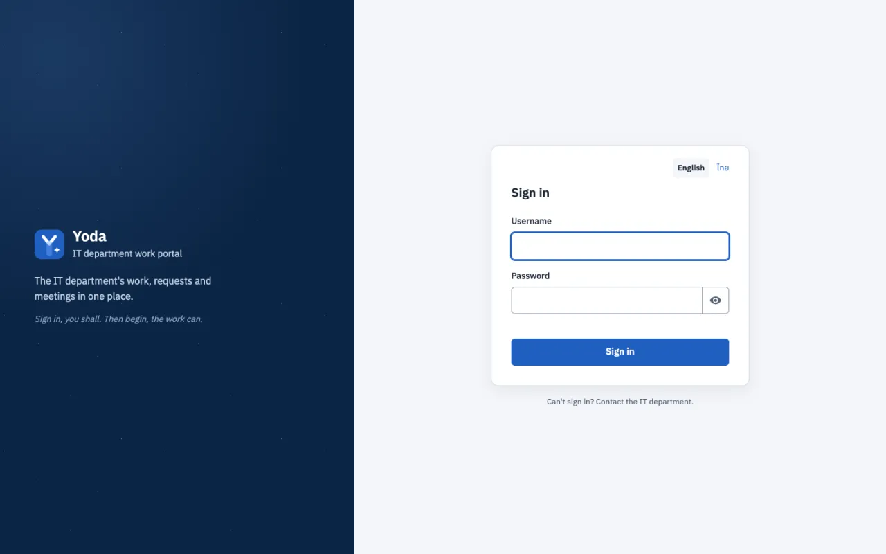

The side menu groups the pages:

| Group | Pages |
| --- | --- |
| My work | **To-do**, **Chat** |
| Projects | **Projects**, **Overall status**, **Runners** |
| Meetings | **Discussions**, **Meeting agendas** |
| System (admins only) | **People**, **AI budget**, **System settings** |

The search box at the top (<kbd>Ctrl</kbd>/<kbd>⌘</kbd> + <kbd>K</kbd>) finds work items, projects and people.
The bell shows your notifications; its menu links to your notification settings.

## To-do

**To-do** is your start page. It lists everything waiting for you, and updates by itself.

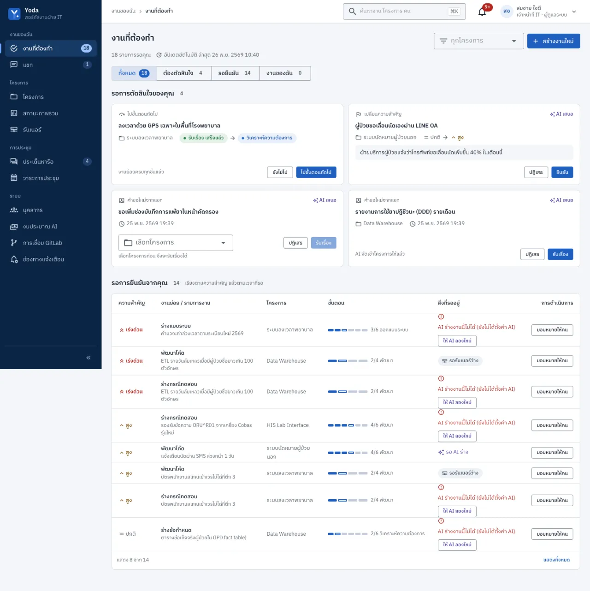

- **Waiting for your decision** holds proposals from the AI secretary, each with its reason:
  - *Move to the next step*: every task of the current step is done. Choose **Move to next step** or **Not yet**.
  - *Priority change*: the AI suggests a new priority. **Confirm** or **Reject**.
  - *New request from chat*: a request the secretary gathered in chat. Choose the project (if the AI has not
    picked one) and press **Accept request**, or **Reject** with a reason.
- **Waiting for your confirmation** lists tasks that need a person, sorted by priority and then by waiting time.
  The *Waiting for* column says why: an AI draft that failed (press **Retry AI**), a task waiting for a runner, or
  a proposed assignee. **Assign a person** hands the task to someone; the dialog shows each person's open load.
- The tabs filter the list: **All**, **Decisions**, **To confirm** and **My tasks** (tasks assigned to you).
- **New work item** creates a work item in a project by hand.

## Tasks: review an AI draft, approve, submit

Open a task from the to-do list. A task shows its **Instructions**, the results **From previous steps** and, on
the right, the work item, owner, requester and due date.

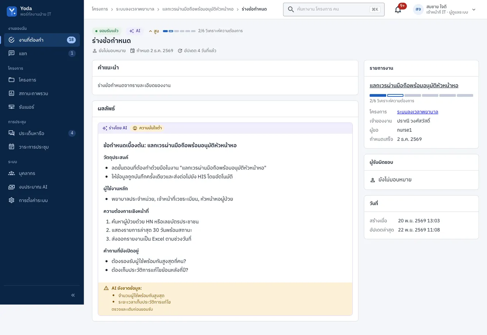

- **AI draft**: the AI's first version, marked "Drafted by AI". When the AI lacks information it says so in a
  yellow box (with a confidence note). Check those points before you accept.
- **Your work**: press **Copy into my result** to start from the draft, edit it, attach files if needed and
  **Submit**.
- **Approval** and **review** tasks show the previous step's result. **Approve** it, or **Request changes…** with
  what needs to change; the task goes back to its assignee with your comment.

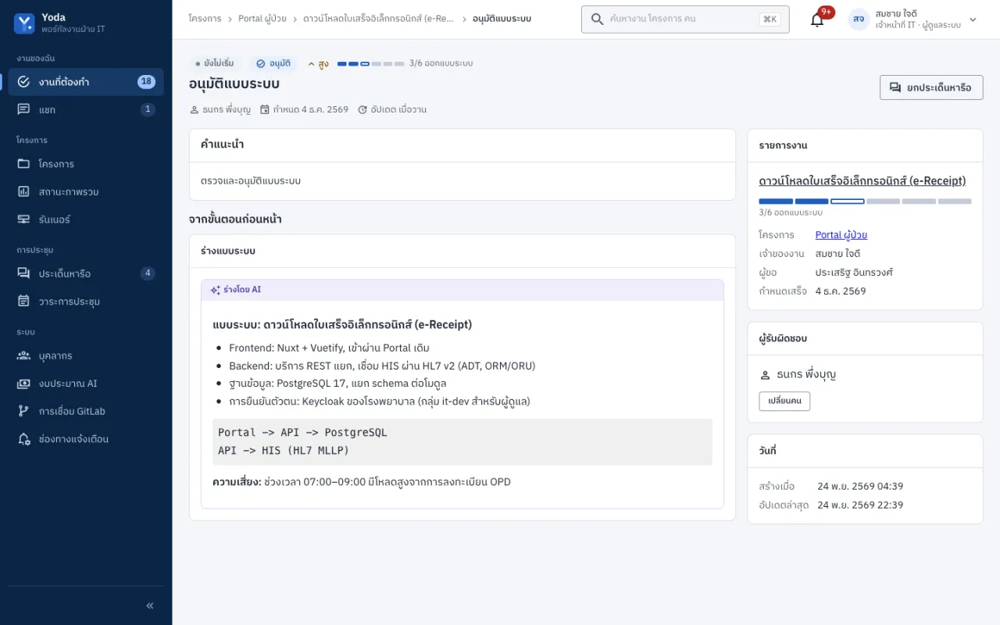

- **Change assignee** moves a task to someone else. **Raise discussion** (top right) turns a question the task
  cannot settle into a [discussion](#discussions-and-meeting-agendas).

## Work items and projects

A **work item** is one piece of business value, for example "SMS reminder one day before the appointment". It
moves through the steps of its template (for a software change: intake, requirements analysis, system design,
development, testing, close), and each step holds tasks for people and AI.

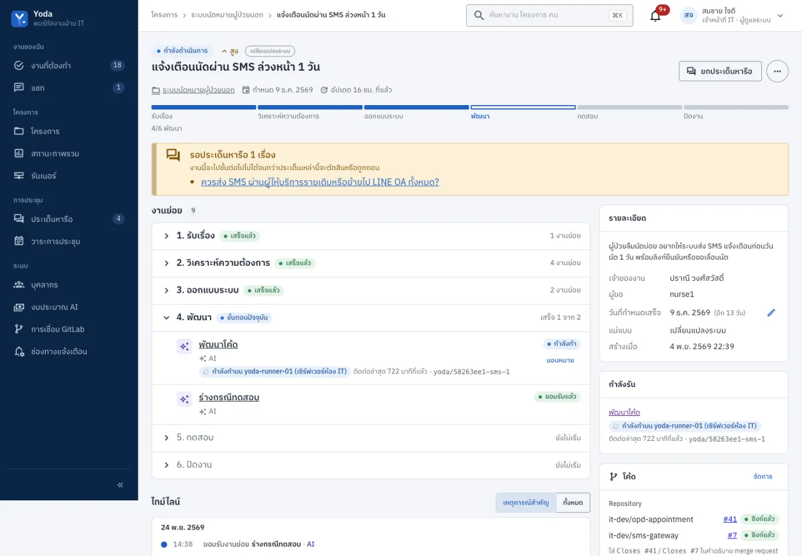

- The bar at the top shows the steps; the current one is outlined.
- A yellow banner means the work item waits on an open discussion and cannot move on until it is decided.
- **Tasks** lists each step and its tasks. An AI task in development shows the runner working on it.
- **Code** (right) shows the linked GitLab repositories, issues and merge requests. Write `Closes #41` in a merge
  request description to link it.
- **Timeline** shows the key events, or everything.
- The **⋯** menu changes the due date or cancels the work item; **Raise discussion** asks the team to decide
  something.

**Projects** lists the projects you can see. A project page has tabs for **Status**, **Work items**, **Members
& settings**, **Repository**, **Knowledge** and **AI budget**.

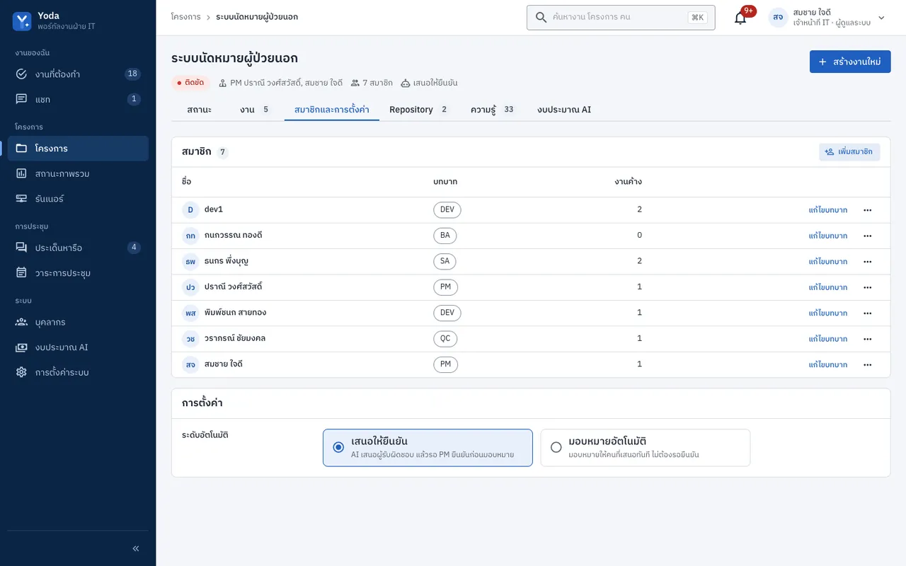

- Roles are per project (BA, SA, DEV, QC, PM); the AI proposes assignees by role and current load.
- **Autonomy**: *Propose* (the AI proposes who should do each task and a PM confirms) or *Auto-assign* (the
  proposed person is assigned straight away).
- **Knowledge** holds the project's facts, decisions and documents, shared by people and AI. Facts the AI saves
  from chat stay drafts until a person confirms them.

## Chat and the AI secretary

**Chat** is where you talk to the AI secretary. **My assistant** is your personal thread; projects and work items
have their own threads too.

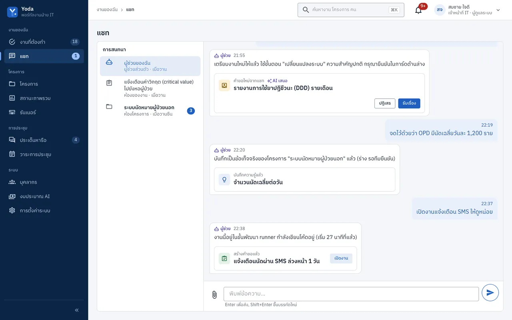

- Ask in plain language: "open a request for SMS reminders", "where is the lab interface work?", "note that the
  OPD has about 1,200 appointments a day".
- The secretary answers with cards: a new request to accept, knowledge it saved (as a draft), a work item it
  created with an **Open** button.
- Attach files and images with the paper clip. <kbd>Enter</kbd> sends, <kbd>Shift</kbd>+<kbd>Enter</kbd> adds a
  line.
- A thread that a requester can see says so at the top. Do not post internal notes there.

## Discussions and meeting agendas

A **discussion** is a decision the AI cannot or should not make: a scope change, a design choice, conflicting
requirements.

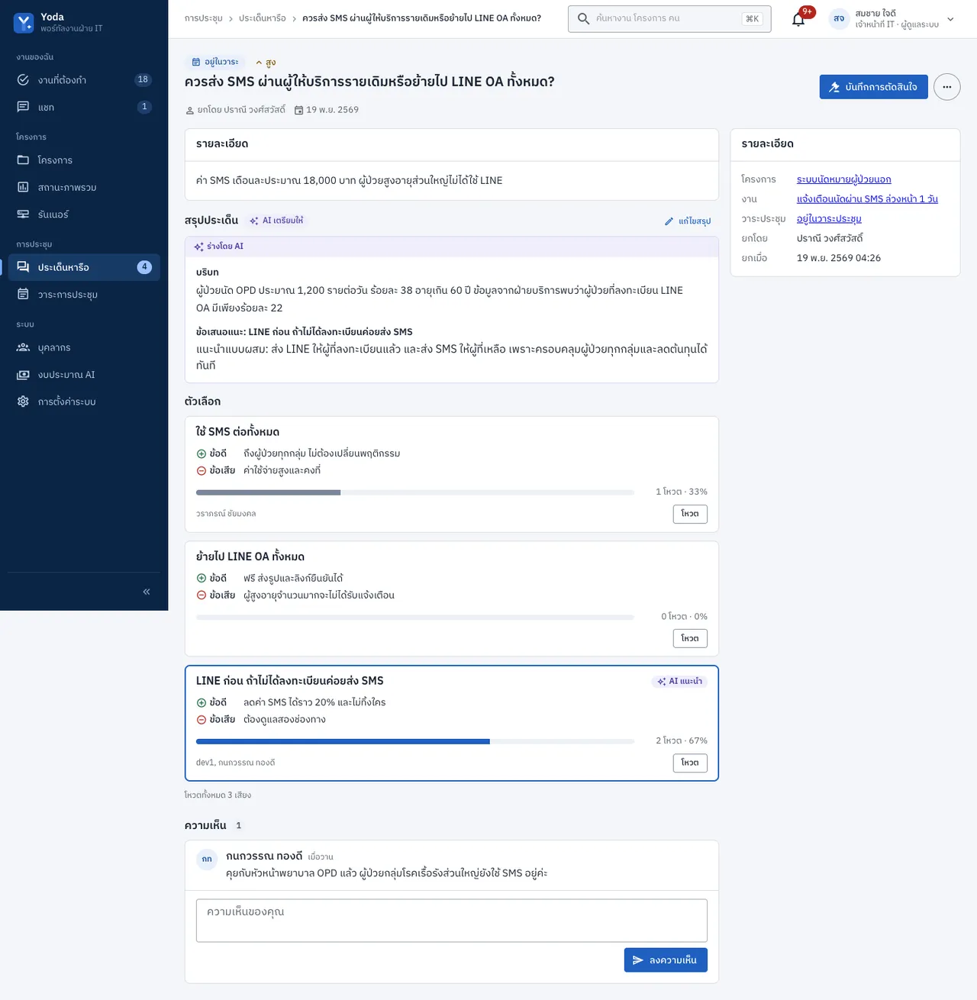

- **Raise a discussion** from the Discussions page, a work item or a task. Tick **Ask AI to prepare a brief** and
  the AI drafts the context, options with pros and cons, and a recommendation; **Edit brief** to correct it.
- Everyone involved can **Vote** for an option and post an opinion.
- **Record decision** closes it with the chosen option and the decision text; the work item continues.
  **Withdraw** (in the ⋯ menu) closes it without a decision, with a reason.
- The tabs show **Open**, **Scheduled** (on an agenda) and **Decided** discussions.

**Meeting agendas** collect discussions for a meeting.

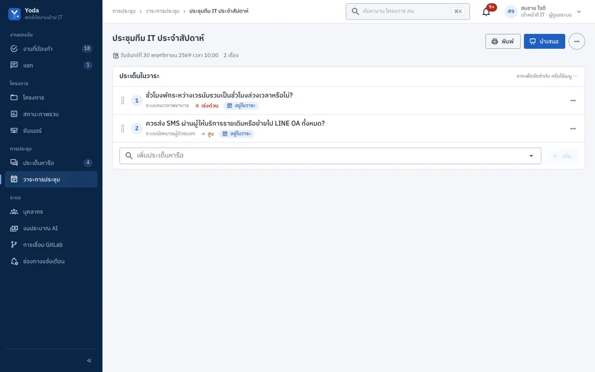

- **New agenda**, then **Add a discussion**; drag items (or use the ⋯ menu) to order them.
- **Present** shows one discussion per screen for the meeting room (arrow keys move between items), where you can
  vote and record decisions.
- **Print** gives a paper agenda. Deleting an agenda sends its discussions back to open.

## Overall status

**Overall status** shows the health of every project you can see: work in progress, overdue items, open
discussions and this month's AI spend against each project's budget.

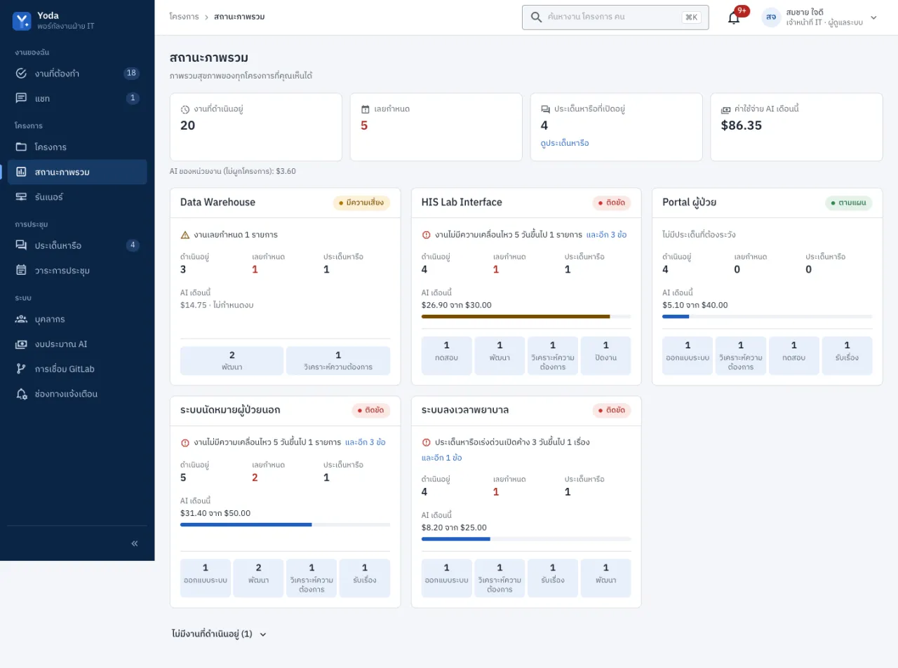

Each card is marked *On track*, *At risk* or *Blocked*, with the reasons (overdue work, items with no activity for
five days or more, urgent discussions open for three days or more). The chips at the bottom of a card count work items per step.

## Notification settings

Every notification shows on the bell in the portal. To also get them by email, LINE or Telegram, open the bell
menu → **Notification settings**.

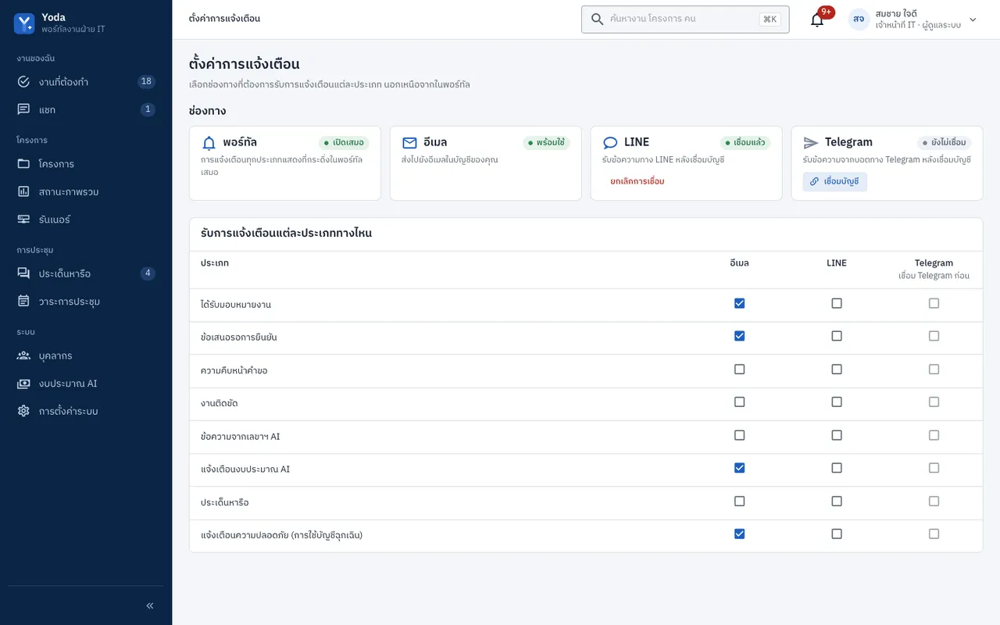

- **Channels**: email goes to the address on your account. For LINE or Telegram press **Link account** and follow
  the steps (add Yoda's LINE Official Account and send it the code, or open the Telegram bot and press Start).
  **Unlink** stops the channel.
- **Where to get each kind of notification**: tick a channel for each kind (task assigned, proposal awaiting
  confirmation, request updates, work item stuck, AI secretary messages, AI budget alerts, discussions).
- A channel shows only once an admin has turned it on.

## Runners

A **runner** works AI tasks that need a repository (code changes, repository analysis, running tests) with a
coding agent such as Claude Code, on your machine or on a server. It acts on your behalf: its results are
marked as AI work done for you, and every code change arrives as a GitLab merge request for a person to review.

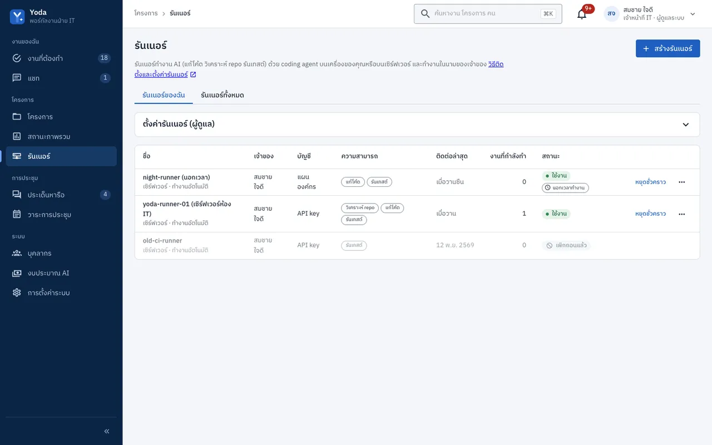

- **Create runner** for your own machine: choose the account type, capabilities, mode (*On demand* or
  *Unattended*), maximum concurrency and optional working hours. The token is shown once: copy it into the
  runner's config.
- A runner on a *personal subscription* works only on demand (`yoda-runner work <taskId>`).
- **Pause**, **Resume** or **Revoke** a runner from its row. Revoke it at once if the machine is lost.
- Installing and configuring the runner program: [development guide, Runners](../development.md#runners).
