# คู่มือสำหรับเจ้าหน้าที่ IT

[English](staff.md) · [คู่มือทั้งหมด](../README.md)

คู่มือนี้สำหรับเจ้าหน้าที่ฝ่าย IT ที่ใช้ Yoda ทำงานทุกวัน ทั้ง BA, SA, นักพัฒนา, ผู้ทดสอบ และผู้จัดการโครงการ
ใน Yoda นั้น AI จะร่างงานของแต่ละขั้นตอนให้ก่อน แล้วคุณเป็นผู้ตรวจ แก้ไข อนุมัติ และตัดสินใจ

- [การเข้าสู่ระบบและเมนู](#การเข้าสู่ระบบและเมนู)
- [งานที่ต้องทำ](#งานที่ต้องทำ)
- [งานย่อย: ตรวจร่างของ AI อนุมัติ และส่งงาน](#งานย่อย-ตรวจร่างของ-ai-อนุมัติ-และส่งงาน)
- [งานและโครงการ](#งานและโครงการ)
- [แชทกับผู้ช่วย](#แชทกับผู้ช่วย)
- [ประเด็นหารือและวาระการประชุม](#ประเด็นหารือและวาระการประชุม)
- [สถานะภาพรวม](#สถานะภาพรวม)
- [ตั้งค่าการแจ้งเตือน](#ตั้งค่าการแจ้งเตือน)
- [รันเนอร์](#รันเนอร์)

## การเข้าสู่ระบบและเมนู

เปิดพอร์ทัลแล้วเข้าสู่ระบบด้วยบัญชีขององค์กร (Keycloak) หน้าเข้าสู่ระบบและพอร์ทัลใช้ภาษาไทยเป็นค่าเริ่มต้น
เปลี่ยนเป็นภาษาอังกฤษได้ที่หน้าเข้าสู่ระบบ หรือที่เมนูผู้ใช้มุมขวาบน

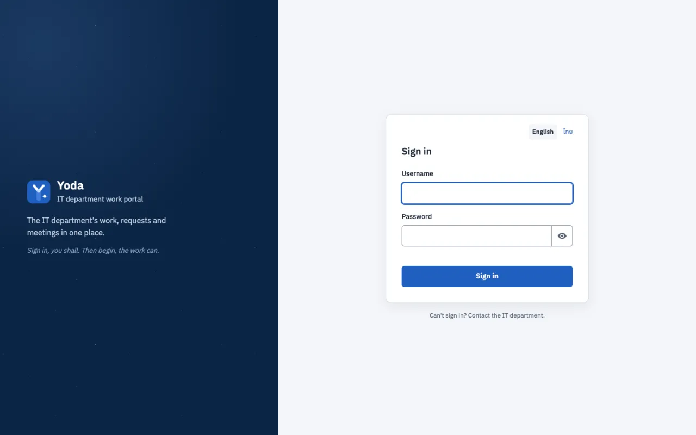

เมนูด้านข้างแบ่งเป็นกลุ่ม ดังนี้

| กลุ่ม | หน้า |
| --- | --- |
| งานของฉัน | **งานที่ต้องทำ**, **แชท** |
| โครงการ | **โครงการ**, **สถานะภาพรวม**, **รันเนอร์** |
| การประชุม | **ประเด็นหารือ**, **วาระการประชุม** |
| ระบบ (เฉพาะผู้ดูแลระบบ) | **บุคลากร**, **งบประมาณ AI**, **การตั้งค่าระบบ** |

ช่องค้นหาด้านบน (<kbd>Ctrl</kbd>/<kbd>⌘</kbd> + <kbd>K</kbd>) ใช้ค้นหางาน โครงการ และบุคลากร
ส่วนกระดิ่งแสดงการแจ้งเตือน และมีลิงก์ไปยังหน้าตั้งค่าการแจ้งเตือน

## งานที่ต้องทำ

**งานที่ต้องทำ** คือหน้าแรกของคุณ รวมทุกเรื่องที่รอคุณอยู่ และอัปเดตเองโดยอัตโนมัติ

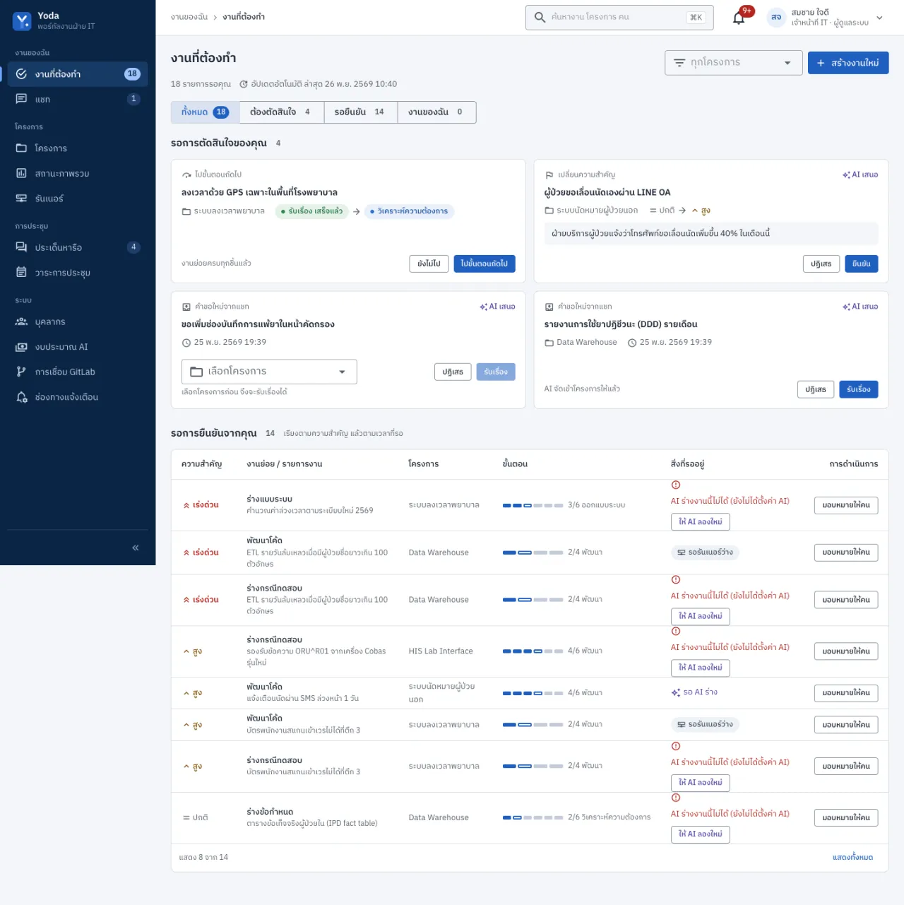

- **รอการตัดสินใจของคุณ** คือข้อเสนอจากผู้ช่วย (เลขาฯ AI) พร้อมเหตุผล
  - *ไปขั้นตอนถัดไป*: งานย่อยของขั้นตอนนี้ครบแล้ว เลือก **ไปขั้นตอนถัดไป** หรือ **ยังไม่ไป**
  - *เปลี่ยนความสำคัญ*: AI เสนอให้ปรับความสำคัญ กด **ยืนยัน** หรือ **ปฏิเสธ**
  - *คำขอใหม่จากแชท*: คำขอที่ผู้ช่วยรวบรวมมาจากแชท เลือกโครงการ (ถ้า AI ยังไม่ได้เลือกให้) แล้วกด
    **รับเรื่อง** หรือกด **ปฏิเสธ** พร้อมระบุเหตุผล
- **รอการยืนยันจากคุณ** คืองานย่อยที่ต้องมีคนดูแล เรียงตามความสำคัญแล้วตามเวลาที่รอ คอลัมน์ *สิ่งที่รออยู่*
  บอกสาเหตุ เช่น AI ร่างงานไม่ได้ (กด **ให้ AI ลองใหม่**) รอรันเนอร์ว่าง หรือมีผู้รับผิดชอบที่ AI เสนอไว้
  ปุ่ม **มอบหมายให้คน** ใช้มอบงานให้เจ้าหน้าที่ โดยหน้าต่างจะแสดงจำนวนงานค้างของแต่ละคนด้วย
- แท็บด้านบนใช้กรองรายการ: **ทั้งหมด**, **ต้องตัดสินใจ**, **รอยืนยัน** และ **งานของฉัน**
- **สร้างงานใหม่** ใช้สร้างงานในโครงการด้วยตนเอง

## งานย่อย: ตรวจร่างของ AI อนุมัติ และส่งงาน

เปิดงานย่อยจากหน้างานที่ต้องทำ หน้างานย่อยจะแสดง **คำแนะนำ** ผลงาน **จากขั้นตอนก่อนหน้า**
และข้อมูลด้านขวา ได้แก่ งานหลัก เจ้าของงาน ผู้ขอ และวันกำหนดเสร็จ

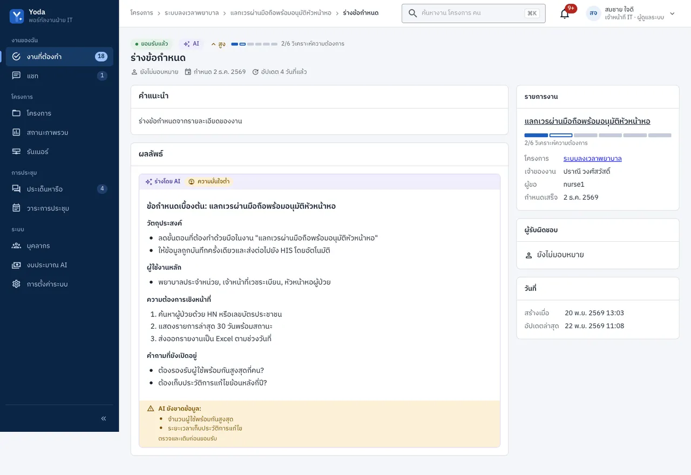

- **ร่างโดย AI** คือฉบับแรกที่ AI เขียนให้ ถ้า AI ยังขาดข้อมูล จะแจ้งไว้ในกรอบสีเหลือง
  พร้อมระดับความมั่นใจ ควรตรวจประเด็นเหล่านั้นก่อนยอมรับ
- **ผลงานของคุณ**: กด **คัดลอกไปยังผลงานของฉัน** เพื่อเริ่มจากร่างของ AI แก้ไขตามต้องการ แนบไฟล์ได้
  แล้วกด **ส่งงาน**
- งานย่อยประเภท **อนุมัติ** และ **ตรวจทาน** จะแสดงผลงานของขั้นตอนก่อนหน้า กด **อนุมัติ** หรือ
  **ขอให้แก้ไข…** พร้อมระบุสิ่งที่ต้องแก้ งานจะกลับไปยังผู้รับผิดชอบพร้อมความเห็นของคุณ

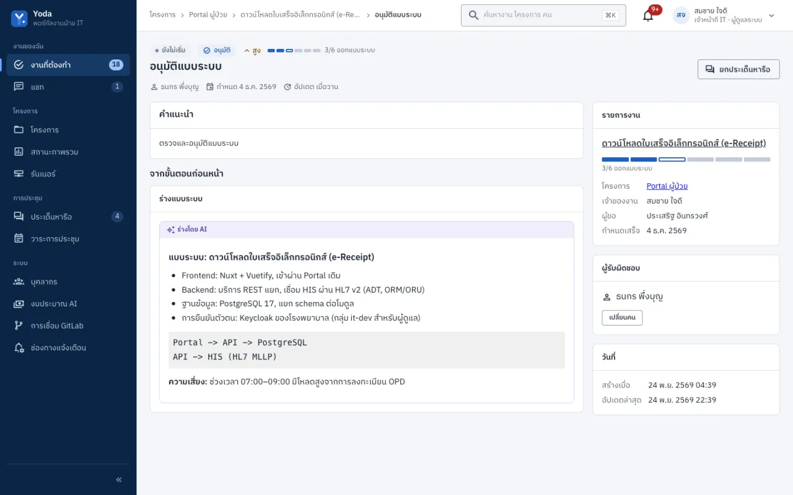

- **เปลี่ยนผู้รับผิดชอบ** ใช้ย้ายงานให้คนอื่น ส่วน **ยกประเด็นหารือ** (มุมขวาบน)
  ใช้เมื่อมีคำถามที่งานย่อยนี้ตัดสินเองไม่ได้ ดูหัวข้อ[ประเด็นหารือ](#ประเด็นหารือและวาระการประชุม)

## งานและโครงการ

**งาน** (work item) คือเรื่องหนึ่งเรื่องที่สร้างคุณค่าให้ผู้ใช้ เช่น "แจ้งเตือนนัดผ่าน SMS ล่วงหน้า 1 วัน"
งานจะเดินไปตามขั้นตอนของแม่แบบ (สำหรับการเปลี่ยนแปลงระบบ: รับเรื่อง วิเคราะห์ความต้องการ ออกแบบระบบ พัฒนา
ทดสอบ ปิดงาน) และแต่ละขั้นตอนมีงานย่อยสำหรับคนและ AI

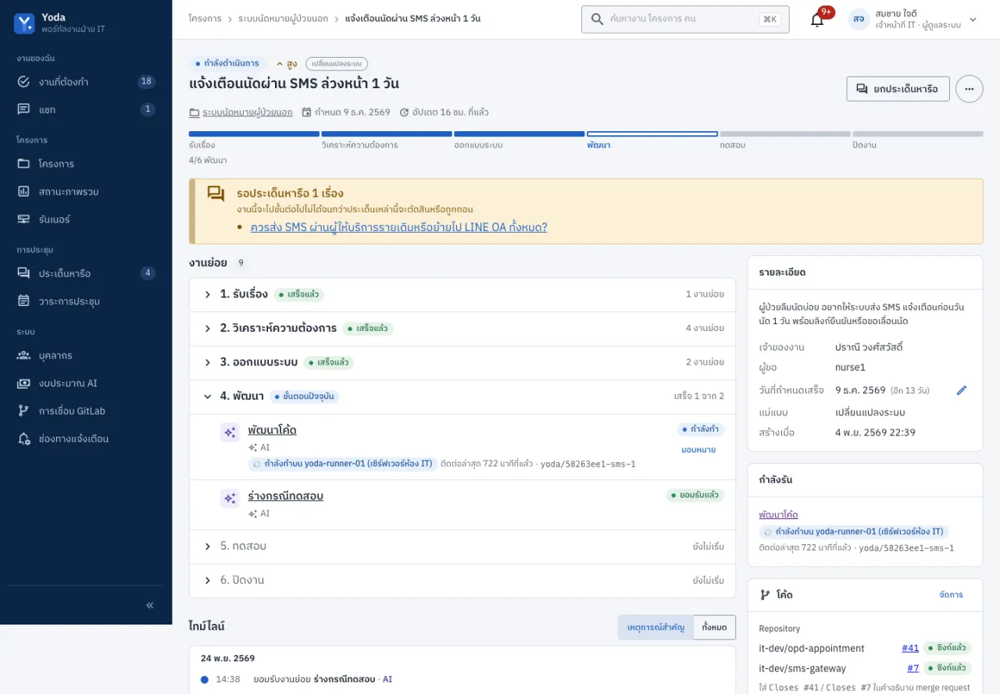

- แถบด้านบนแสดงขั้นตอนทั้งหมด ขั้นตอนปัจจุบันมีกรอบเน้น
- แถบสีเหลืองหมายถึงงานนี้รอประเด็นหารือที่ยังเปิดอยู่ และจะไปต่อไม่ได้จนกว่าจะตัดสินหรือถอนประเด็น
- **งานย่อย** แสดงแต่ละขั้นตอนและงานย่อยในขั้นนั้น งาน AI ในขั้นพัฒนาจะแสดงรันเนอร์ที่กำลังทำอยู่
- **โค้ด** (ด้านขวา) แสดง repository, issue และ merge request ใน GitLab ที่เชื่อมไว้ ใส่ `Closes #41`
  ในคำอธิบาย merge request เพื่อเชื่อมกับงาน
- **ไทม์ไลน์** แสดงเหตุการณ์สำคัญ หรือเลือกดูทั้งหมด
- เมนู **⋯** ใช้เปลี่ยนวันกำหนดเสร็จหรือยกเลิกงาน ส่วน **ยกประเด็นหารือ** ใช้ขอให้ทีมช่วยตัดสินใจ

หน้า **โครงการ** แสดงโครงการที่คุณเห็นได้ ในหน้าโครงการมีแท็บ **สถานะ**, **งาน**, **สมาชิกและการตั้งค่า**,
**Repository**, **ความรู้** และ **งบประมาณ AI**

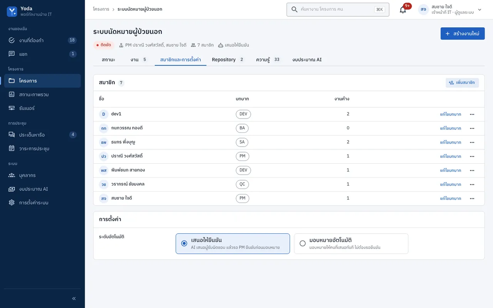

- บทบาทกำหนดแยกตามโครงการ (BA, SA, DEV, QC, PM) AI จะเสนอผู้รับผิดชอบตามบทบาทและจำนวนงานค้าง
- **ระดับอัตโนมัติ**: *เสนอให้ยืนยัน* (AI เสนอผู้รับผิดชอบ แล้ว PM ยืนยันก่อนมอบหมาย) หรือ
  *มอบหมายอัตโนมัติ* (มอบหมายให้คนที่ AI เสนอทันที)
- **ความรู้** เก็บข้อเท็จจริง การตัดสินใจ และเอกสารของโครงการ ใช้ร่วมกันทั้งคนและ AI
  ข้อมูลที่ AI บันทึกจากแชทจะเป็นฉบับร่างจนกว่าจะมีคนยืนยัน

## แชทกับผู้ช่วย

หน้า **แชท** ใช้คุยกับผู้ช่วย ห้อง **ผู้ช่วยของฉัน** เป็นห้องส่วนตัวของคุณ นอกจากนี้โครงการและงานแต่ละเรื่อง
ก็มีห้องแชทของตัวเอง

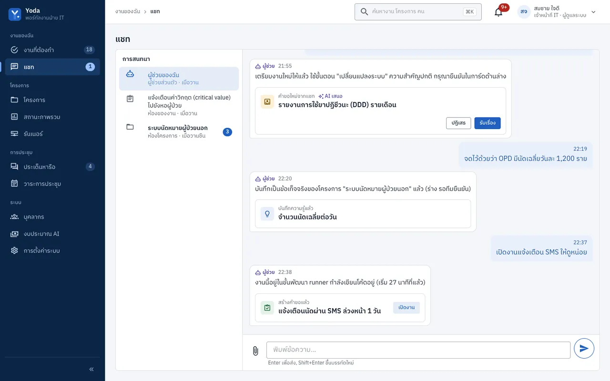

- พิมพ์ด้วยภาษาปกติได้เลย เช่น "เปิดงานแจ้งเตือน SMS ให้หน่อย" "งาน lab interface ถึงไหนแล้ว"
  "จดไว้ด้วยว่า OPD มีนัดเฉลี่ยวันละ 1,200 ราย"
- ผู้ช่วยจะตอบพร้อมการ์ด เช่น คำขอใหม่ที่รอรับเรื่อง ความรู้ที่บันทึกไว้ (เป็นฉบับร่าง)
  หรืองานที่สร้างแล้วพร้อมปุ่ม **เปิดงาน**
- แนบไฟล์และรูปภาพได้ด้วยปุ่มคลิปหนีบกระดาษ กด <kbd>Enter</kbd> เพื่อส่ง และ
  <kbd>Shift</kbd>+<kbd>Enter</kbd> เพื่อขึ้นบรรทัดใหม่
- ห้องแชทที่ผู้ขอมองเห็นได้จะมีข้อความแจ้งไว้ด้านบน ไม่ควรเขียนบันทึกภายในทีมในห้องนั้น

## ประเด็นหารือและวาระการประชุม

**ประเด็นหารือ** คือเรื่องที่ AI ตัดสินใจเองไม่ได้หรือไม่ควรตัดสินใจเอง เช่น การเปลี่ยนขอบเขตงาน
ทางเลือกในการออกแบบ หรือความต้องการที่ขัดกัน

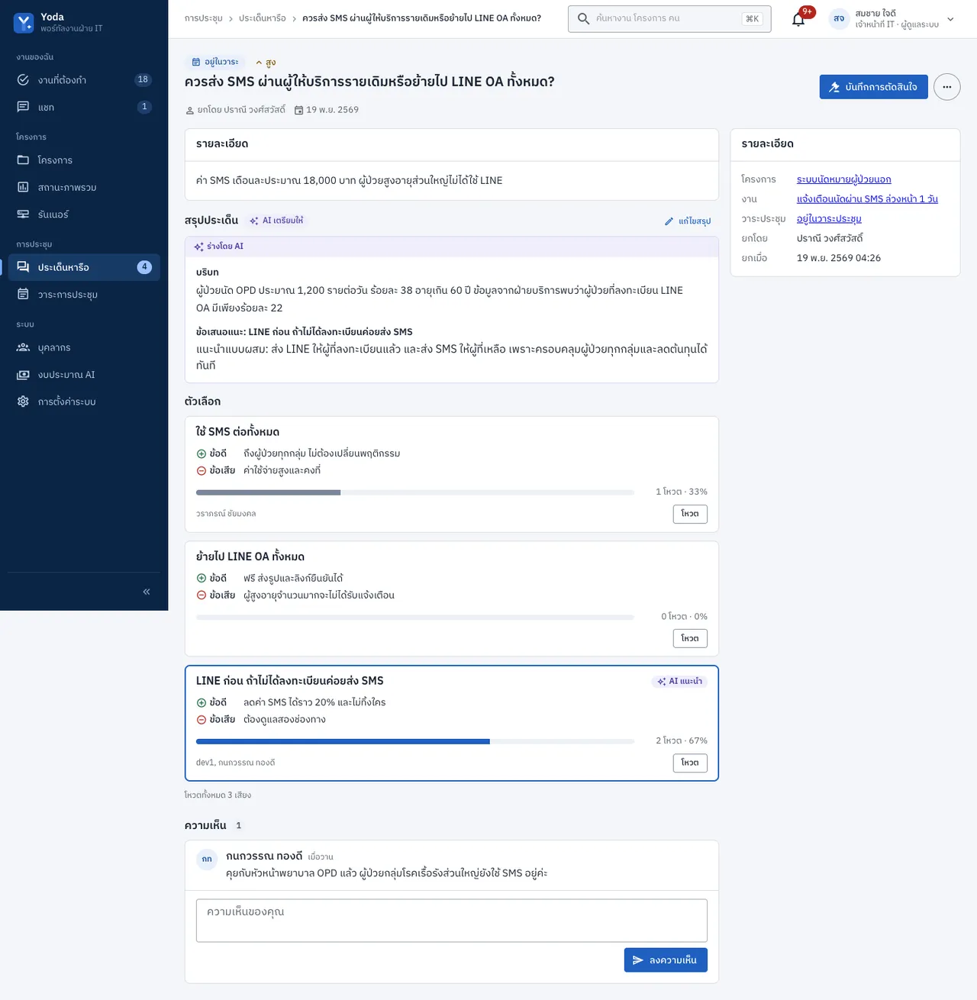

- **ยกประเด็นหารือ** ได้จากหน้าประเด็นหารือ หน้างาน หรือหน้างานย่อย ถ้าเลือก **ให้ AI เตรียมสรุปประเด็น**
  AI จะร่างบริบท ตัวเลือกพร้อมข้อดีข้อเสีย และข้อเสนอแนะ กด **แก้ไขสรุป** เพื่อปรับแก้ได้
- ผู้เกี่ยวข้องทุกคน **โหวต** ตัวเลือกและแสดงความเห็นได้
- **บันทึกการตัดสินใจ** เพื่อปิดประเด็นพร้อมตัวเลือกที่เลือกและเหตุผล แล้วงานจะเดินต่อ
  ส่วน **ถอนประเด็น** (ในเมนู ⋯) ใช้ปิดประเด็นโดยไม่ตัดสิน และต้องระบุเหตุผล
- แท็บแสดงประเด็นที่ **เปิดอยู่**, **อยู่ในวาระ** และ **ตัดสินแล้ว**

**วาระการประชุม** ใช้รวบรวมประเด็นหารือสำหรับการประชุมแต่ละครั้ง

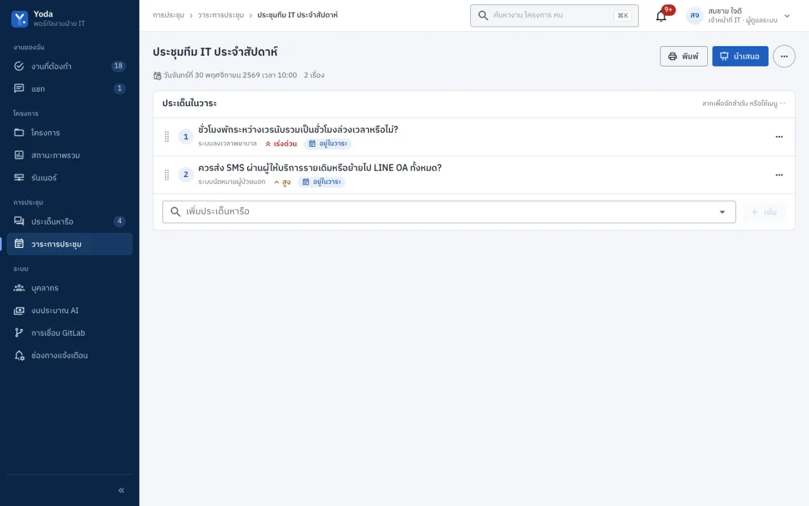

- กด **สร้างวาระ** แล้ว **เพิ่มประเด็นหารือ** ลากเพื่อจัดลำดับ หรือใช้เมนู ⋯
- **นำเสนอ** แสดงประเด็นละหนึ่งหน้าจอสำหรับห้องประชุม (ใช้ปุ่มลูกศรเปลี่ยนประเด็น)
  โหวตและบันทึกการตัดสินใจได้จากหน้านี้
- **พิมพ์** ใช้พิมพ์วาระเป็นกระดาษ ถ้าลบวาระ ประเด็นในวาระจะกลับไปเป็นสถานะเปิดอยู่

## สถานะภาพรวม

**สถานะภาพรวม** แสดงสุขภาพของทุกโครงการที่คุณเห็นได้ ได้แก่ งานที่ดำเนินอยู่ งานเลยกำหนด
ประเด็นหารือที่เปิดอยู่ และค่าใช้จ่าย AI เดือนนี้เทียบกับงบของแต่ละโครงการ

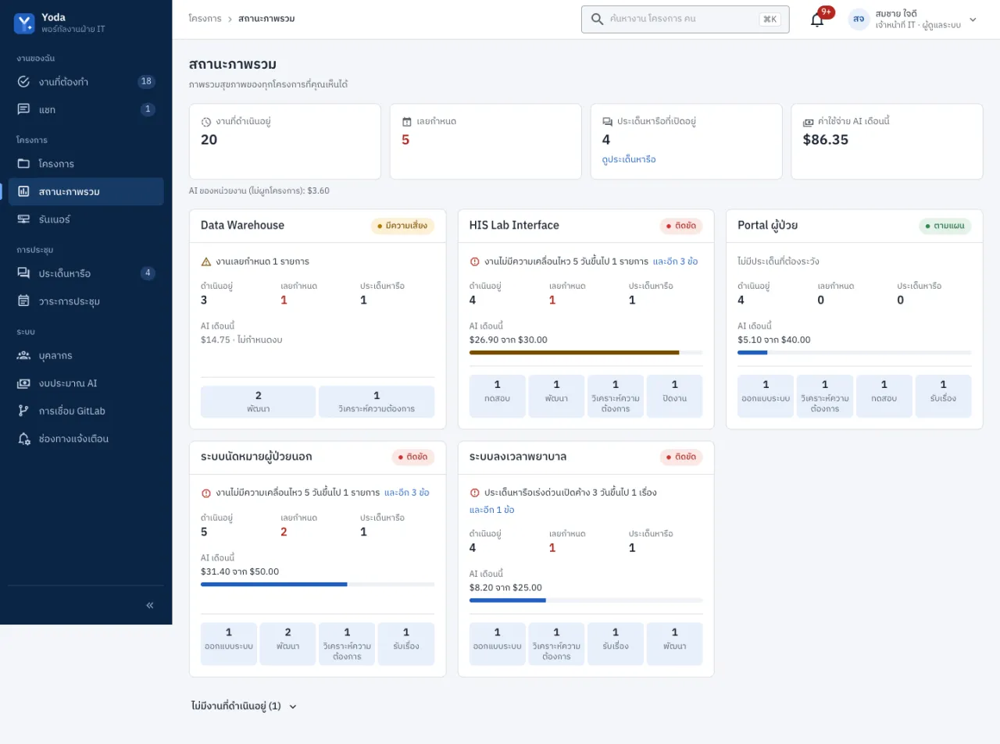

แต่ละการ์ดมีป้าย *ตามแผน*, *มีความเสี่ยง* หรือ *ติดขัด* พร้อมเหตุผล เช่น งานเลยกำหนด
งานที่ไม่มีความเคลื่อนไหว 5 วันขึ้นไป หรือประเด็นหารือเร่งด่วนที่เปิดค้างไว้ 3 วันขึ้นไป
ส่วนตัวเลขด้านล่างของการ์ดคือจำนวนงานในแต่ละขั้นตอน

## ตั้งค่าการแจ้งเตือน

การแจ้งเตือนทุกรายการจะแสดงที่กระดิ่งในพอร์ทัลเสมอ ถ้าต้องการรับทางอีเมล LINE หรือ Telegram ด้วย
ให้เปิดเมนูกระดิ่ง แล้วเลือก **ตั้งค่าการแจ้งเตือน**

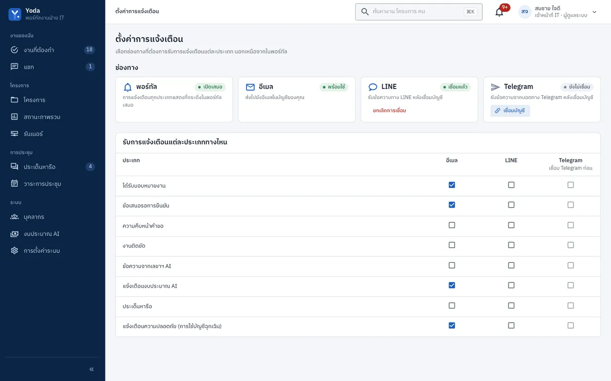

- **ช่องทาง**: อีเมลจะส่งไปที่อีเมลในบัญชีของคุณ สำหรับ LINE หรือ Telegram ให้กด **เชื่อมบัญชี**
  แล้วทำตามขั้นตอน (เพิ่ม LINE Official Account ของ Yoda เป็นเพื่อนแล้วส่งรหัสให้ หรือเปิดบอท Telegram
  แล้วกด Start) กด **ยกเลิกการเชื่อม** เมื่อไม่ต้องการรับทางช่องทางนั้นแล้ว
- **รับการแจ้งเตือนแต่ละประเภททางไหน**: เลือกช่องทางให้แต่ละประเภท เช่น ได้รับมอบหมายงาน
  ข้อเสนอรอการยืนยัน ความคืบหน้าคำขอ งานติดขัด ข้อความจากผู้ช่วย แจ้งเตือนงบประมาณ AI และประเด็นหารือ
- ช่องทางจะแสดงเมื่อผู้ดูแลระบบเปิดใช้งานแล้วเท่านั้น

## แจ้งข้อบกพร่องด้วย Yoda แจ้งปัญหา

Yoda แจ้งปัญหาเป็นส่วนขยายของเบราว์เซอร์ (Chrome หรือ Edge) สำหรับแจ้งปัญหาของระบบที่คุณทดสอบ เมนู **ความช่วยเหลือ**
มีไฟล์ดาวน์โหลดและขั้นตอนการติดตั้ง

1. เปิดส่วนขยาย วางที่อยู่ของ Yoda ที่แสดงในหน้าความช่วยเหลือ แล้วกด **เชื่อมต่อ** จากนั้นกดอนุญาตในหน้าที่เปิดขึ้น
   เฉพาะเมื่อคุณเพิ่งกดเชื่อมต่อเองเท่านั้น
2. ที่หน้าที่มีปัญหา เปิดส่วนขยาย ถ่ายภาพหน้าจอ (หรือวิดีโอสั้น ๆ) แล้ววาดเน้นด้วยลูกศรหรือกรอบ และใช้ **โมเสก เบลอ
   หรือปิดทับ** กับข้อมูลที่ไม่ควรเห็น ระบบไม่ปิดบังข้อมูลให้อัตโนมัติ
3. กรอกชื่อเรื่อง ความรุนแรง ขั้นตอน ผลที่คาดไว้และผลที่เกิดขึ้น ตรวจโครงการ ยืนยันคำถามเรื่องความเป็นส่วนตัว แล้วส่ง
   รายงานจะเป็นงานในขั้นคัดกรองของโครงการ โดยมีคุณเป็นผู้ขอ และคุณจะเป็นผู้ทดสอบซ้ำเมื่อแก้ไขแล้ว

ภาพ วิดีโอ และ log จะไม่ถูกส่งให้ AI ในทุกกรณี หากติ๊กว่าข้อความอาจมีข้อมูลผู้ป่วย ชื่อเรื่องและข้อความจะไม่ถูกส่งให้ AI
ด้วย แต่การแจ้งเตือนทางอีเมล LINE หรือ Telegram ยังแสดงชื่อเรื่องจริง เบราว์เซอร์ที่เชื่อมต่อไว้อยู่ที่เมนูชื่อของคุณ →
**เบราว์เซอร์ที่เชื่อมต่อ** ซึ่งยกเลิกการเชื่อมต่อได้

**วิดีโอ** ปุ่ม **อัดวิดีโอ** จะอัดแท็บนั้นโดยไม่มีเสียงได้นานสูงสุด 30 วินาที กด **หยุดและแจ้งปัญหา** ในส่วนขยาย หรือรอให้หยุดเอง
ในหน้าแก้ไข ลากกรอบทับส่วนที่ต้องซ่อนและกำหนดช่วงเวลาบนแถบเวลา แล้วกด **ใส่โมเสก** ก่อนส่ง วิดีโอที่ยังมีกรอบที่ยังไม่ได้ใส่
โมเสกจะส่งไม่ได้ หากใส่โมเสกไม่สำเร็จ ให้ส่งโดยไม่มีวิดีโอ หรือใช้ภาพนิ่งจากวิดีโอแทน

**เลือกโครงการ** ส่วนขยายเลือกโครงการจากที่อยู่ของหน้า โดยใช้ URL ของแอปพลิเคชันและ GitLab environment ของโครงการใน Yoda
หรือกฎที่คุณเพิ่มเองในหน้าตั้งค่าของส่วนขยาย (**จับคู่ URL** ซึ่งมีช่องทดสอบที่บอกว่ากฎไหนชนะและเพราะอะไร) คุณเปลี่ยนโครงการ
ก่อนส่งได้เสมอ บนหน้าที่ Yoda ระบุว่าเป็น **ระบบจริง** ส่วนขยายจะแจ้งไว้ ไม่มีปุ่มอัดวิดีโอ และไม่แนบ log เว้นแต่คุณเปิดเอง

## รันเนอร์

**รันเนอร์** ทำงาน AI ที่ต้องใช้ repository (แก้โค้ด วิเคราะห์ repo รันเทสต์) ด้วย coding agent เช่น
Claude Code บนเครื่องของคุณหรือบนเซิร์ฟเวอร์ รันเนอร์ทำงานในนามของเจ้าของ ผลงานจะแสดงว่าเป็น
งานที่ AI ทำแทนคุณ และการแก้โค้ดทุกครั้งจะมาเป็น merge request ใน GitLab ให้คนตรวจก่อนเสมอ

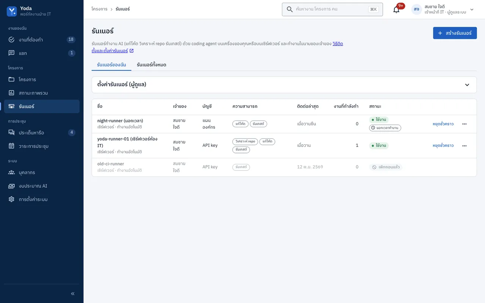

- กด **สร้างรันเนอร์** สำหรับเครื่องของคุณ เลือกประเภทบัญชี ความสามารถ โหมด (*สั่งทีละงาน* หรือ
  *ทำงานอัตโนมัติ*) จำนวนงานพร้อมกันสูงสุด และเวลาทำงาน (ถ้าต้องการ) โทเค็นจะแสดงเพียงครั้งเดียว
  ให้คัดลอกไปใส่ในไฟล์ตั้งค่าของรันเนอร์ทันที
- รันเนอร์ที่ใช้ *subscription ส่วนตัว* ทำงานได้เฉพาะแบบสั่งทีละงาน (`yoda-runner work <taskId>`)
- **หยุดชั่วคราว**, **ทำงานต่อ** หรือ **เพิกถอน** รันเนอร์ได้จากแถวของรันเนอร์นั้น
  ถ้าเครื่องหาย ให้เพิกถอนทันที
- วิธีติดตั้งและตั้งค่าโปรแกรมรันเนอร์: [คู่มือนักพัฒนา หัวข้อ Runners](../development.md#runners) (ภาษาอังกฤษ)
